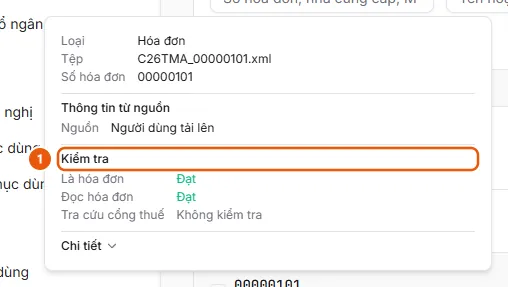
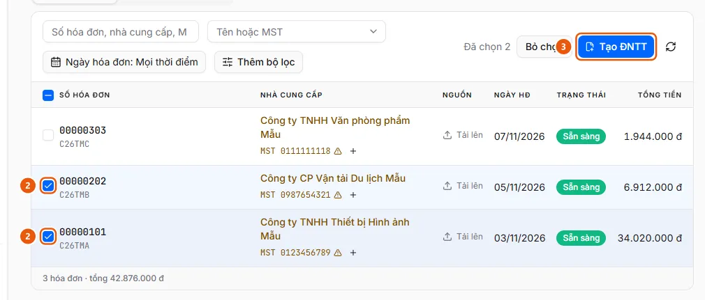
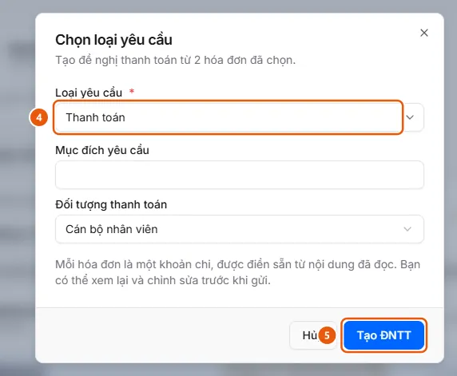

# Create a Payment Request from Existing Invoices in Invoice Management

Users want to select multiple invoices already processed in Invoice Management and create a payment request, with each invoice as an expense item.

**When to use:**

- Users are in Invoice Management and want to pay invoices that haven't been added to a payment request.
- Users want to group multiple invoices from a vendor into one payment request.

The request is created as a draft with expense items prefilled from the invoices. Users can review it, complete it, and submit it as described in [Create a payment request](../requests/create-draft.md).

## Ways to do this

- [Select invoices and create a payment request](how-to/create-request.md) — Select Ready invoices in Invoice Management, click Create Payment Request, choose a Request Type, and click Create Payment Request. Each invoice becomes an expense item in the draft.

## See also

- [Create a payment request](../requests/create-draft.md) — Users want to create a new payment request and save it as a draft.

## Used in these guides

- [Create a payment request](../requests/create-draft.md) — Users want to create a new payment request and save it as a draft.
- [AkaPayment](../../index.md) — Create, approve, and track payment requests; receive incoming invoices, reconcile documents, and manage budgets with an AI assistant.

## Before you begin

- **[Who can view and work with incoming invoices](../../reference/invoices/access.md)**\
  An invoice belongs to the uploader's organization; that organization and its parent organizations can view it. Administrators and operators can view all organizations.
- **[Requirements for creating a payment request from invoices](../../reference/invoices/create-request-rules.md)**\
  You can select only Ready invoices, up to 50 invoices per request, and only for request types that use invoices.

## Steps

[Select invoices and create a payment request](how-to/create-request.md)

1. Check that the [invoice status is Ready](../../troubleshooting/invoices/invoice-ready.md).
   In Invoice Management, the invoice's Status column displays "Ready" and its row checkbox is enabled.
   
   If the requirements aren't met, follow [Review check results and resolve invoices that are blocked](how-to/review-check.md) below.
2. [Review check results and resolve invoices that are blocked](how-to/review-check.md) — only if the [invoice status is Ready](../../troubleshooting/invoices/invoice-ready.md) requirement isn't met
   1. In **Invoice Management**, hover over the invoice number to view the **Checks** section (1): **Is an invoice**, **Read invoice**, then **Tax portal lookup** (when there is no result, the lookup is in progress, or it stopped at this step) or each e-invoice portal result. Each item has a result:
      
   2. Click the row to open the invoice. The checks panel shows why processing stopped: "Not an invoice," "Invalid on the tax portal," or "Stopped at file classification / invoice reading / tax portal lookup," along with the **Tax portal lookup result**.
   3. For the **Interrupted** status, click **Retry** to rerun the step that stopped.
   4. For the **Manual entry required** status (or Ready status with incorrect extracted data), edit the fields in the **Invoice information** card, click **Add line** to add goods if needed, then click **Save**. If **Check on e-Invoice Portal** is enabled for the source (and the invoice hasn't already been verified by the source), the invoice changes to **Looking up** while the lookup runs again. Otherwise, it changes directly to **Ready**.
   5. For the **Rejected** status, or if you believe the invoice is still usable, override the result as described in [Override invoice check results](how-to/overrule-check.md).
3. [Select invoices and create a payment request](how-to/create-request.md)
   1. Open **Invoice Management** and select the **Not in a payment request** tab.
   2. Select the row checkboxes (2) for the **Ready** invoices to pay (up to 50), or select the checkbox in the header to select all invoices on the page. The action bar displays "N selected."
      
   3. Click **Create Payment Request** (3). The **Select request type** dialog opens.
   4. Select a **Request Type** (4), then fill in the general fields requested for that type (for example, request purpose and payee).
      
   5. Click **Create Payment Request** (5). The system creates a draft request (with a document number) and opens **Request creation workflow** at the **Overview** step with the fields you just filled in. The request total is the sum of the invoices.
   6. Click **Continue** to go to **Expense report**: each invoice appears as an expense item with its invoice number, description, and total prefilled. Review and edit as needed, then continue with the request creation process: [Create a request and complete it through the Review step](../requests/how-to/create-draft.md), then submit it as described in [Submit a request](../requests/how-to/submit.md).

## Troubleshooting

### [Review check results and resolve invoices that are blocked](how-to/review-check.md)

- "The invoice status has changed. Reloaded.": the invoice moved to another step while you were viewing it. Check the updated status and try again.
- Saving doesn't continue and required fields are highlighted in red: when an invoice needs a lookup on the e-invoice portal, the Seller Tax ID, Invoice template number, Invoice symbol, Invoice number, and Total payment amount fields must all be filled in (field names follow the Invoice document type catalog).
- You can't edit an invoice that has already been added to a request. See [Requirements for creating a payment request from invoices](../../reference/invoices/create-request-rules.md).

### [Select invoices and create a payment request](how-to/create-request.md)

- The checkbox or Create Payment Request button is disabled, or you see "Some invoices haven't finished processing" / "The invoice is already in payment request …": see [Requirements for creating a payment request from invoices](../../reference/invoices/create-request-rules.md).
- If you close the page before finishing, the draft has already been created. Reopen it under **Payment Requests** → **My Requests**.
