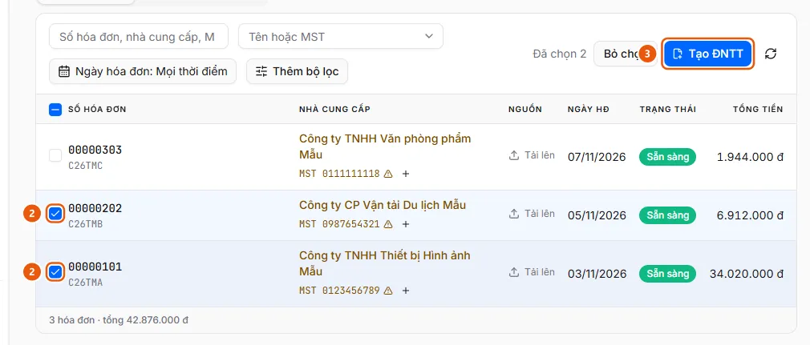
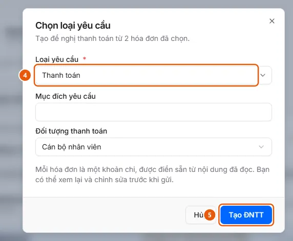

# Select Invoices and Create a Payment Request

Select Ready invoices in Invoice Management, click Create Payment Request, choose a Request Type, and click Create Payment Request. Each invoice becomes an expense item in the draft.

## Before you begin

- **[Requirements for creating a payment request from invoices](../../../reference/invoices/create-request-rules.md)**\
  You can select only Ready invoices, up to 50 per request, and only for request types that use invoices.
- **[Who can view and work with incoming invoices](../../../reference/invoices/access.md)**\
  Invoices belong to the uploader's business unit. That unit and its parent units can view them. Administrators and operators can view invoices across all units.

## Steps

1. Open **Invoice Management** and go to the **No Payment Request Created** tab.
2. Select the checkboxes at the beginning of the rows (2) for the Ready invoices to pay (up to 50), or select the checkbox in the header to select all invoices on the page. The action bar displays "N selected".

   

3. Click **Create Payment Request** (3). The **Select Request Type** dialog opens.
4. Select a **Request Type** (4) and fill in the overview fields it requires (for example, request purpose and payee).

   

5. Click **Create Payment Request** (5). The system creates a draft request with a document number and opens **Create Process** at the **Overview** step with the fields you just filled in. The request total equals the total of the invoices.
6. Click **Continue** to go to **Expense Details**: each invoice appears as an expense line with its invoice number, description, and total prefilled. Review and edit the details, then continue as you would when creating a request: [Create a request and complete it through the Review step](../../requests/how-to/create-draft.md), then submit it at [Submit a request](../../requests/how-to/submit.md).

## Troubleshooting

- If a checkbox or the Create Payment Request button is disabled, or you see "Some invoices are still being processed" / "Invoice is already included in payment request …", see [Requirements for creating a payment request from invoices](../../../reference/invoices/create-request-rules.md).
- If you close the page before finishing, the draft has already been created. Reopen it from **Payment Requests** → **My Requests**.

## Conditions to check

- [Invoice is in Ready status](../../../troubleshooting/invoices/invoice-ready.md) — The invoice has passed the required checks (or was overridden or entered manually) and is in Ready status, so it can be selected to create a payment request.

## Result

- [A draft request is open](../../../troubleshooting/requests/draft-open.md) — A request is in Draft status in the creation process and has a document number.

## See also

- [Create a payment request](../../requests/create-draft.md) — For users who want to create a new payment request and save it as a draft.

## Used in these guides

- [Create a payment request from invoices in Invoice Management](../create-request.md) — For users who want to select multiple invoices already processed in Invoice Management and create a payment request, with each invoice as an expense item.
