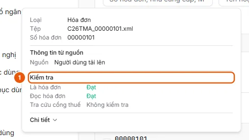

# View Check Results and Handle Paused Invoices

Open an invoice to see which check stopped. Click Retry for an interruption, or enter the invoice information manually and click Save when manual entry is required.

## Before you start

- **[Who can view and process incoming invoices](../../../reference/invoices/access.md)**\
  An invoice belongs to the uploader's unit, and is visible to that unit and its parent units. Administrators and operators can see all units.

## Steps

1. In **Invoice Management**, hover over an invoice number to view the **Checks** section (1): **Is an invoice**, **Read invoice**, then **Tax portal lookup** (when there is no result yet, a lookup is in progress, or the check stopped at this step) or each result row from the e-invoice portal. Each item has one result:
   - Needs attention: Manual entry required, Mismatch, Unable to check, Not checked.
   - Running: Waiting, Running.
   - Completed: Passed, Partially matched, Overridden, Not checked.

   

2. Click the row to open the invoice. The check panel explains why processing stopped: "Not an invoice," "Invalid on the tax portal," or "Stopped at the file classification / invoice reading / tax portal lookup step," along with the **Tax portal lookup result**.
3. **Interrupted** status: click **Retry** to rerun the step that stopped.
4. **Manual entry required** status (or Ready status when the information was read incorrectly): edit the fields on the **Invoice information** card, click **Add row** to add goods if needed, then click **Save**. If **Check on e-Invoice Portal** is enabled for the invoice's source (and the invoice has not already been validated by the source), the invoice changes to **Looking up** while the lookup runs again; otherwise, it changes immediately to **Ready**.
5. **Rejected** status, or if you believe the invoice is still valid: override it as described in [Override invoice check results](overrule-check.md).

## Troubleshooting

- "The invoice status has just changed. Reloaded.": the invoice moved to another step while you were viewing it. Review the new status and try again.
- If saving does not proceed and required fields are highlighted in red: when an invoice requires a lookup on the e-invoice portal, you must provide the seller's Tax identification number, Invoice template, Invoice series, Invoice number, and Total payment amount (field names follow the Invoice document type catalog).
- An invoice that is already included in a payment request cannot be edited. See [Conditions for creating a payment request from an invoice](../../../reference/invoices/create-request-rules.md).

## Outcome

- [Invoice in Ready status](../../../troubleshooting/invoices/invoice-ready.md) — The invoice has passed the checks (or has been overridden or entered manually) and is in Ready status, so it can be selected to create a payment request.

## Used in these guides

- [Handle rejected, interrupted, or manual-entry invoices](../review-check.md) — Users who want to understand why an invoice is not Ready and resolve it by retrying, entering the information manually, or overriding the check result.
- [Override invoice check results](overrule-check.md) — For a Rejected or Interrupted invoice, click Override, enter a reason (optional), and confirm. The invoice proceeds, and the person who performed the override and the reason are saved.
- [Upload invoice files to Invoice Management](upload.md) — In Invoice Management, click Upload on the User uploads card, select XML/PDF/image files or a zip file, then click Upload. The system reads each invoice automatically.
- [Invoice in Ready status](../../../troubleshooting/invoices/invoice-ready.md) — The invoice has passed the checks (or has been overridden or entered manually) and is in Ready status, so it can be selected to create a payment request.
