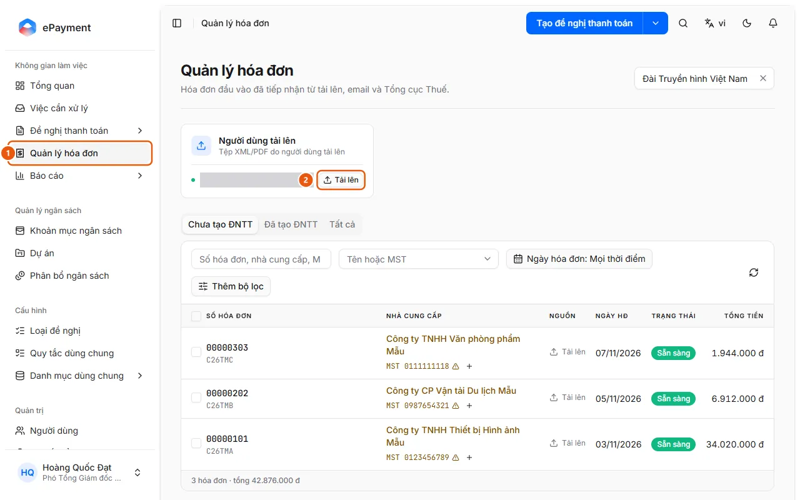
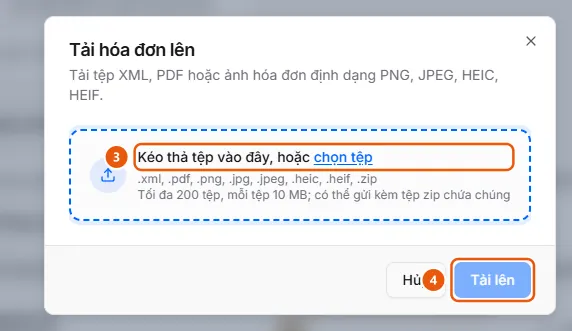

# Upload Invoice Files to Invoice Management

In Invoice Management, click Upload on the User uploads card, select XML/PDF/image files or a ZIP file, then click Upload. The system automatically reads each invoice.

## Before you start

- **[Invoice file formats, size limits, and duplicates](../../../reference/invoices/file-types.md)**\
  Accepted formats are XML, PDF, PNG/JPEG/HEIC/HEIF images, or ZIP files containing these formats. You can upload up to 200 files, with a default limit of 10 MB per file. Duplicate files within the same unit cannot be uploaded.
- **[Who can view and work with incoming invoices](../../../reference/invoices/access.md)**\
  Invoices belong to the uploader's unit, which is visible to that unit and its parent units. Administrators and operators can view invoices from all units.

## Steps

1. Open **Invoice Management** (1) in the sidebar.

   

2. On the **User uploads** source card ("XML/PDF files uploaded by users"), click **Upload** (2). The **Upload invoices** dialog opens.
3. Drag and drop or select files (3): XML, PDF, PNG/JPEG/HEIC/HEIF images, or a ZIP file containing these formats (up to 200 files). The **Selected files** list displays each file. Invalid files show a reason; click X to remove them. To add more files, drag and drop them or click **select files** again in the **Add files** area above the list.

   

4. Click **Upload** (4). A message confirms that "N invoices were submitted for reading." If all files are accepted, the dialog closes. If there are duplicate files, the dialog stays open and lists them under **Already in inbox** (the other files are still submitted). Click **Cancel** to close the dialog.
5. Track new invoices in the list. Their status updates automatically from Received → Classifying → Reading → (Looking up) → **Ready**, without refreshing the page. XML invoices are usually Ready within a few seconds; files that aren't invoices are marked **Rejected**.

## Troubleshooting

- "Already in inbox": The file duplicates an invoice already in the unit and won't be added again. Click **View** to open the existing invoice. See [Invoice file formats, size limits, and duplicates](../../../reference/invoices/file-types.md).
- "The upload source is turned off. Turn it on in Administration › Incoming invoices": Ask an administrator to enable the source ([Enable or disable invoice sources and save settings](../../invoice-sources/how-to/configure.md)).
- If an invoice stops at Rejected, Interrupted, or Requires manual entry, see [Review validation results and handle stopped invoices](review-check.md).

## Prerequisites to check

- [User uploads source is enabled](../../../troubleshooting/invoice-sources/upload-enabled.md) — The User uploads invoice source is enabled, so users can upload invoice files on the Invoice Management page.

## Used in these guides

- [Upload incoming invoices to Invoice Management](../upload.md) — For users who want to add invoice files (XML, PDF, images, or ZIP files) to the Invoice Management repository so the system can read and validate them automatically before creating a request.
