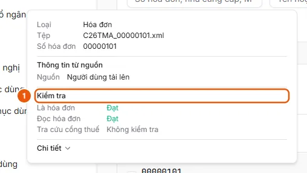

# Handle rejected, interrupted, or manually entered invoices

Learn why an invoice is not Ready and how to handle it: retry, enter invoice details manually, or override the check result.

**When to use:**

- An invoice is marked Not an invoice or Invalid on the tax portal, but the user knows it is valid.
- An invoice is stuck in Interrupted or Manual input required and cannot yet be selected to create a request.
- The user wants to fix or override an invoice that failed during file classification, data extraction, or e-invoice portal validation.

Each invoice goes through three checks: Is an invoice, Read invoice, and Tax portal lookup. If an invoice stops at a check, it must be handled before it can become Ready.

## How to

- [Review check results and handle invoices that are stuck](how-to/review-check.md) — Open the invoice to see which check stopped; click Retry when it is Interrupted, or enter the invoice details manually and click Save when Manual input required.
- [Override invoice check results](how-to/overrule-check.md) — On a Rejected or Interrupted invoice, click Override, enter a reason (optional), and confirm; the invoice proceeds, and the user who overrode it and the reason are recorded.

## Before you start

- **[Who can view and work with incoming invoices](../../reference/invoices/access.md)**\
  An invoice belongs to the unit of the user who uploaded it; that unit and its parent units can view it. Administrators and operators can view all units.

## Steps

[Review check results and handle invoices that are stuck](how-to/review-check.md)

1. [Review check results and handle invoices that are stuck](how-to/review-check.md)
   1. In **Invoice Management**, hover over the invoice number to view **Checks** (1): **Is an invoice**, **Read invoice**, then **Tax portal lookup** (when there is no result yet, a lookup is in progress, or processing stopped at this check), or each individual e-invoice portal result. Each item has a result:
      
   2. Click the row to open the invoice. The check panel shows why processing stopped: "Not an invoice," "Invalid on the tax portal," or "Stopped at file classification / invoice reading / tax portal lookup," along with the **Tax portal lookup result**.
   3. For **Interrupted** status: click **Retry** to rerun the check that stopped.
   4. For **Manual input required** status (or Ready when the extracted data is incorrect): edit the fields in the **Invoice information** card, click **Add row** to add an item if needed, then click **Save**. If **Validate on e-Invoice Portal** is enabled for the source (and the invoice has not already been verified by the source), the invoice changes to **Looking up** while it is checked again; otherwise, it changes to **Ready** immediately.
   5. For **Rejected** status, or if you believe the invoice is still valid: override it as described in [Override invoice check results](how-to/overrule-check.md).

## Troubleshooting

### [Review check results and handle invoices that are stuck](how-to/review-check.md)

- "The invoice status has changed. Reloaded.": the invoice moved to another step while you were viewing it; review the new status and try again.
- Saving does not proceed and required fields are highlighted in red: when an invoice needs to be checked on the e-invoice portal, the following fields are required: Seller tax ID, Invoice form number, Invoice series, Invoice number, and Total payment amount (field names depend on the Invoice document type catalog).
- An invoice that is already included in a request cannot be edited. See [Requirements for creating a payment request from an invoice](../../reference/invoices/create-request-rules.md).

## Alternative

- [Override invoice check results](how-to/overrule-check.md)
