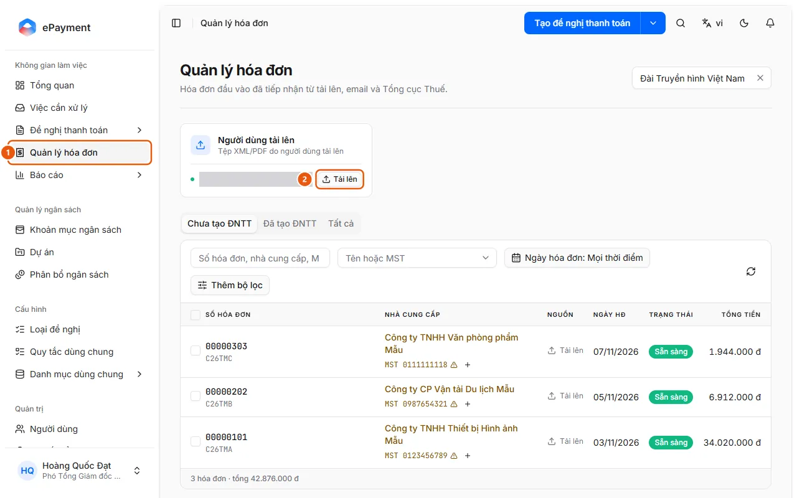
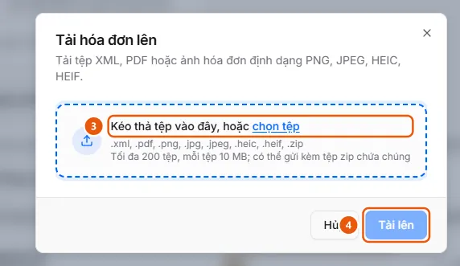

# Upload Incoming Invoices to Invoice Management

Users want to add invoice files (XML, PDF, images, or ZIP files) to Invoice Management so the system can automatically read and validate them before creating a request.

**When to use:**

- You have an invoice file from a supplier and want to save it in Invoice Management first, without creating a request right away.
- You have a ZIP file containing multiple invoices that you need to add to the system.
- You want to add a supplier invoice in PDF, XML, or image format to the invoice list.

Uploaded invoices are assigned to your business unit, automatically read and validated, and then held in the Not Yet Added to Payment Request tab. To read an invoice directly into a request you’re preparing, see [Create an expense from an existing invoice](../requests/add-invoice-expense.md).

## Ways to do this

- [Upload invoice files to Invoice Management](how-to/upload.md) — In Invoice Management, click Upload on the User Uploads card, select XML/PDF/image files or a ZIP file, then click Upload; the system automatically reads each invoice.

## See also

- [Create an expense from an existing invoice](../requests/add-invoice-expense.md) — You have an invoice (XML, PDF, or image) or an invoice already in Invoice Management, and want each invoice to become a prefilled expense line.

## Used in these guides

- [Add an expense from an invoice](../requests/how-to/add-invoice-expense.md) — In the Expense Details step, select Add from invoice, upload an invoice or select one from the Invoice Management list; each invoice becomes an expense line.
- [AkaPayment](../../index.md) — Create, approve, and track payment requests; receive incoming invoices, reconcile supporting documents, and manage budgets with an AI assistant.

## Before you start

- **[Invoice file types, size limits, and duplicate handling](../../reference/invoices/file-types.md)**\
  Supports XML, PDF, PNG/JPEG/HEIC/HEIF images (or ZIP files containing these formats), up to 200 files, with a default limit of 10 MB per file; duplicate files within a business unit cannot be uploaded.
- **[Who can view and manage incoming invoices](../../reference/invoices/access.md)**\
  Invoices belong to the uploader’s business unit and are visible to that unit and its parent units. Administrators and operators can see all units.

## Steps

[Upload invoice files to Invoice Management](how-to/upload.md)

Availability requirements: check the plan and permission requirements

1. Check that the [User Uploads source is enabled](../../troubleshooting/invoice-sources/upload-enabled.md).
   In Invoice Management, there should be no warning saying "Upload source is disabled. Enable it again in Administration › Incoming Invoices", and there should be a "User Uploads" source card with an Upload button. For administrators: in Administration → Incoming Invoices, the "User Uploads" card shows "Enabled".
   If this requirement is not met: follow [Enable/disable invoice sources and save settings](../invoice-sources/how-to/configure.md) below.
2. [Enable/disable invoice sources and save settings](../invoice-sources/how-to/configure.md) — only if the [User Uploads source is enabled](../../troubleshooting/invoice-sources/upload-enabled.md) requirement is not met
   1. Open **Administration** → **Incoming Invoices** (on desktop).
   2. In the **Business Unit** field, leave **All business units** selected to edit the organization default, or select a unit to set a custom frequency and download schedule for that unit.
   3. Turn the toggle on or off for each source card (labeled **Enabled** / **Disabled**): **User Uploads**, **Email**, **Periodic download from GDT**, **AkaConnect connection**, **AkaPay account**.
   4. For file-receiving sources (User Uploads, Email, AkaConnect), select the **Accepted formats** (XML, PDF, Images) and **Maximum file size** (5, 10, or 15 MB).
   5. Turn on **Check on the e-Invoice Portal** ("Automatically check after upload" / "after receipt") for sources that need to look up invoice and seller status as soon as files are received.
   6. Select the **Sync frequency** for Email (Real time, Every 5/15/30 minutes, Every hour), AkaConnect, and AkaPay (Every 5/15/30 minutes, Every hour; Real time is not available), and the **Download schedule** for **Periodic download from GDT**. For an individual unit, click **Use default** to remove its custom value.
   7. Click **Save changes**. If you have a unit selected and have changed a setting that applies to the entire organization, the **Apply to all business units?** dialog lists the changes; click **Save and apply to all**. The confirmation message "Invoice source settings saved" appears.
3. [Upload invoice files to Invoice Management](how-to/upload.md)
   1. Open **Invoice Management** (1) from the sidebar.
      
   2. On the **User Uploads** source card ("XML/PDF files uploaded by users"), click **Upload** (2). The **Upload invoices** dialog opens.
   3. Drag and drop files or select them (3): XML, PDF, PNG/JPEG/HEIC/HEIF images, or a ZIP file containing these formats (up to 200 files). The **Selected files** list shows each file; invalid files display a reason. Click X to remove a file. To add more files, drag and drop them or click **select files** again in the **Add files** area above the list.
      
   4. Click **Upload** (4). The message "N invoices submitted for reading" appears. If all files are accepted, the dialog closes; if there are duplicate files, the dialog remains open and lists them under **Already in inbox** (the other files are still submitted). Click **Cancel** to close the dialog.
   5. Track new invoices in the list: their status changes automatically from Received → Classifying → Reading → (Checking) → **Ready**, without requiring a page refresh. XML invoices are typically Ready within a few seconds; files that are not invoices are marked **Rejected**.

## Notes

- **[Invoice source settings: organization-wide or per business unit](../../reference/invoice-sources/unit-scope.md)**\
  Enable/disable settings, formats, file size limits, and Check on the e-Invoice Portal apply to the entire organization; frequency, download schedules, and source accounts are configured per business unit.

## Troubleshooting

### [Enable/disable invoice sources and save settings](../invoice-sources/how-to/configure.md)

- Which settings apply to the entire organization and which are specific to a business unit: [Invoice source settings: organization-wide or per business unit](../../reference/invoice-sources/unit-scope.md).
- Enabling a source is not enough to receive invoices via email, the e-Invoice Portal, AkaConnect, or AkaPay: you also need to configure a mailbox or account. See [Add a mailbox to receive invoices via IMAP](../invoice-sources/how-to/connect-mailbox.md), [Download invoices periodically from the General Department of Taxation e-Invoice Portal](../invoice-sources/how-to/connect-tax-portal.md), [Connect a Gmail/Outlook mailbox via AkaConnect](../invoice-sources/how-to/connect-akaconnect.md), [Connect an AkaPay account using an API key](../invoice-sources/how-to/connect-akapay.md).

### [Upload invoice files to Invoice Management](how-to/upload.md)

- "Already in inbox": the file is a duplicate of an invoice already in the business unit and cannot be added again; click **View** to open the existing invoice. See [Invoice file types, size limits, and duplicate handling](../../reference/invoices/file-types.md).
- "Upload source is disabled. Enable it again in Administration › Incoming Invoices": ask an administrator to enable the source ([Enable/disable invoice sources and save settings](../invoice-sources/how-to/configure.md)).
- If an invoice is stuck in Rejected, Interrupted, or Manual entry required, see [Review validation results and resolve stalled invoices](how-to/review-check.md).
