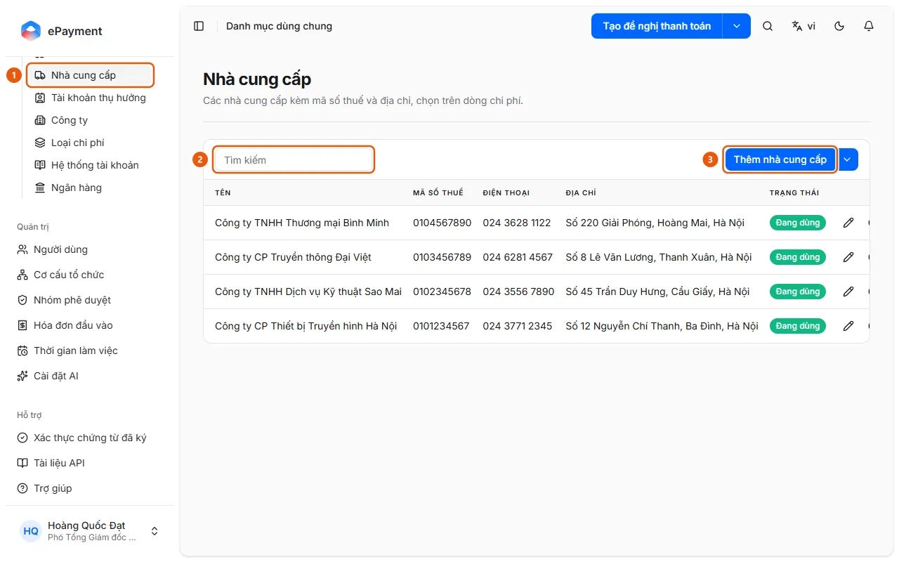

# Add or edit a catalog record

Open the catalog (Settings → Shared Master Data, or Budget Management → Budget Items / Projects), click Add or Edit record on the row, then Save.

## Before you start

- **[Duplicate rules for shared master data](../../../reference/master-data/duplicates.md)**\
  You can't create suppliers with duplicate tax IDs, beneficiary accounts with the same account number and bank, or expense types with duplicate codes; the system identifies the existing record.

## Steps

1. Open the catalog: in the sidebar, go to **Settings** → **Shared Master Data**, then select a catalog (1) (Suppliers, Banks, Expense Types, Beneficiary Accounts, etc.). **Budget Items** and **Projects** are under **Budget Management**.

   

2. Use the **Search** box (2) to find an existing record (for Suppliers and Beneficiary Accounts, enter a few characters; Beneficiary Accounts can also be filtered by type).
3. Click **Add …** (3) on the toolbar (for example, **Add supplier**: Name, Tax ID, Address, Phone, Email, and **Add new account** for a beneficiary account; **Add budget item** / **Add project**: Name, Description), or click the pencil icon **Edit record** in the row; then click **Save**.
4. To remove a record from selection lists without deleting it, use **Deactivate** in the row (and **Reactivate** to enable it again). The Invoice document type can't be deactivated.
5. The dropdown next to the Add button contains **Export to Excel**. Depending on the catalog, it may also include **Import from Excel** (employee beneficiary accounts), **Import document types** (Document Types, from a JSON file), and **Sync system data** (system catalogs such as currencies, banks, and tax types).

## Troubleshooting

- Duplicate tax ID, account, or expense type code: see [Duplicate rules for shared master data](../../../reference/master-data/duplicates.md).

## Used in these guides

- [Update shared master data](../manage-list.md) — Administrators who want to add or edit catalog records: suppliers, banks, expense types, budget items, and projects.
- [Allocate a budget for a period](../../budget/how-to/allocate.md) — In Budget Management → Budget Allocation, select the year, month, unit (and project), click Allocate, then enter amounts by budget item and unit.
