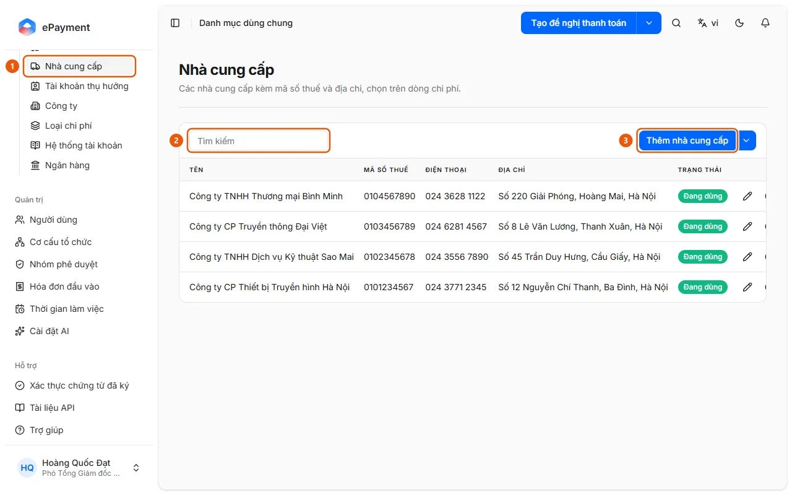

# Update shared master data

An administrator wants to add or edit a master data record: a supplier, bank, expense type, budget item, or project.

**When to use:**

- An invoice from a new supplier isn't in the system yet.
- You need a new budget item or project before allocating a budget.
- A user wants to create a new project to allocate a budget by project.
- An administrator wants to add or edit an item in shared master data.

There are 14 shared master data catalogs on one screen; 12 are under Configuration → Master Data: currencies, payment methods, invoice types, document types, tax types, payment terms, suppliers, beneficiary accounts, companies, expense types, chart of accounts, and banks. Budget items and Projects are under Budget Management.

## Ways to do this

- [Add or edit a master data record](how-to/manage-list.md) — Open a catalog (Configuration → Master Data, or Budget Management → Budget Items / Projects), click **Add** or **Edit record** on a row, then click **Save**.

## Before you start

- **[Duplicate rules for shared master data](../../reference/master-data/duplicates.md)**\
  You can't create a supplier with a duplicate tax ID, a beneficiary account with the same account number and bank, or an expense type with a duplicate code. The system identifies the existing record.

## Steps

[Add or edit a master data record](how-to/manage-list.md)

1. [Add or edit a master data record](how-to/manage-list.md)
   1. Open the catalog: in the sidebar, go to **Configuration** → **Master Data**, then select a catalog (1) (Suppliers, Banks, Expense Types, Beneficiary Accounts, and so on). **Budget Items** and **Projects** are under **Budget Management**.
      
   2. Use the **Search** field (2) to find an existing record (for Suppliers and Beneficiary Accounts, enter a few characters; Beneficiary Accounts can also be filtered by type).
   3. Click the **Add …** button (3) on the toolbar (for example, **Add supplier**: Name, Tax ID, Address, Phone, Email; **Add new account** for beneficiary accounts; **Add item** / **Add project**: Name, Description), or click the pencil icon for **Edit record** on a row; then click **Save**.
   4. To remove an item from selection lists without deleting it, use **Stop using** on the row (and **Use again** to reactivate it). The Invoice document type can't be deactivated.
   5. The dropdown beside the Add button includes **Export to Excel**. Depending on the catalog, it may also include **Import from Excel** (employee beneficiary accounts), **Import document types** (Document Types, from a JSON file), and **Sync system data** (system catalogs such as currencies, banks, and tax types).

## Troubleshooting

### [Add or edit a master data record](how-to/manage-list.md)

- Duplicate tax ID, account, or expense type code: see [Duplicate rules for shared master data](../../reference/master-data/duplicates.md).
