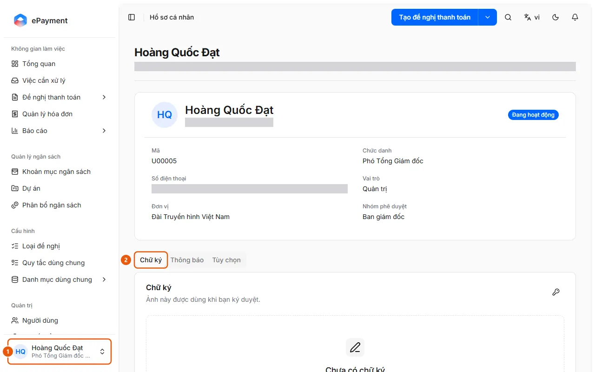
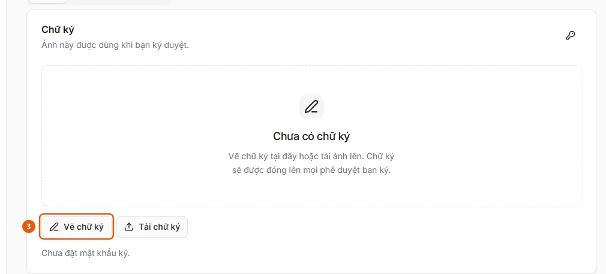

# Set a signature and signing password in your profile

In Personal Profile, open the Signature tab to draw or upload a signature image and set a signing password for approvals.

## Steps

1. Click the user card (1) at the bottom of the sidebar → **Personal Profile**.

   

2. Select the **Signature** tab (2) ("This image is used when you approve").
3. Click **Draw signature** (3), sign in the box with your mouse, trackpad, or finger (**Clear drawing** to start over), then click **Use this signature**; or click **Upload signature** (**Change image** if one is already set) to select a PNG, JPEG, or WEBP image up to 256 KB; click **Remove signature** to delete it.

   

4. If you don't have a signing password, the **Signing password** dialog opens automatically after you save your signature; enter a password of at least 6 characters and confirm it. To change it later, click the key icon in the corner of the card (the **Change signing password** dialog also asks for your current password). The page displays "Signing password set." when one is configured.

## Troubleshooting

- "Signature image is too large." or "Use a PNG, JPEG, or WEBP image.": select another image. "Current signing password is incorrect.": try again; if you forgot your password, ask an administrator to **Reset signing password** in **Administration** → **Users**.

## Result

- [Signature and signing password are set](../../../troubleshooting/profile/signing-ready.md) — Your Personal Profile has a signature image and signing password, which are required for approval steps that require a signature.

## Used in these guides

- [Set a signature for approvals](../set-signature.md) — Users need a personal signature to sign when approving a request.
- [Signature and signing password are set](../../../troubleshooting/profile/signing-ready.md) — Your Personal Profile has a signature image and signing password, which are required for approval steps that require a signature.
