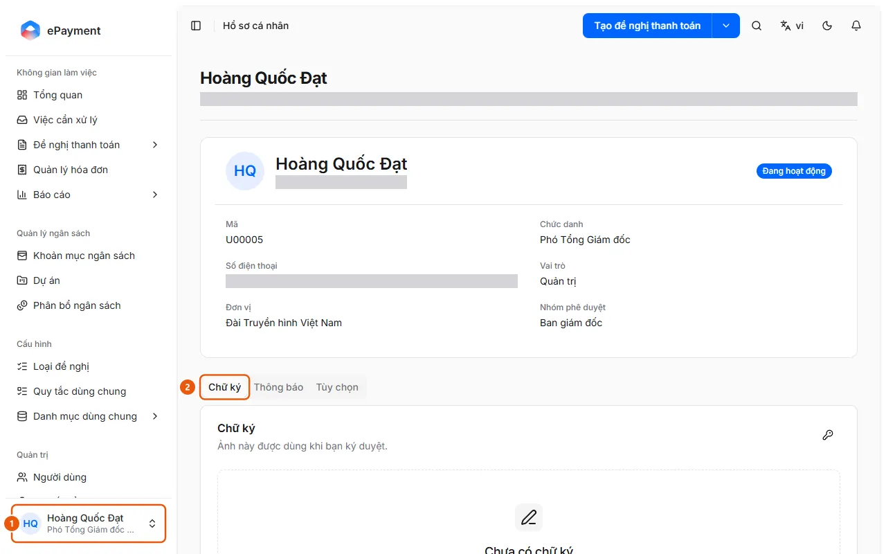
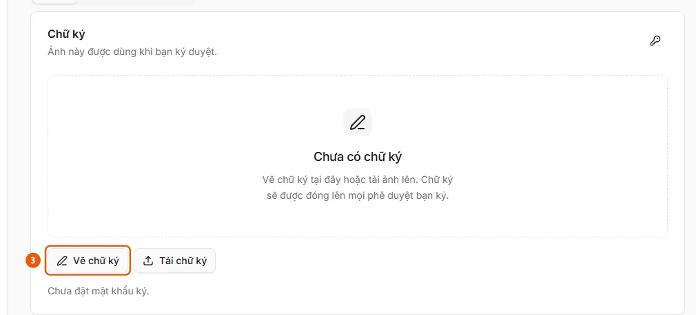

# Set a Signature for Approval

Users need a personal signature to sign when approving requests.

**When to use:**

- An approver doesn't have a signature yet, but the request type requires one.
- An approver wants to save a signature before approving.

Save a hand-drawn signature or an image in your profile.

## How to do it

- [Set a signature and signing password in your profile](how-to/set-signature.md) — In Personal Profile, on the Signature tab, draw or upload an image of your signature and set a signing password to use when approving.

## Steps

[Set a signature and signing password in your profile](how-to/set-signature.md)

1. [Set a signature and signing password in your profile](how-to/set-signature.md)
   1. Click your user card (1) at the bottom of the sidebar → **Personal Profile**.
      
   2. Select the **Signature** tab (2) ("This image is used when you sign approvals").
   3. Click **Draw signature** (3), sign in the box using your mouse, trackpad, or finger (**Clear drawing** to start over), then click **Use this signature**; or click **Upload signature** (**Replace image** if a signature already exists) to select a PNG, JPEG, or WEBP image up to 256 KB; click **Remove signature** to delete it.
      
   4. If you don't have a signing password, the **Signing password** dialog opens automatically after you save the signature; enter a password with at least 6 characters and confirm it. To change it later, click the key icon in the card's top corner (the **Change signing password** dialog also asks for your current password). The page displays "Signing password set." when one is set.

## Troubleshooting

### [Set a signature and signing password in your profile](how-to/set-signature.md)

- "Signature image is too large." or "Use a PNG, JPEG, or WEBP image.": select another image. "Current signing password is incorrect.": try again; if you forgot your password, ask an administrator to **Reset signing password** in **Admin** → **Users**.
