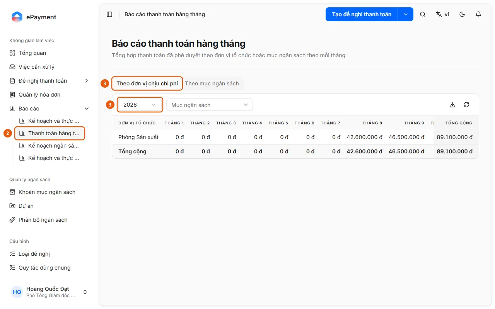

# Open the Monthly Payment Report

Open Reports → Monthly Payments in the sidebar, select a year, and view approved totals by month.

## Steps

1. Open **Reports** in the sidebar.
2. Select **Monthly Payments** (2) (a monthly summary of approved payments by organizational unit or budget item).

   

3. Select the **By Cost Center** (3) or **By Budget Item** tab (the Budget Item tab is available only when the budget is not organized by unit), then select a **Year** (3). If needed, filter by **Budget Item** (By Cost Center tab) or **Organizational Unit** (By Budget Item tab).
4. Review the table showing January through December and Total. Use the download icon (**Export Excel**) to export the report, or the refresh icon to reload it.

## Used in these guides

- [View monthly payments](../review-payments.md) — For users who want to view a monthly summary of payments.
