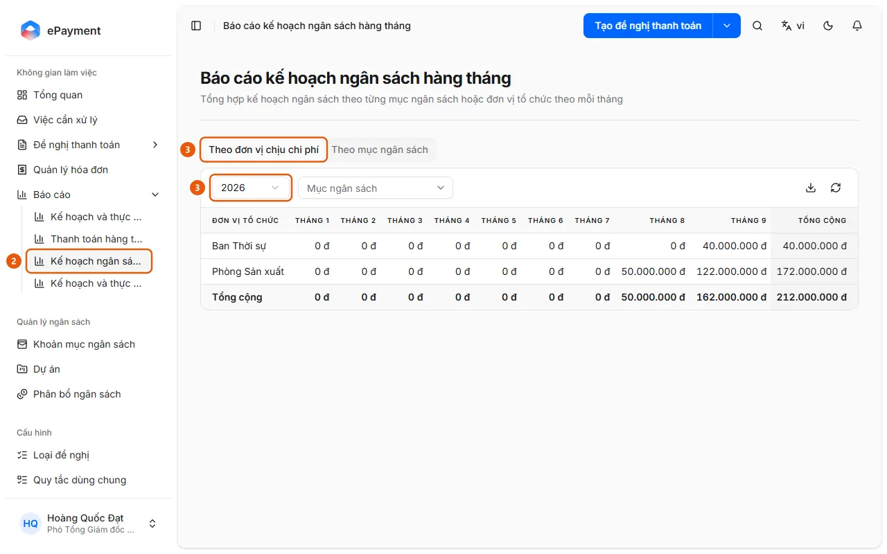

# Open the Monthly Budget Plan Report

In the sidebar, open Reports → Monthly Budget Plan, select a year, and view the amounts allocated for each month by organizational unit or budget item.

## Steps

1. In the sidebar, open **Reports** (available on desktop only).
2. Select **Monthly Budget Plan** (2) (the "Monthly Budget Plan Report" page summarizes budget plans by budget item or organizational unit for each month).

   

3. Select the **By Cost Center** tab (3) (available only when budgets are allocated by unit) or **By Budget Item**, then select **Year** (3) (defaults to the current year).
4. Filter by **Budget Item** (Cost Center tab) or **Organizational Unit** (Budget Item tab), if needed.
5. Review the January through December columns and the Total column (allocated amounts). Use the download icon (**Export to Excel**) to export, or the refresh icon to reload.

## Troubleshooting

- "No data for this period.": No allocations for the selected year match the filters. Select a different year or clear the filters, or allocate a budget in [Allocate a budget for a period](../../budget/how-to/allocate.md).

## Used in these guides

- [Review the monthly budget plan](../review-plan-monthly.md) — For users who want to view the budget allocated for each month of the year by organizational unit or budget item.
