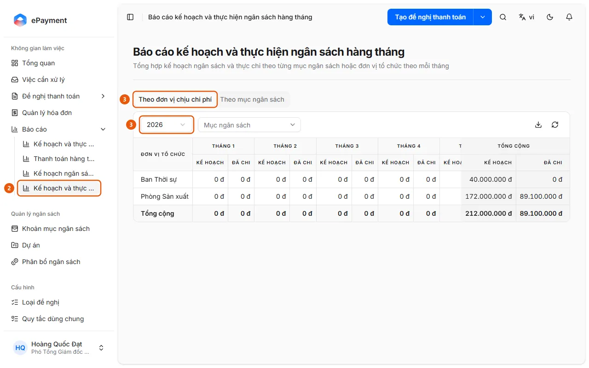

# Open the Monthly Budget Plan and Actual Report

In the sidebar, open Reports → Monthly Budget Plan and Actual, select a year, and compare Plan with Spent for each month.

## Steps

1. In the sidebar, open **Reports** (desktop only).
2. Select **Monthly Budget Plan and Actual** (2) (the "Monthly Budget Plan and Actual Report" page).

   

3. Select the **By Cost Center** tab (3) (available only when the budget is allocated by cost center) or **By Budget Item**, then select **Year** (3).
4. Filter by **Budget Item** (Cost Center tab) or **Organization Unit** (Budget Item tab), if needed.
5. Review the **Plan** (allocated) and **Spent** (approved or paid requests) columns for each month, along with the Total. Use the download icon (**Export Excel**) to export the report.

## Troubleshooting

- "No data for this period.": The selected year or filters have no planned or spent amounts. Select a different year or remove the filters.
- To compare a custom month range with an "Opening Balance" and utilization percentage instead of viewing each month separately, use [Open the Budget Plan and Actual Report](review-budget.md).

## Used in these guides

- [Compare the plan with actual spending for each month](../review-plan-vs-actual-monthly.md) — Users want to see the planned budget alongside the amount spent for each month of the year.
