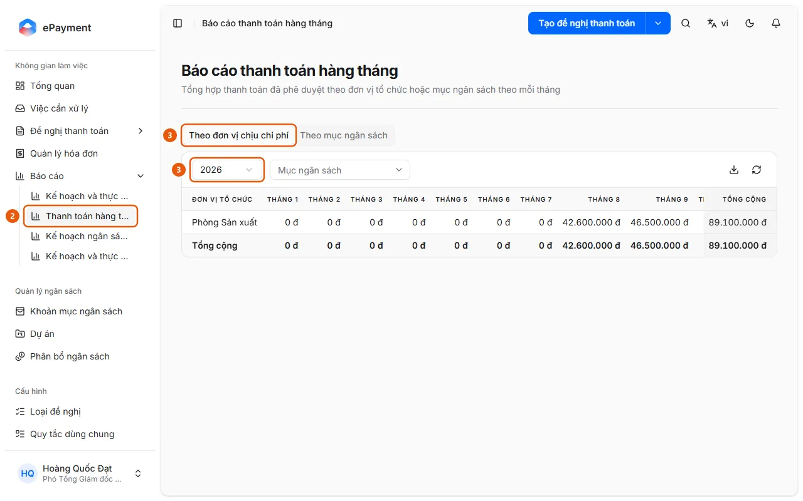

# View Monthly Payments

Users want to view a summary of payments for each month.

**When to use:** Users need monthly payment statistics.

Monthly Payments report.

## Ways to do this

- [Open the Monthly Payments report](how-to/review-payments.md) — In the sidebar, open Reports → Monthly Payments, select a year, and view the approved totals by month.

## Steps

[Open the Monthly Payments report](how-to/review-payments.md)

1. [Open the Monthly Payments report](how-to/review-payments.md)
   1. In the sidebar, open **Reports**.
   2. Select **Monthly Payments** (2) (a summary of approved payments by organizational unit or budget item for each month).
      
   3. Select the **By Cost Unit** tab (3) or **By Budget Item** (the Budget Item tab is available only when the budget is not by unit), then select a **Year** (3); filter by **Budget Item** (Cost Unit tab) or **Organizational Unit** (Budget Item tab) if needed.
   4. Review the table showing January through December and Total; use the download icon (**Export to Excel**) to export, and the refresh icon to reload.
