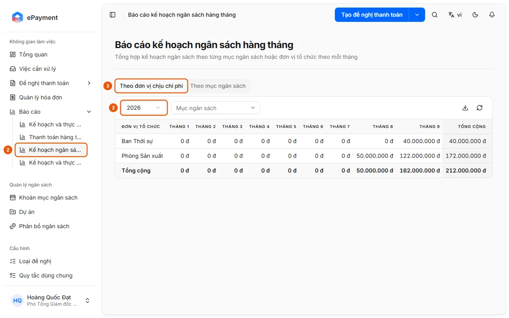

# View the Monthly Budget Plan

Users want to view the budget allocated for each month of the year, by unit or budget item.

**When to use:** Users want to know how much budget has been allocated for each month of the year.

The Monthly Budget Plan report shows planned (allocated) amounts only; it does not compare them with spending.

## Ways to do this

- [Open the Monthly Budget Plan report](how-to/review-plan-monthly.md) — In the sidebar, open Reports → Monthly Budget Plan, select a year, and view the amounts allocated for each month by unit or budget item.

## Steps

[Open the Monthly Budget Plan report](how-to/review-plan-monthly.md)

1. [Open the Monthly Budget Plan report](how-to/review-plan-monthly.md)
   1. In the sidebar, open **Reports** (desktop only).
   2. Select **Monthly Budget Plan** (2) (the "Monthly Budget Plan report" page summarizes the budget plan by budget item or organizational unit for each month).
      
   3. Select the **By Cost Center** tab (3) (available only when budgets are allocated by unit) or **By Budget Item**, then select **Year** (3) (defaults to the current year).
   4. Filter by **Budget Item** (unit tab) or **Organizational Unit** (budget item tab), if needed.
   5. Review the January through December columns and the Total column (allocated amounts); use the download icon (**Export Excel**) to export, or the refresh icon to reload.

## Troubleshooting

### [Open the Monthly Budget Plan report](how-to/review-plan-monthly.md)

- "No data for this period.": No allocations for the selected year match the filters. Change the year or clear the filters, or allocate a budget in [Allocate a budget for a period](../budget/how-to/allocate.md).
