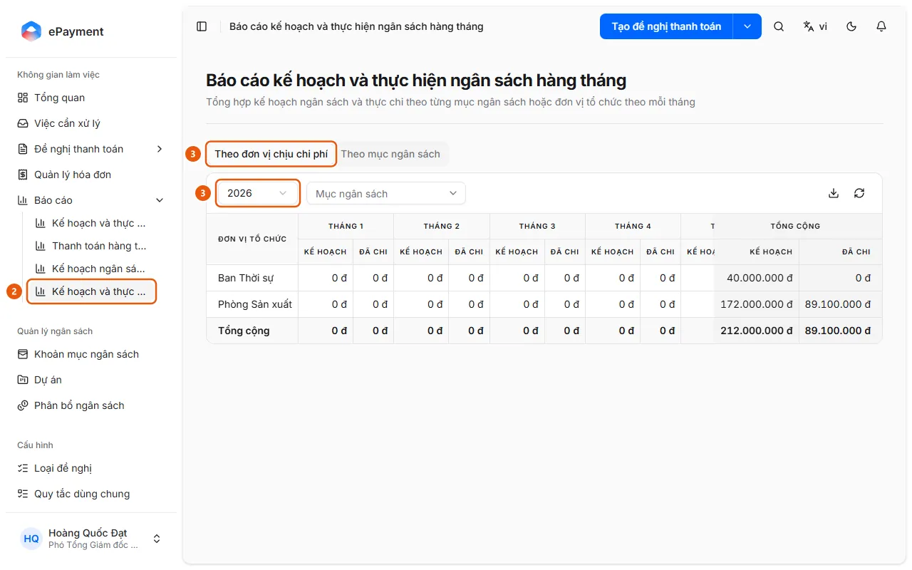

# Compare Plan with Actual Spending by Month

Users want to see the planned budget alongside the amount spent for each month of the year.

**When to use:**

- Users want to see which months exceeded or underspent the planned budget for the year.
- Users want to compare planned and actual amounts side by side for each month.

Monthly Budget Plan and Actual report: each month has a Planned and Spent column.

## Ways to do this

- [Open the Monthly Budget Plan and Actual report](how-to/review-plan-vs-actual-monthly.md) — Open Reports → Monthly Budget Plan and Actual in the sidebar, select a year, and compare the Planned and Spent amounts for each month.

## Steps

[Open the Monthly Budget Plan and Actual report](how-to/review-plan-vs-actual-monthly.md)

1. [Open the Monthly Budget Plan and Actual report](how-to/review-plan-vs-actual-monthly.md)
   1. Open **Reports** in the sidebar (desktop only).
   2. Select **Monthly Budget Plan and Actual** (2) (the "Monthly Budget Plan and Actual report" page).
      
   3. Select the **By Expense Unit** tab (3) (available only when the budget is allocated by expense unit) or **By Budget Item**, then select **Year** (3).
   4. Filter by **Budget Item** (Expense Unit tab) or **Organization Unit** (Budget Item tab), if needed.
   5. For each month, review the **Planned** (allocated) and **Spent** (approved or paid requests) columns, along with the Total; use the download icon (**Export to Excel**) to export.

## Troubleshooting

### [Open the Monthly Budget Plan and Actual report](how-to/review-plan-vs-actual-monthly.md)

- "No data for this period.": The selected year or filters have no planned budget or spending; change the year or remove the filters.
- To compare any range of months with an "Opening Balance" and utilization percentage instead of viewing each month individually, use [Open the Budget Plan and Actual report](how-to/review-budget.md).
