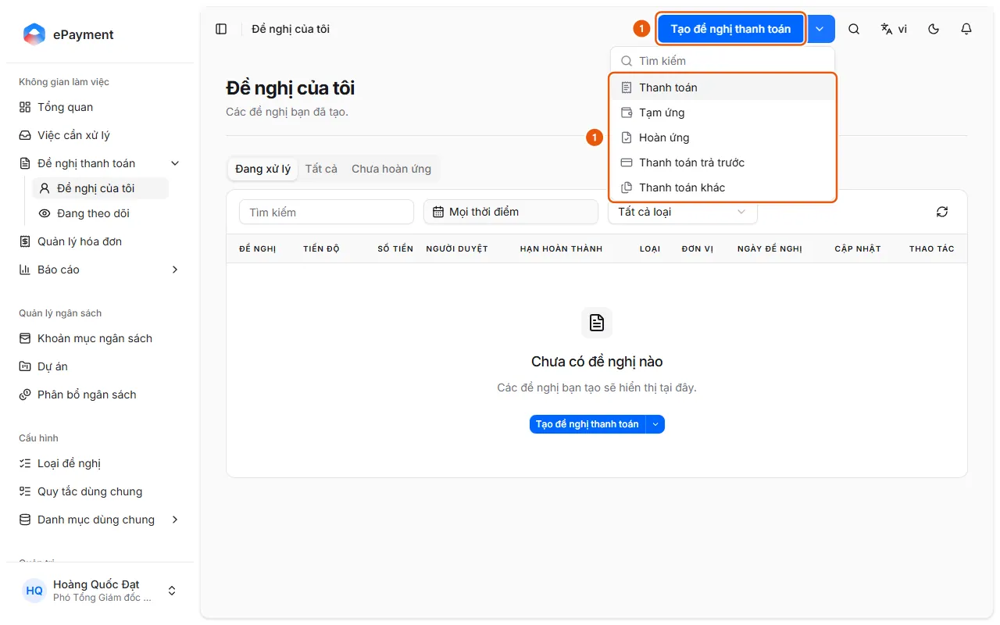
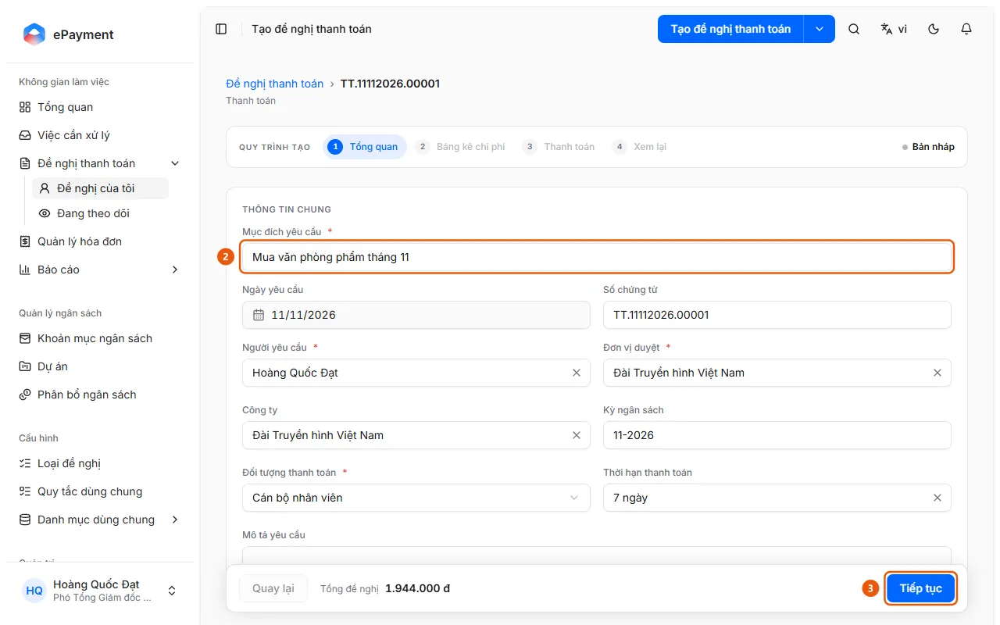
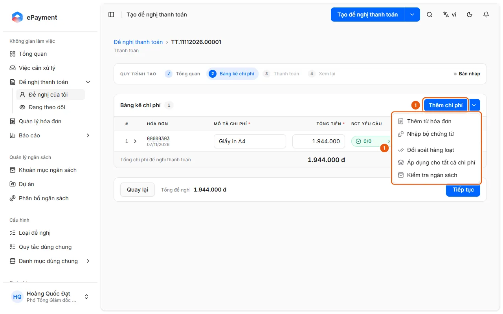
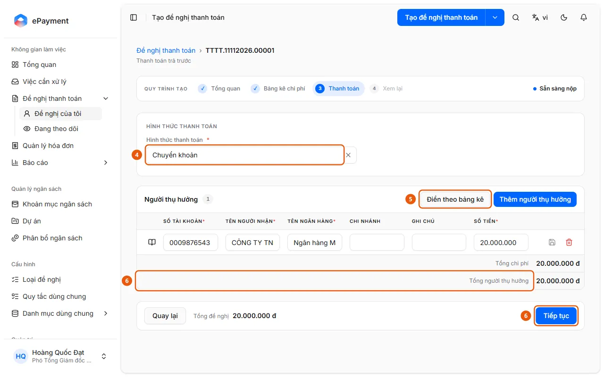

# Create a payment request

The user wants to create a new payment request and save it as a draft.

**When to use:** The user needs to pay an expense and wants to create a request.

Start a new request from scratch, then enter the request details, expenses, and payment method. Alternatively, select invoices in Invoice Management and click [Create Payment Request](../invoices/create-request.md) (each invoice becomes a prefilled expense), or ask the AI assistant to help ([Create a request with the assistant](../assistant/create-draft.md)).

## Ways to do this

- [Create a request and complete it through the Review step](how-to/create-draft.md) — After opening a new request, add expenses in Expense Breakdown, enter payment details, and continue to Review.

## Used in these guides

- [Create a payment request from invoices in Invoice Management](../invoices/create-request.md) — The user wants to select multiple invoices already processed in Invoice Management and create a payment request, with each invoice as an expense.
- [Select invoices and create a payment request](../invoices/how-to/create-request.md) — Select the Ready invoices in Invoice Management, click Create Payment Request, select a Request Type, and click Create Payment Request; each invoice becomes an expense in the draft.
- [AkaPayment](../../overview.md) — Create, approve, and track payment requests; process incoming invoices, reconcile documents, and manage budgets with an AI assistant.

## Before you start

- **[Requirements for proceeding through the request creation workflow](../../reference/requests/draft-validation.md)**\
  Each step in the creation workflow has required fields. If they are incomplete, clicking Continue displays "Please correct the highlighted fields."

## Steps

[Create a request and complete it through the Review step](how-to/create-draft.md)

1. [Open a new request and complete the Overview step](how-to/start-draft.md)
   1. Click **Create Payment Request** at the top of the page to open the default request type. Click the arrow next to it to open the list of enabled request types and select one (sample data: Payment, Advance, Reimbursement, Prepayment, Other Payment; the actual list is configured by an administrator). A draft is created immediately.
      
   2. In **1 Overview**, enter the **Request Purpose** (2); check **Requester** (you), **Approving Unit** (your unit), **Payee** (pre-filled), and other fields such as Request Date, Document Number, Company, Budget Period, Payment Deadline, and Request Description. The Approving Unit is also the default Cost Department for expense lines.
      
   3. Click **Continue** (3) to go to **2 Expense Breakdown**.
2. [Create a request and complete it through the Review step](how-to/create-draft.md)
   1. In **2 Expense Breakdown**, click **Add Expense** to add a line manually, or click the adjacent arrow to select an option: [Add an expense from an invoice](how-to/add-invoice-expense.md), [Import a document bundle as expense lines](how-to/import-bundle.md), or [Apply allocations to all expenses](how-to/apply-expense-defaults.md). You can also attach documents to the entire request with [Attach shared documents to the request](how-to/add-shared-documents.md).
      
   2. For a manually added line, enter **Expense Description** and **Total Amount**. Expand the line to check **Allocation**: **Budget Item** (pre-filled with the first line's item or the first active item), **Cost Department** (pre-filled based on the Approving Unit), **Cost Project** (only if the budget is managed by project), and Employee. Attach an invoice using **Attach Invoice**.
   3. Click **Continue**. The draft is saved automatically as you make changes (the label next to the request type changes from "Saving..." to "Saved").
   4. In **3 Payment**, select a **Payment Method** (4) from the methods allowed for the request type (Bank Transfer, Cash, or Debt Offset; the default is Bank Transfer).
      
   5. Complete the **Beneficiary** table: click **Fill from Expense Breakdown** (5) to create a row for each payee from the expenses, or click **Add Beneficiary**. Use the book icon at the start of a row to select an account saved in the payment directory. Bank Transfer requires Account Number, Beneficiary Name, Bank Name, and Amount; Cash and Debt Offset require Beneficiary Name, ID/Personal ID Number, and Amount.
   6. Make sure **Total Beneficiaries** matches **Total Expenses**, then click **Continue** (6).
   7. In **4 Review** (status "Ready to Submit"), review **Validation** (each expense and its required documents), the "Payment Request Form" preview, and the **Submission Package**. If the request type uses reconciliation, this step automatically reconciles expenses with files that have not been reconciled or have changed. You can click **Generate Spreadsheet** or **Upload Edited File** if the request type uses an Excel spreadsheet. Submit the request as described in [Submit a request](how-to/submit.md).

## Troubleshooting

### [Create a request and complete it through the Review step](how-to/create-draft.md)

- The message "Please correct the highlighted fields before continuing" appears: see [Requirements for proceeding through the request creation workflow](../../reference/requests/draft-validation.md).
- The message "This invoice is already included in line …" appears: an invoice can only be paid once; remove the duplicate invoice.
