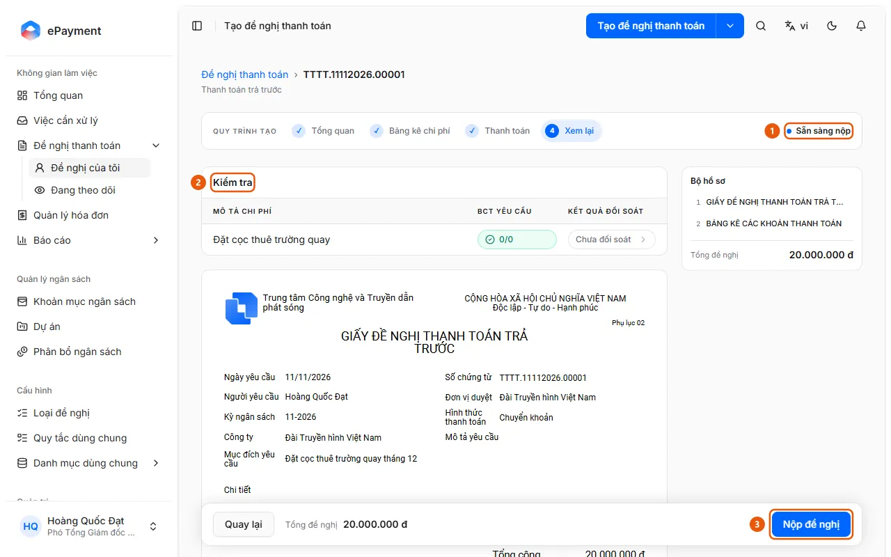

# Submit a request

At the Review step, click Submit request. The system opens the first approval step and seals the form.

## Before you start

- **[Request submission requirements](../../../reference/requests/submission.md)**\
  You can't submit if the form is incomplete, an invoice is duplicated, required supporting documents are missing, reconciliation is unfinished, or the budget is exceeded (at the Blocking level).

## Steps

1. Open the draft request at **4 Review** and check that its status is "Ready to submit" (1). If it isn't ready, the page displays "There are unresolved checks."

   

2. Review the **Checks** section (2) and resolve all blocking issues, such as missing required supporting documents ("Missing required supporting documents: …"), incomplete reconciliation ("Not reconciled. Attach supporting documents and reconcile.") or reconciliation in progress ("Reconciliation in progress. Submit when reconciliation is complete.").
3. Click **Submit request** (3).
4. The system rechecks the requirements, links the request to invoices from Invoice Management, sets the "Committed completion date" according to the work schedule, opens the first approval step, notifies the approver, and seals the payment form.
5. The page displays "Request submitted" and opens the request details page, where you can download the sealed document package. If the request type has an auto-approval or auto-rejection branch, the request may be approved or rejected as soon as it's submitted.

## Troubleshooting

- If "Unable to submit request" is displayed or submission is blocked, see [Request submission requirements](../../../reference/requests/submission.md). A second submission attempt is rejected because the request is no longer a draft.

## Checks

- [Draft request is ready to submit](../../../troubleshooting/requests/draft-ready.md) — At the Review step, the request displays the "Ready to submit" status and has no blocking checks.

## Used in these guides

- [Submit a payment request for approval](../submit.md) — The requester has completed the form and wants to submit the request for approval.
- [Select invoices and create a payment request](../../invoices/how-to/create-request.md) — Select the Ready invoices in Invoice Management, click Create Payment Request, choose a Request Type, and click Create Payment Request. Each invoice becomes an expense in the draft.
- [Create a request and complete it through the Review step](create-draft.md) — After opening a new request, add expenses in the Expense Breakdown, enter payment details, and proceed to the Review step.
