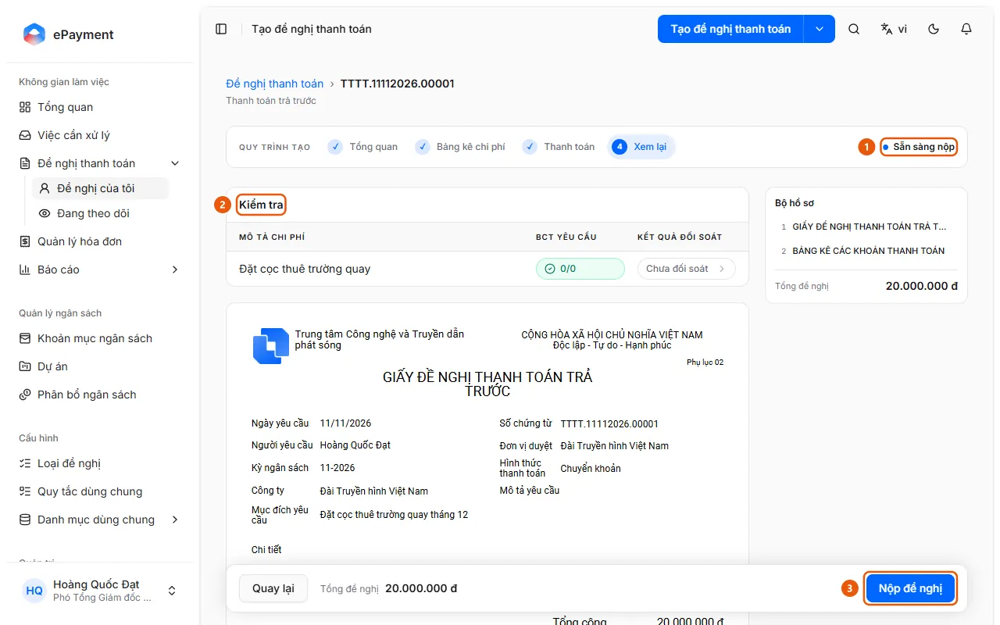

# Submit a payment request for approval

The creator has finished filling out the request and wants to submit it for approval.

**When to use:** The user has finished drafting the request and wants to submit it.

Move the request from draft into the approval workflow.

## Ways to do this

- [Submit a request](how-to/submit.md) — On the Review step, click Submit request; the system opens the first approval step and seals the form.

## Used in these guides

- [AkaPayment](../../overview.md) — Create, approve, and track payment requests; receive incoming invoices, reconcile documents, and manage budgets with an AI assistant.

## Before you start

- **[Requirements to continue through the request creation workflow](../../reference/requests/draft-validation.md)** — only if [Draft request is ready to submit](../../troubleshooting/requests/draft-ready.md) has not been met\
  Each step in the creation workflow has required fields. If they are incomplete, clicking Continue displays "Please fix the highlighted fields."
- **[Requirements for submitting a request](../../reference/requests/submission.md)**\
  You can't submit if the form is incomplete, an invoice is duplicated, required documentation is missing, reconciliation is incomplete, or (at the Block level) the request exceeds the budget.

## Steps

[Submit a request](how-to/submit.md)

1. Check that the [Draft request is ready to submit](../../troubleshooting/requests/draft-ready.md).
   Open the request at the **Review** step (step 4): the label in the upper-right corner of the Creation workflow bar says "Ready to submit," and the Submit request button is enabled (the message "There are still unresolved checks." is not displayed).
   
   If the requirements aren't met, follow [Create a request and fill it out through the Review step](how-to/create-draft.md) below.
2. [Open a new request and fill out the Overview step](how-to/start-draft.md) — only if [Draft request is ready to submit](../../troubleshooting/requests/draft-ready.md) has not been met
   1. Click **Create payment request** at the top of the page to open the default request type. Click the arrow beside it to open the list of enabled request types and select one (sample data: Payment, Advance, Advance settlement, Prepayment, Other payment; the actual list is configured by an administrator). A draft is created immediately.
      
   2. In **1 Overview**, enter the **Request purpose** (2); check the **Requester** (you), **Approving unit** (your unit), **Payee** (pre-filled), and other fields such as Request date, Document number, Company, Budget period, Payment due date, and Request description. The Approving unit is also the default Cost center for expense lines.
      
   3. Click **Continue** (3) to go to **2 Expense details**.
3. [Create a request and fill it out through the Review step](how-to/create-draft.md) — only if [Draft request is ready to submit](../../troubleshooting/requests/draft-ready.md) has not been met
   1. In **2 Expense details**, click **Add expense** to add a line manually, or click the arrow beside it to [Add an expense from an invoice](how-to/add-invoice-expense.md), [Import a document bundle as expense lines](how-to/import-bundle.md), or [Apply allocations to all expenses](how-to/apply-expense-defaults.md). You can attach documents to the entire request using [Attach shared documents to the entire request](how-to/add-shared-documents.md).
      
   2. For a manually added line, enter the **Expense description** and **Total amount**; expand the line to check **Allocation**: **Budget item** (pre-filled with the first line's item or the first active item), **Cost center** (pre-filled based on the Approving unit), **Project** (only if the budget is managed by project), and Employee. Attach an invoice using **Attach invoice**.
   3. Click **Continue**. The draft is saved automatically as you make changes (the label "Saving..." changes to "Saved" next to the request type name).
   4. In **3 Payment**, select a **Payment method** (4) from the methods allowed for the request type (Bank transfer, Cash, Accounts payable offset; Bank transfer is the default).
      
   5. Fill out the **Beneficiaries** table: click **Fill from expense details** (5) to create a row for each payee in the expenses, or click **Add beneficiary**. Use the book icon at the start of a row to select a saved account from the payment directory. Bank transfers require an Account number, Payee name, Bank name, and Amount; Cash and Accounts payable offset require a Payee name, ID/passport number, and Amount.
   6. Check that **Total beneficiaries** matches **Total expenses**, then click **Continue** (6).
   7. At **4 Review** (with the "Ready to submit" label), review **Checks** (each expense and required document), the "Payment request" preview, and the **Document package**. If the request type uses reconciliation, this step automatically reconciles expenses with files that haven't been reconciled or have changed. You can **Generate report** or **Upload revised version** if the request type uses an Excel report. Submit the request using [Submit a request](how-to/submit.md).
4. [Submit a request](how-to/submit.md)
   1. Open the draft at **4 Review** and check that its status is "Ready to submit" (1). If the requirements aren't met, the page displays "There are still unresolved checks."
      
   2. Review **Checks** (2) and resolve any blockers, such as a missing required document ("Missing required document: …"), incomplete reconciliation ("Not reconciled. Attach the document and reconcile it."), or an ongoing reconciliation ("Reconciliation in progress. Submit when reconciliation is complete.").
   3. Click **Submit request** (3).
   4. The system rechecks the requirements, links the request to invoices from Invoice Management, sets the "Committed completion date" based on the work schedule, opens the first approval step, notifies the approver, and seals the payment form.
   5. The page displays "Request submitted" and opens the request details page, where you can download the sealed document package. If the request type has an auto-approve or auto-reject branch, the request may be approved or rejected immediately upon submission.

## Troubleshooting

### [Create a request and fill it out through the Review step](how-to/create-draft.md)

- The message "Please fix the highlighted fields before continuing" appears: see [Requirements to continue through the request creation workflow](../../reference/requests/draft-validation.md).
- The message "This invoice is already on line …" appears: an invoice can only be paid once; remove the duplicate invoice.

### [Submit a request](how-to/submit.md)

- "Can't submit request" appears or submission is blocked: see [Requirements for submitting a request](../../reference/requests/submission.md). A second submission attempt is rejected because the request is no longer a draft.
