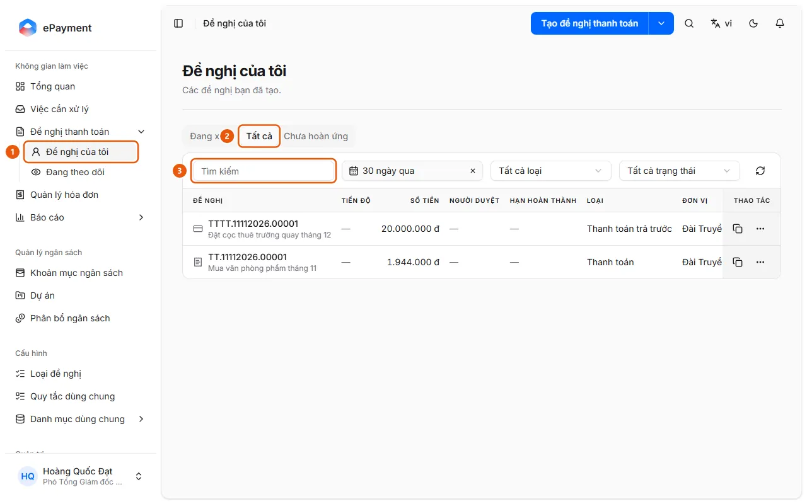

# Find a request

Users want to find a request and check its approval progress.

**When to use:**

- Users want to know what stage their submitted request has reached.
- Users want to look up a request they created.

Look up requests you created by keyword, type, or date.

## Ways to do this

- [Find a request](how-to/find-request.md) — Open My Requests and use the tabs, search, and filters, or use global search with Ctrl+K.

## Used in these guides

- [AkaPayment](../../overview.md) — Create, approve, and track payment requests; process incoming invoices, reconcile supporting documents, and manage budgets with an AI assistant.

## Steps

[Find a request](how-to/find-request.md)

1. [Find a request](how-to/find-request.md)
   1. In the sidebar, open **Payment Requests** → **My Requests** (1) (the requests you created).
      
   2. Select the **In Progress**, **All** (2), or **Unreimbursed** tab (advances that have not been reimbursed, showing the advanced, reimbursed, and remaining amounts).
   3. Enter a keyword in the **Search** field (3), or use the date filters (the **All** tab defaults to "Last 30 days"; the **In Progress** tab defaults to "Any time"), **All types**, and, on the **All** tab, **All statuses**.
   4. Alternatively, click the search icon at the top of the page (Ctrl+K) and enter a keyword. Results include the "Requests" and "Your tasks" groups. Enter # followed by a code to find requests that ended more than 365 days ago.
   5. Click a result to open the request details (Progress, Documents, Discussion, History). To view requests from your organization, open **Payment Requests** → **Following** (the "Tracking" page) → the **Organization** tab. The **Mentioned** tab lists requests where someone mentioned you.
