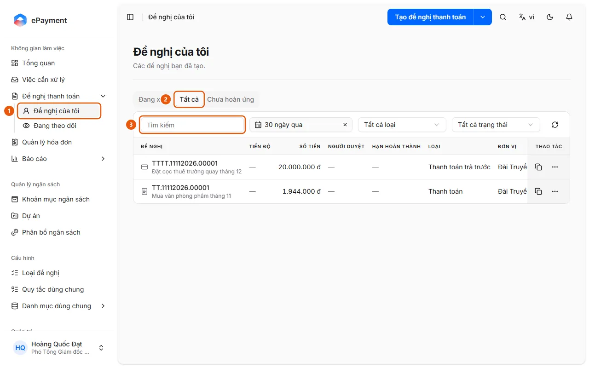

# Find a Request

Open My Requests and use tabs, search, and filters, or use global search with Ctrl+K.

## Steps

1. In the sidebar, open **Payment Requests** → **My Requests** (1) (the requests you created).

   

2. Select the **In Progress**, **All** (2), or **Unreimbursed** tab (advances that haven't been reimbursed, showing the advanced, reimbursed, and remaining amounts).
3. Enter a search term in the **Search** field (3), or use the time filters (the **All** tab defaults to "Past 30 days"; the **In Progress** tab defaults to "Any time"), **All types**, and, on the **All** tab, **All statuses**.
4. Alternatively, click the search icon at the top of the page (Ctrl+K) and enter a keyword. Results include the "Requests" and "Your tasks" groups. Enter # followed by an ID to find requests that ended more than 365 days ago.
5. Click a result to open the request details (Progress, Documents, Discussion, History). To view requests from your unit, open **Payment Requests** → **Tracking** (the "Tracking" page) → the **Unit** tab. The **Mentioned** tab lists requests where someone mentioned you.

## Used in these guides

- [Find a request](../find-request.md) — For users who want to find a request and check its approval progress.
