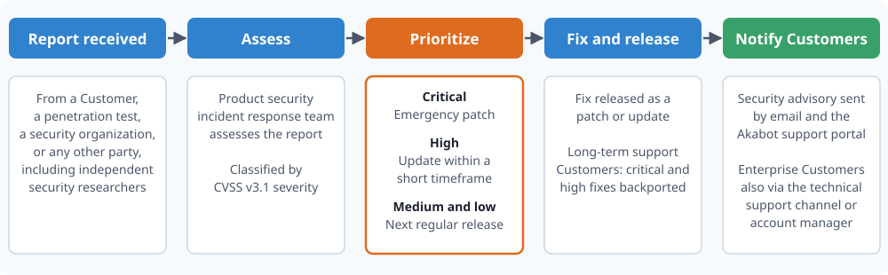

# Secure Product Development Process

## 1. Introduction

### 1.1 Purpose

Akabot considers security at every stage of a product's life, from design and coding to releasing and supporting each version. This document describes that process, so that Customers can understand how security is built into Akabot Products.

### 1.2 Scope

This document applies to the whole Akabot system. It describes how Akabot develops and supports its Products. The security of a Customer's own deployment, including infrastructure, network, and access management, is covered in the [Technical Security and Data Flow Description](../../../legal/latest/technical-security-and-data-flow-description.md), which also describes how security responsibilities are divided between Akabot and the Customer.

### 1.3 Audience

This document is intended for the security, risk, and IT teams of Customers who want to understand how Akabot develops, tests, releases, and supports its Products.

### 1.4 Terms

Akabot Products are offered by FPT IS Company Limited ("FPT IS"). The terms "Customer" and "Products" have the meaning given in the [Terms of Use](../../../legal/latest/term-of-use.md). The term "AI Provider" is used as in the Technical Security and Data Flow Description, which lists the AI Providers that Akabot works with in its [External AI Provider Matrix](../../../legal/latest/technical-security-and-data-flow-description.md#14-external-ai-provider-matrix).

### 1.5 Related documents

- [Technical Security and Data Flow Description](../../../legal/latest/technical-security-and-data-flow-description.md)
- [Terms of Use](../../../legal/latest/term-of-use.md)
- Release notes for [Akabot Center](../release-notes.md) and [Akabot Studio](../../../studio/latest/release-notes.md)
- [Role Management](../user-guide/how-to-use-by-function/operation-functions/administration/role-management.md) and [Password Policy](../user-guide/how-to-use-by-function/operation-functions/administration/password-policy.md) in Akabot Center

## 2. Process Overview

| Stage | What Akabot does | Details |
|---|---|---|
| Roles and training | Assigns clear security responsibilities and trains developers in secure development. | Sections 3.1 and 3.2 |
| Security requirements and design | Identifies security requirements and reviews risks before code is written. | Section 3.3 |
| Secure coding | Follows recognized secure coding standards and requires peer review of every change. | Section 4.1 |
| Source protection | Scans source code for exposed secrets and restricts who can change protected branches. | Section 4.2 |
| Third-party components | Manages libraries centrally and scans them for known vulnerabilities and license risks. | Section 4.3 |
| Security testing | Runs static analysis, dependency scanning, dynamic testing, and penetration testing. | Section 5.1 |
| Release control | Blocks a release while serious security findings remain open. | Section 5.2 |
| Release integrity | Builds on controlled servers, digitally signs packages, and publishes checksums. | Section 6 |
| Vulnerability response | Assesses reported vulnerabilities, prioritizes fixes, and notifies Customers. | Sections 7.1 and 7.2 |

## 3. Plan

### 3.1 Roles and Responsibilities

Security is a shared responsibility of the teams that build and release Akabot Products. The following roles take part in the process described in this document.

| Role | Security responsibility |
|---|---|
| Development team | Writes code that follows the secure coding standards, submits every change for peer review, and fixes security findings. |
| Senior reviewer | Reviews and approves merge requests before changes reach a protected branch. |
| Security lead | Oversees security testing and the security quality gate, and approves compensating controls together with the product owner. |
| Product owner | Decides whether a release can go ahead, and approves compensating controls together with the security lead. |
| Release manager or DevOps lead | Controls the build pipeline, and triggers and tags each release. |
| Product security incident response team | Assesses reported vulnerabilities and coordinates the response. |

### 3.2 Security Training

Developers receive training in secure development. The training covers secure coding practices and common software weaknesses, such as those listed in the OWASP Top 10, and is refreshed regularly.

### 3.3 Security Requirements and Design

Security is considered before code is written.

- **Security requirements.** Security requirements are identified as part of defining each new feature, for example requirements for authentication, access control, and the protection of data.
- **Secure design review.** Features that handle sensitive data, authentication, or connections to external services are reviewed for security risks during design.
- **Threat modeling.** For such features, potential threats are identified and the measures to reduce them are planned before development starts.

## 4. Build

### 4.1 Secure Coding and Code Review

- **Standards.** Development follows the Microsoft .NET secure coding guidelines, the OWASP secure coding guidance, and the clean and secure code standards of FPT IS.
- **Mandatory peer review.** Every change goes through a merge request on a self-hosted GitLab system. A change can be merged into a protected branch only after at least one senior reviewer approves it and it passes all automated pipeline checks.

### 4.2 Source Protection

- **Secret scanning.** Automated secret detection runs in the CI/CD pipeline to prevent API keys, tokens, passwords, and private keys from being committed to source code.
- **Handling of secrets.** Passwords, database credentials, API keys, access tokens, private keys, and client secrets are treated as secrets, and access to them is restricted.
- **Repository access.** Access follows the principle of least privilege and separation of roles. Developers can push only to their own feature and fix branches. The main, release, and development branches are protected: direct pushes are not allowed and every change needs an approved merge request.

### 4.3 Third-Party and Open-Source Components

Packages are managed centrally through the package manager, with control over their sources and checksums.

Software composition analysis with Black Duck runs on a regular schedule and before each release. It reviews the full dependency tree, including transitive dependencies, to find:

- known vulnerabilities;
- open-source license risks; and
- outdated or deprecated components.

Findings are handled under the security quality gate described in section 5.2.

## 5. Verify

### 5.1 Security Testing

- **Static analysis.** Source code is scanned with Coverity and SonarQube, both on a regular schedule and in the development pipeline.
- **Dependency scanning.** Third-party libraries are scanned for known vulnerabilities, as described in section 4.3.
- **Dynamic testing.** Dynamic application security testing is applied to the web service components (Akabot Center).
- **Penetration testing.** Penetration tests are performed every year and before major releases. They are carried out by the dedicated internal information security team (FPT CSIRT and the Cyber Security Department) together with independent external security specialists.

### 5.2 Security Quality Gate (Release Control)

A release is blocked until all critical and high severity findings are fixed. If a medium or low severity finding cannot be fixed in time, compensating controls must be put in place. These controls must be assessed for risk and approved in writing by the security lead and the product owner before the release goes ahead.

## 6. Release Integrity

### 6.1 Controlled Builds and Separation of Duties

- **Controlled builds.** Release builds are automated on dedicated build servers. Manual builds from developer machines are not allowed.
- **Separation of duties.** Only the release manager or DevOps lead can trigger a release and tag a version. This role is separate from the development team that builds the features.

### 6.2 Code Signing, Code Protection, and Checksums

- **Code signing.** Executable files, libraries, and installers are digitally signed with an EV code signing certificate issued by GlobalSign, with a trusted timestamp.
- **Code protection.** Compiled code is obfuscated to make reverse engineering harder.
- **Checksum.** Each installer is delivered with a SHA-256 hash so that Customers can verify its integrity before installing it.

## 7. Support and Response

### 7.1 Release Notes and Security Advisories

Release notes for each Product are published in its documentation, so that Customers can see what has changed in each version. For example, see the release notes for [Akabot Center](../release-notes.md) and [Akabot Studio](../../../studio/latest/release-notes.md).

- **Release notes** summarize improvements to stability and security, for example security enhancements and dependency updates. They do not describe how a weakness could be exploited, to protect Customers who have not yet upgraded.
- **Security advisories** are issued for serious vulnerability fixes. An advisory gives the CVE identifier, the affected scope, the CVSS severity, and remediation guidance. Advisories are sent by email and through the Akabot support portal. Enterprise customers also receive them through the technical support channel or their account manager.

### 7.2 Responding to Vulnerabilities and Which Versions Receive Fixes

- **Assessment.** When a vulnerability is reported by a Customer, a penetration test, a security organization, or any other party, including independent security researchers, Akabot's product security incident response team assesses it and classifies it by CVSS v3.1 severity.
- **Prioritization.** Critical vulnerabilities are addressed with an emergency patch. High severity vulnerabilities are addressed in an update released within a short timeframe. Medium and low severity vulnerabilities are included in the next regular release or maintenance release.
- **Customer notification.** Akabot notifies Customers of serious security fixes through security advisories, as described in section 7.1. Other security fixes are summarized in the release notes.
- **Supported versions.** Akabot supports the current version and at least one previous major version. For enterprise Customers with a long-term support agreement, critical and high severity security fixes are backported to the version the Customer runs.

### 7.3 Incident Response and Remote Support Access

Incidents involving Akabot Products are handled under Akabot's incident response process.

- Incidents involving the Customer's infrastructure are handled by the Customer.
- Incidents involving an AI Provider or another external service are handled under that provider's policies.
- The parties coordinate when an incident affects more than one area of responsibility.

By default, Akabot does not have persistent administrative access to the Customer's environment. When remote support is requested:

1. The Customer approves the access.
2. Access is limited to what is needed.
3. Access activity is subject to the Customer's own procedures.
4. Access is revoked after support is complete.

## 8. Reporting a Security Issue

To report a security issue, contact **support@akabot.com**.
