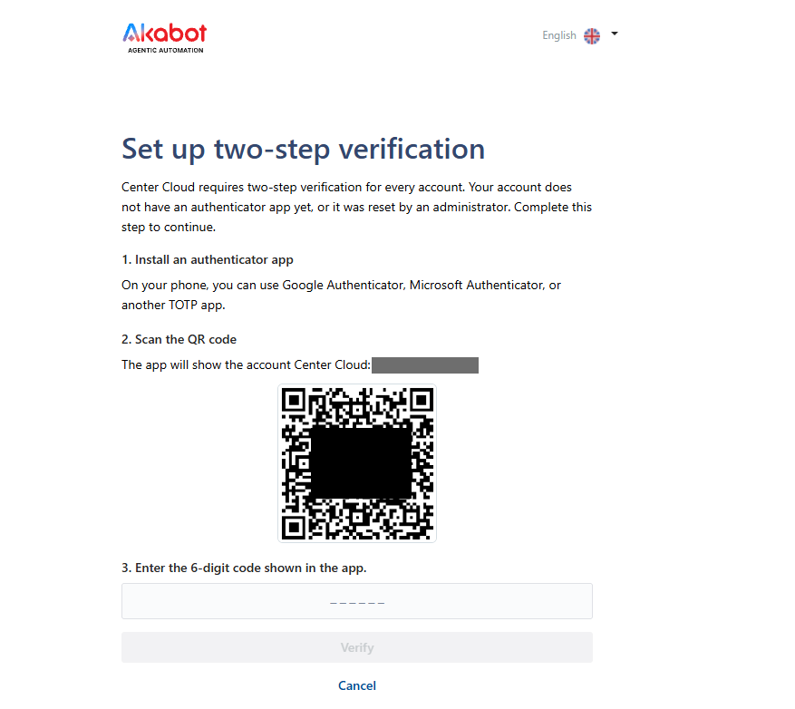
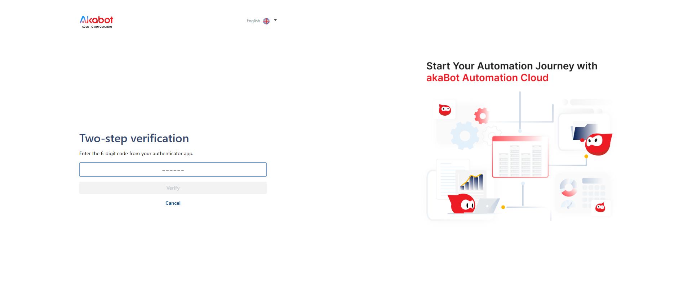

# Two-Step Verification for Center Cloud

Center Cloud requires **two-step verification** (also called Multi-Factor Authentication, or MFA) for every account. You use a 6-digit code from an authenticator app on your phone to verify your sign-in.

This guide covers two tasks:

- [Set up two-step verification](#set-up-two-step-verification) — done once, the first time you sign in, or again after an administrator resets your account.
- [Sign in with a verification code](#sign-in-with-a-verification-code) — done every time you sign in afterwards.

## Before you begin

Make sure you have:

- A Center Cloud account.
- A smartphone with an authenticator app, such as **Google Authenticator**, **Microsoft Authenticator**, or another TOTP app.

## Set up two-step verification

The **Set up two-step verification** page appears in either of these cases:

- Your account does not have an authenticator app yet (for example, it is your first sign-in).
- An administrator has reset your two-step verification.

You must complete this step to continue.

### Step 1. Install an authenticator app

On your phone, install an authenticator app. You can use Google Authenticator, Microsoft Authenticator, or any other TOTP app.

### Step 2. Scan the QR code

1. Open the authenticator app and choose the option to add a new account by scanning a QR code.
2. Point the phone camera at the QR code shown on the page.
3. The app shows the account as **Center Cloud** followed by your account name, as stated on the page.

### Step 3. Enter the 6-digit code

1. In the authenticator app, read the 6-digit code shown for **Center Cloud**.
2. Type the code into the field under **Enter the 6-digit code shown in the app**.
3. Click **Verify**.

The page also has a **Cancel** option.

## Sign in with a verification code

Once two-step verification is set up, the **Two-step verification** page asks for the 6-digit code from your authenticator app.

1. Open the authenticator app on your phone.
2. Find the **Center Cloud** entry and read the 6-digit code.
3. Type the code into the field on the page.
4. Click **Verify**.

The page also has a **Cancel** option.

## Change the page language

Both pages have a language selector at the top of the page.

## Troubleshooting

| Problem | What to check |
|---|---|
| The code is rejected | Make sure you use the code from the **Center Cloud** entry, not another account in the app. Authenticator codes depend on time, so check that your phone date and time are set to update automatically. |
| You cannot scan the QR code | Check that the camera has a clear view of the whole QR code and try again. |
| You lost your phone or deleted the app | Contact your administrator to reset your two-step verification. After a reset, the **Set up two-step verification** page appears again. |
