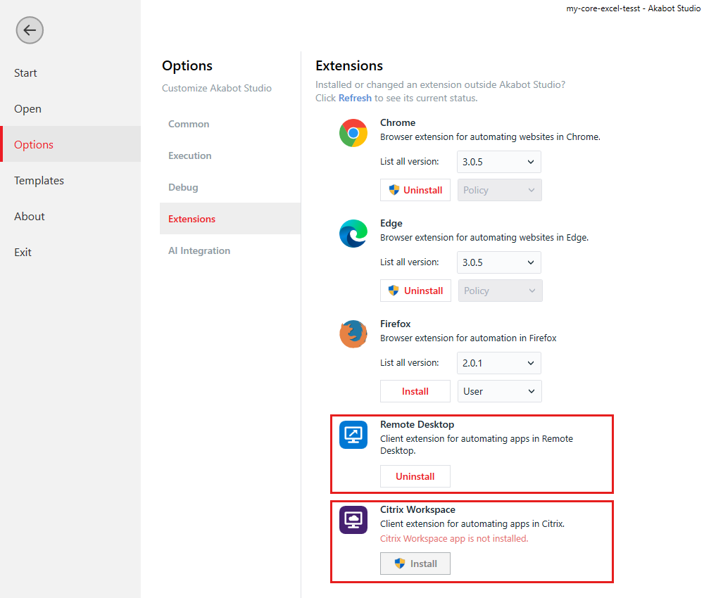
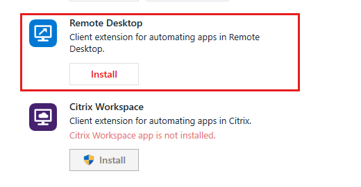
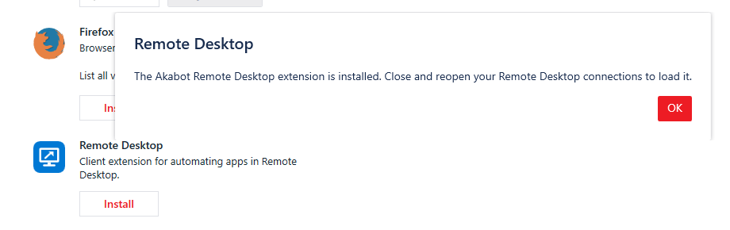
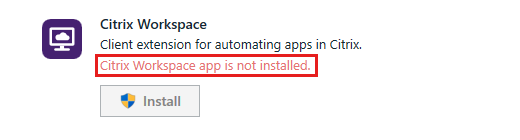
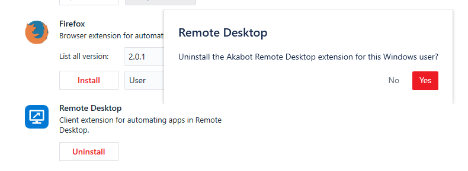

# How to install Akabot Remote Desktop and Citrix Extensions

## 1. Introduction
When an application runs inside a **Remote Desktop (RDP)** or **Citrix** session, Akabot Studio and Robot see only an image of the session. To detect and interact with the elements of that application (Indicate, Click, Type Into, Get Text, and so on), Akabot needs two parts that talk to each other through the session:

| Part | Where it is installed | How it is installed |
|---|---|---|
| **Remote Desktop extension** or **Citrix extension** (client) | The **local machine**: the machine that **opens** the session, where Akabot Studio or Robot runs | Akabot Studio: **Options / Extensions** (see [section 3](#3-install-the-remote-desktop-extension) and [section 4](#4-install-the-citrix-extension)) |
| **akaBot Remote Runtime** (server) | The **remote machine**: the Remote Desktop host or the Citrix VDA (Virtual Delivery Agent) | Installer `AkabotRemoteRuntime-<version>-x64.exe` (see [section 5](#5-install-akabot-remote-runtime-on-the-remote-machine)) |

Both parts are required. The Studio installer does not install Remote Runtime, and the Remote Runtime installer does not install the Remote Desktop or Citrix extension.

## 2. Prerequisites

### 2.1 Local machine (Studio or Robot)
- Windows 10/11, Windows Server 2016/2019/2022.
- Akabot Studio installed (supported version).
- **Remote Desktop:** Remote Desktop Connection (`mstsc.exe`) is used to open the session. No administrator rights are needed: the extension is installed for the current Windows user only.
- **Citrix:** **Citrix Workspace app** is installed. Administrator rights are needed: the extension is installed for the whole machine.

### 2.2 Remote machine (Remote Desktop host or Citrix VDA)
- Windows 64-bit.
- An account with **administrator rights** to install Remote Runtime.
- The Remote Runtime installer `AkabotRemoteRuntime-<version>-x64.exe`, copied to the remote machine. Use the version that matches your Akabot Studio.
- **Citrix only:** permission to change the Citrix policy **Virtual channel allow list**, or a Citrix administrator who can do it (see [section 6](#6-citrix-allow-the-akabot-virtual-channel)).

### 2.3 Overview of the steps
| Step | Remote Desktop | Citrix |
|---|---|---|
| 1. Install the client extension on the local machine | [Section 3](#3-install-the-remote-desktop-extension) | [Section 4](#4-install-the-citrix-extension) |
| 2. Install Remote Runtime on the remote machine | [Section 5](#5-install-akabot-remote-runtime-on-the-remote-machine) | [Section 5](#5-install-akabot-remote-runtime-on-the-remote-machine) |
| 3. Allow the akaBot virtual channel | — | [Section 6](#6-citrix-allow-the-akabot-virtual-channel) |
| 4. Reopen the session and check | [Section 7](#7-check-the-installation) | [Section 7](#7-check-the-installation) |

## 3. Install the Remote Desktop extension
Do this on the **local machine**, as the Windows user who opens the Remote Desktop connections (for an unattended Robot, sign in with the Robot account).

### 3.1 Launch installation from Akabot Studio
- Open Akabot Studio.
- Navigate to **Options / Extensions**.
- Find the **Remote Desktop** card (*"Client extension for automating apps in Remote Desktop."*).



- Click **"Install"**. No **User Account Control** prompt appears.



- When the message *"The Akabot Remote Desktop extension is installed. Close and reopen your Remote Desktop connections to load it."* appears, click **"OK"**.



After installation, the button on the card changes to **Uninstall**.

### 3.2 Load the extension
- Close all open Remote Desktop connections and open them again. Remote Desktop Connection loads the extension only when a connection starts.

> **Note:** The extension is installed for the **current Windows user** only (`HKEY_CURRENT_USER\Software\Microsoft\Terminal Server Client\Default\AddIns`). Every Windows user who opens Remote Desktop connections for automation must install it under their own account.

## 4. Install the Citrix extension
Do this on the **local machine** where Citrix Workspace app is installed.

### 4.1 Launch installation from Akabot Studio
- Open Akabot Studio.
- Navigate to **Options / Extensions**.
- Find the **Citrix Workspace** card (*"Client extension for automating apps in Citrix."*).
- Click **"Install"**, then click **Yes** in the Windows **User Account Control** prompt.
- When the message *"The Akabot Citrix extension is installed. Close and reopen your Citrix sessions to load it."* appears, click **"OK"**.

After installation, the button on the card changes to **Uninstall**.

> **Note:** If Citrix Workspace app is not installed, the card shows *"Citrix Workspace app is not installed."* and the **Install** button is disabled. Install Citrix Workspace app first, then click **Refresh** on the **Extensions** page.



### 4.2 Load the extension
- Close all open Citrix sessions and open them again. Citrix Workspace app loads the extension only when a session starts.

> **Note:** The extension is installed for the **whole machine**, in the Citrix Workspace app configuration. All Windows users of the machine can use it.

## 5. Install akaBot Remote Runtime on the remote machine
Do this on the **Remote Desktop host** or the **Citrix VDA**. For a Citrix environment with several VDAs (or a machine catalog built from a master image), install Remote Runtime on every VDA, or on the master image.

### 5.1 Install with the setup wizard
1. Sign in to the remote machine with an account that has administrator rights.
2. Double-click `AkabotRemoteRuntime-<version>-x64.exe`. If Windows asks *"Do you want to allow this app to make changes to your device?"*, click **Yes**.
3. Choose the install folder, or keep the default `C:\Program Files\FPT Software\akaBot Remote Runtime`, and click **Next**.
4. Choose the components:

   | Component | Meaning |
   |---|---|
   | **akaBot Remote Runtime Core Server** | Always installed. |
   | **Chrome extension** | The akaBot extension for Chrome **inside** the session, needed to automate web pages in Chrome on the remote machine. |
   | **Edge extension** | The same for Microsoft Edge. |

   **Full installation** selects all components. **Compact installation** installs the server only. The browser extensions selected here are installed in **User** mode, for every Windows user at their first sign-in.
5. Click **Next**, then **Install**.
6. **Citrix VDA only:** the wizard shows *"Citrix VDA detected. Add this entry to the Citrix policy "Virtual channel allow list", then restart this machine:"* with the entry to add. Copy the entry and see [section 6](#6-citrix-allow-the-akabot-virtual-channel).
7. Click **Finish**. Remote Runtime starts in the current session, and from now on it starts automatically when a user signs in to the remote machine.

### 5.2 Install from the command line
To install without the wizard, to install on many machines, or to install the browser extensions in **Policy** or **Policy (Offline)** mode, use the command line. For example, in a Command Prompt opened with **Run as administrator**:

```bat
AkabotRemoteRuntime-3.3.0.0-x64.exe /EXTMODE=policy /VERYSILENT /SUPPRESSMSGBOXES /NORESTART /LOG="C:\Windows\Temp\akabot-rr-setup.log"
```

For every option, see [Install akaBot Remote Runtime from the Command Line](./install-remote-runtime-from-command-line.md).

## 6. Citrix: allow the akaBot virtual channel
Skip this section for Remote Desktop.

Since Citrix Virtual Apps and Desktops 7 2109, all custom virtual channels are blocked by default. Remote Runtime works in a Citrix session only when the Citrix policy **[Virtual channel allow list](https://docs.citrix.com/us/en/citrix-virtual-apps-desktops/current-release/policies/reference/ica-policy-settings/virtual-channel-allow-list-policy-settings.html)** contains this entry:

```text
AKABOT,C:\Program Files\FPT Software\akaBot Remote Runtime\AkaBot.RemoteRuntime.Server.exe
```

- If you installed Remote Runtime in another folder, use the path of `AkaBot.RemoteRuntime.Server.exe` in that folder.
- The installer adds the entry to the allow list stored on the VDA itself. When your company manages the allow list with a Citrix policy (Citrix Studio or Group Policy), the next policy refresh replaces that list and removes the entry. **Ask your Citrix administrator to add the entry to the Citrix policy**, so that it is kept.
- Restart the Citrix VDA after the allow list changes.

For details, see [Citrix: allow the akaBot virtual channel](./install-remote-runtime-from-command-line.md#14-citrix-allow-the-akabot-virtual-channel).

## 7. Check the installation

### 7.1 On the local machine
- In Akabot Studio, navigate to **Options / Extensions** and click **Refresh**.
- The **Remote Desktop** card or the **Citrix Workspace** card shows the **Uninstall** button and no message under the card.

### 7.2 On the remote machine
In a Command Prompt opened with **Run as administrator**, run:

```bat
"C:\Program Files\FPT Software\akaBot Remote Runtime\Setup\AkaBot.RemoteRuntime.Setup.exe" runtime validate
```

It prints `Remote Runtime validation passed.` when the sign-in task (and, on a Citrix VDA, the allow-list entry) is in place.

### 7.3 Try Indicate
1. On the local machine, open a new Remote Desktop connection or Citrix session to the remote machine.
2. In Akabot Studio, add an activity such as **Click** and click **Indicate on screen**.
3. Point at an element of an application inside the session. The element (not the whole session window) is highlighted, and the selector describes the application on the remote machine.

## 8. Uninstall
- **Remote Desktop extension:** in **Options / Extensions**, click **Uninstall** on the **Remote Desktop** card and click **Yes**. It is removed from open connections when they close.

  

- **Citrix extension:** in **Options / Extensions**, click **Uninstall** on the **Citrix Workspace** card, click **Yes**, then **Yes** in the **User Account Control** prompt. It is removed from open sessions when they close.
- **Remote Runtime:** on the remote machine, open **Settings > Apps > Installed apps**, find **akaBot Remote Runtime** and click **Uninstall**. The browser extensions it registered are removed too. The Citrix allow list is left as it is.

To install or remove the client extensions without opening Akabot Studio, use the command line: see [akaBot Commander: Remote Desktop and Citrix extensions](../user-guide/akabot-commander.md#74-remote-desktop-and-citrix-extensions). The Studio installer can also install them with `/REMOTEEXT=rdp,citrix` (see [Install akaBot Platform from the Command Line](./install-akabot-platform-from-command-line.md#remote-desktop-and-citrix-extensions-remoteext)).

## 9. Troubleshooting
| Problem | Cause | Solution |
|---|---|---|
| The card shows *"Commander.exe not found. Repair or reinstall Studio."* | The Studio installation is incomplete. | Repair or reinstall Akabot Studio. |
| The **Remote Desktop** card shows *"Extension file missing. Repair or reinstall Studio."* | The extension file is missing from the Studio install folder (`RemoteRuntime\Client`). | Repair or reinstall Akabot Studio. |
| The **Citrix Workspace** card shows *"Citrix Workspace app is not installed."* and **Install** is disabled | Citrix Workspace app is not installed on the local machine. | Install Citrix Workspace app, then click **Refresh**. |
| The **Citrix Workspace** card shows *"Outdated. Uninstall, then install again."* | The installed extension is older than the one shipped with this Studio, for example after a Studio upgrade. | Click **Uninstall**, then **Install**. Reopen your Citrix sessions. |
| The card shows *"Check failed: ... Click Refresh to retry."* | Akabot Studio could not read the status of the extension. | Click **Refresh**. If the message stays, check the text after *"Check failed:"*. |
| *"The operation failed: ..."* after clicking **Install** or **Uninstall** | The extension could not be registered or removed. The text after *"The operation failed:"* gives the reason. | For Citrix, click **Yes** in the **User Account Control** prompt (administrator rights are required). Close Citrix Workspace app and try again. |
| Indicate highlights the whole session window instead of the element | The client extension is not loaded, or Remote Runtime is not running in the session. | Close the session and open it again. Check that Remote Runtime is installed on the remote machine and that **AkaBot.RemoteRuntime.Server.exe** runs in the session (Task Manager on the remote machine). |
| *"Make sure Akabot Remote Runtime is installed and running"* | Remote Runtime is not installed or not started in the session. | Install Remote Runtime ([section 5](#5-install-akabot-remote-runtime-on-the-remote-machine)). If it is installed, sign out of the remote session and sign in again. |
| Works in Remote Desktop but not in Citrix | The akaBot virtual channel is blocked by the Citrix policy. | Add the entry to the **Virtual channel allow list** and restart the VDA ([section 6](#6-citrix-allow-the-akabot-virtual-channel)). |
| Citrix worked after installation, but stopped working later (for example the next day) | Your company's Citrix policy replaced the allow list on the VDA and removed the akaBot entry. | Ask your Citrix administrator to add the entry to the Citrix policy **Virtual channel allow list**, then restart the VDA. |
| Another Windows user on the same local machine cannot automate Remote Desktop | The Remote Desktop extension is installed per user. | Sign in as that user and install the extension again ([section 3](#3-install-the-remote-desktop-extension)). |
| Web pages inside the session cannot be automated | The browser extension is not installed in the browser on the remote machine. | Install Remote Runtime with the **Chrome extension** / **Edge extension** components, or with `/EXTMODE` ([section 5.2](#52-install-from-the-command-line)). Then reopen the browser inside the session. |
