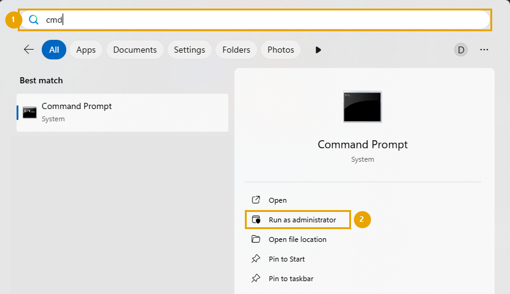
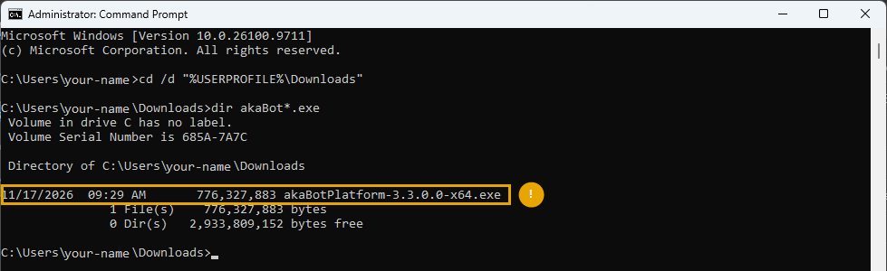
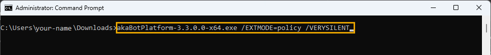
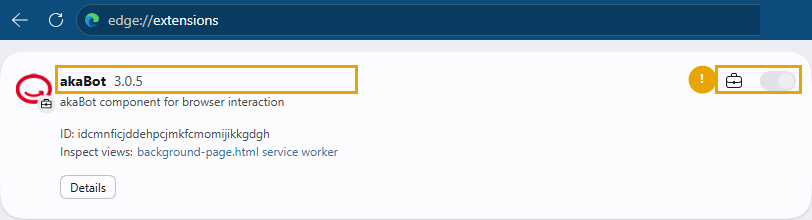
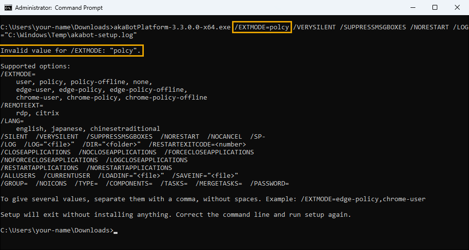
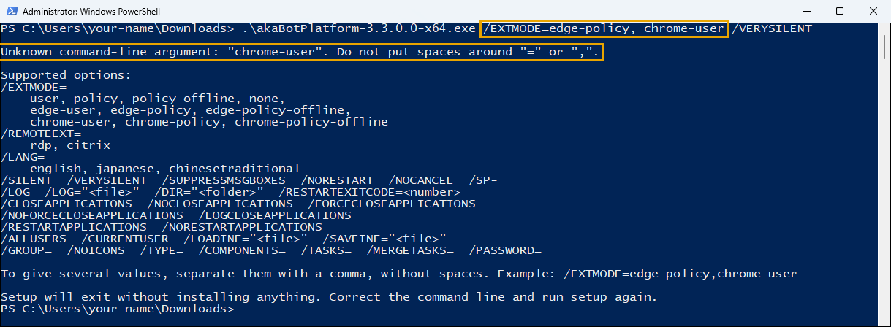

# Install akaBot Platform from the Command Line

This guide shows how to install **akaBot Platform** by typing **one command**. The same command also adds the akaBot browser extension to **Microsoft Edge** and **Google Chrome**, in the mode you choose.

You do not need to be an expert. Follow the 4 steps below one by one.

## Before you start

- **Save your work in Edge and Chrome.** The installer closes them automatically.
- **Download the installer.** It is usually in your **Downloads** folder. The file name looks like `akaBotPlatform-3.3.0.0-x64.exe` (the numbers can be different).
- You need **administrator rights** on the computer. If you do not have them, ask your IT team.

## Step 1. Open the Command Prompt as administrator

1. Click the **Start** button (Windows logo) and type `cmd` (box **1** in the picture).
2. On the right, click **Run as administrator** (box **2**).
3. If Windows asks *"Do you want to allow this app to make changes to your device?"*, click **Yes**.

A black window opens. Its title starts with **Administrator:**



## Step 2. Go to the Downloads folder

Copy the line below, paste it into the black window (right-click pastes), and press **Enter**:

```bat
cd /d "%USERPROFILE%\Downloads"
```

Then check that the installer is there. Copy, paste, and press **Enter**:

```bat
dir akaBot*.exe
```

You should see the installer file name in the list (orange box). Remember this exact name for Step 3.

In the picture, `your-name` is where your own Windows user name appears.



> **Tip:** If you saved the installer somewhere else, change the folder in the first line. For example, for `D:\Setup`:
> `cd /d "D:\Setup"`

## Step 3. Copy and run the install command

Copy the command below, paste it into the black window, and press **Enter**.

**This is the recommended command:**

```bat
akaBotPlatform-3.3.0.0-x64.exe /EXTMODE=policy /VERYSILENT /SUPPRESSMSGBOXES /NORESTART /LOG="C:\Windows\Temp\akabot-setup.log"
```

> **Important:** If your file has a different name (for example `akaBotPlatform-3.4.0.0-x64.exe`), change the file name in the command to match the name you saw in Step 2.

What this command does:

- Installs akaBot **without showing any window** (`/VERYSILENT`).
- Adds the akaBot extension to **Edge and Chrome for every user** of this computer (`/EXTMODE=policy`). The extension is **always on**, and users cannot turn it off or remove it.
- **Closes Edge and Chrome automatically.**
- Shows **no message boxes** (`/SUPPRESSMSGBOXES`). If something goes wrong, the error is written to the log files (see the next point).
- Does **not restart** the computer (`/NORESTART`).
- Writes the installation log to `C:\Windows\Temp\akabot-setup.log` (`/LOG`). The installer also writes a second log, about the akaBot service and the browser extension, to `C:\ProgramData\akaBot\Logs\<date>_Aka.RPA.InstallerV2.log` (for example `2026-11-22_Aka.RPA.InstallerV2.log`). If the installation fails, these **two log files** show why.



After you press **Enter**, nothing appears on the screen. This is normal. **Wait about 5 minutes**: the black window is ready again at once, but the installation keeps running in the background. It is finished when **akaBot** appears in the Start menu.

> **If a message appears in the black window** (for example `Unknown option: /VERYSLIENT` or `Invalid value for /EXTMODE: "polcy"`), the command has a typo. The installer checks the command **before** it installs anything, so nothing was installed and nothing was changed. Correct the command and run it again. See [Typing rules](#typing-rules).

## Step 4. Check that the extension is installed

1. Open **Edge** or **Chrome**.
2. In the address bar, type `edge://extensions` (Edge) or `chrome://extensions` (Chrome) and press **Enter**.
3. Check that:
   - **akaBot** is in the list,
   - there is a small **briefcase icon** next to its switch, and the switch is **gray**. This means your company controls the extension, so it is always on and cannot be turned off. This is correct.



> **Note:** The first time, the extension can take **a minute** to appear. If you do not see it, close the browser completely and open it again.

## All commands

The recommended command is **D**. Use another one only if you need it.

**What the words mean:**

- **User mode**: the extension is added like a normal extension. Each user can turn it off or remove it.
- **Policy mode**: the extension is added by the company for every user. It is always on and cannot be removed by the user. The browser downloads it from the Edge/Chrome store, so the computer needs internet access.
- **Policy offline**: like policy mode, but the extension comes from the installer itself, not from the store. Use it when the computer has no internet access. It works only on **company-managed computers** (joined to the company domain, or managed with Intune/MDM).
- **Silent** (`/VERYSILENT`): no windows, no questions. Edge and Chrome are closed automatically.

| | Command | Extension mode | Questions shown |
|---|---|---|---|
| **A** | `akaBotPlatform-3.3.0.0-x64.exe` | User mode | "Install the extension?" and "Close the browsers?" |
| **B** | `akaBotPlatform-3.3.0.0-x64.exe /VERYSILENT` | User mode | None. Browsers are closed automatically. |
| **C** | `akaBotPlatform-3.3.0.0-x64.exe /EXTMODE=policy` | Policy mode | Only "Close the browsers?" |
| **D** ⭐ | `akaBotPlatform-3.3.0.0-x64.exe /EXTMODE=policy /VERYSILENT /SUPPRESSMSGBOXES /NORESTART /LOG="C:\Windows\Temp\akabot-setup.log"` | Policy mode | None. Browsers are closed automatically. No restart. The log is written to `C:\Windows\Temp\akabot-setup.log`. **(Recommended)** |
| **E** | `akaBotPlatform-3.3.0.0-x64.exe /EXTMODE=user` | User mode | Only "Close the browsers?" |
| **F** | `akaBotPlatform-3.3.0.0-x64.exe /EXTMODE=edge-policy,chrome-user` | Edge: policy mode<br/>Chrome: user mode | Only "Close the browsers?" |
| **G** | `akaBotPlatform-3.3.0.0-x64.exe /EXTMODE=none` | No extension | None about the extension |
| **H** | `akaBotPlatform-3.3.0.0-x64.exe /EXTMODE=policy-offline` | Policy offline (no store download) | Only "Close the browsers?" |
| **I** | `akaBotPlatform-3.3.0.0-x64.exe /EXTMODE=policy-offline /VERYSILENT` | Policy offline (no store download) | None. Browsers are closed automatically. |
| **J** | `akaBotPlatform-3.3.0.0-x64.exe /EXTMODE=chrome-policy-offline,edge-user` | Chrome: policy offline<br/>Edge: user mode | Only "Close the browsers?" |

> **Note:** With **G** (no extension), robots cannot automate websites in Edge or Chrome. Use it only if you do not automate browsers.

> **Tip:** The other silent commands (**B** and **I**) can use the same extra options as **D**: `/SUPPRESSMSGBOXES /NORESTART /LOG="C:\Windows\Temp\akabot-setup.log"`. They hide error messages and keep a log file, which is useful when you install on many computers.

### Values you can use after `/EXTMODE=`

| Value | Edge | Chrome |
|---|---|---|
| `user` | User mode | User mode |
| `policy` | Policy mode | Policy mode |
| `policy-offline` | Policy offline | Policy offline |
| `none` | No extension | No extension |
| `edge-user` / `edge-policy` / `edge-policy-offline` | The chosen mode | — |
| `chrome-user` / `chrome-policy` / `chrome-policy-offline` | — | The chosen mode |

To use a different mode for each browser, write one Edge value and one Chrome value separated by a comma, **without spaces**. For example: `/EXTMODE=edge-policy,chrome-user`.

> **Note:** Write `policy-offline` **with a hyphen** for this installer. The Remote Runtime installer uses a different spelling (`policyoffline`, without a hyphen). See [Install akaBot Remote Runtime from the Command Line](./install-remote-runtime-from-command-line.md#11-extmode-browser-extensions).

### Typing rules

- Start every option with `/`, not `-` (write `/VERYSILENT`, not `-VERYSILENT`).
- Put **one space** before each `/`.
- Do **not** put spaces around `=` or `,`.
- Put a path with spaces in quotes: `/LOG="C:\My Logs\akabot-setup.log"`.

The installer checks the whole command **before** it installs anything. If an option name is misspelled (for example `/VERYSLIENT`), a value is not in the list (for example `/EXTMODE=polcy`), a value is missing (`/EXTMODE` alone), or there is a space where there should not be one, the installer **stops**:

- It shows the problem and the list of supported options **in the black window** and in the log file set with `/LOG`.
- It shows a **message box only when someone is there to close it**: when the installer was started without a command window (for example from a shortcut) and does not run silently. It never shows one when it runs silently (`/SILENT`, `/VERYSILENT`), as the SYSTEM account, or from a deployment tool (SCCM, Intune, Citrix or RDS image builds), so an unattended install never waits for a click.
- It installs **nothing** and changes nothing. If an older akaBot is installed, it stays as it is.
- It ends with **exit code 1**.

**Example in the Command Prompt.** `polcy` is a typo for `policy`. The first line of the message says what is wrong (orange boxes), and the list below shows the options and values you can use:



**Example in Windows PowerShell.** There is a space after the comma. PowerShell splits the value at the space, so the installer receives `chrome-user` as a separate word and reports it:



> **Note:** The Command Prompt and PowerShell do not wait for the installer, so the message can appear just after the next prompt line (`C:\Users\your-name\Downloads>`). This is normal.

> **For scripts:** to wait for the installer and get its exit code (`0` = installed, `1` = wrong command or setup could not start), use `start /wait`:
>
> ```bat
> start "" /wait akaBotPlatform-3.3.0.0-x64.exe /EXTMODE=policy /VERYSILENT /SUPPRESSMSGBOXES /NORESTART /LOG="C:\Windows\Temp\akabot-setup.log"
> echo %ERRORLEVEL%
> ```

| | Example | What the installer says |
|---|---|---|
| ✅ Correct | `akaBotPlatform-3.3.0.0-x64.exe /EXTMODE=policy /VERYSILENT /SUPPRESSMSGBOXES /NORESTART /LOG="C:\Windows\Temp\akabot-setup.log"` | Installs |
| ❌ Wrong | `akaBotPlatform-3.3.0.0-x64.exe /EXTMODE=polcy` | `Invalid value for /EXTMODE: "polcy".` |
| ❌ Wrong | `akaBotPlatform-3.3.0.0-x64.exe /VERYSLIENT` | `Unknown option: /VERYSLIENT. Check the spelling.` |
| ❌ Wrong | `akaBotPlatform-3.3.0.0-x64.exe -VERYSILENT` | `Options start with "/", not "-": write /VERYSILENT instead of -VERYSILENT.` |
| ❌ Wrong | `akaBotPlatform-3.3.0.0-x64.exe /EXTMODE = policy` | `/EXTMODE has no value. Write it as /EXTMODE=<value>, without spaces around "=".` |
| ❌ Wrong | `akaBotPlatform-3.3.0.0-x64.exe /EXTMODE=edge-policy, chrome-user` | Command Prompt: `Invalid value for /EXTMODE: "edge-policy,".`<br/>PowerShell: `Unknown command-line argument: "chrome-user".` |
| ❌ Wrong | `akaBotPlatform-3.3.0.0-x64.exe /VERYSILENT=yes` | `/VERYSILENT does not take a value. Write it without "=".` |

## Remote Desktop and Citrix extensions (/REMOTEEXT)

To automate applications inside a Remote Desktop or Citrix session, the machine that **opens** the session (where Studio or Robot runs) needs the akaBot Remote Desktop or Citrix extension. The Studio installer always copies these extensions. `/REMOTEEXT` also registers them.

The remote machine (the Remote Desktop host or Citrix VDA) needs **akaBot Remote Runtime**, which has its own installer. See [Install akaBot Remote Runtime from the Command Line](./install-remote-runtime-from-command-line.md).

> **Citrix:** a Citrix VDA also needs an entry in the **Virtual channel allow list**. The Remote Runtime installer adds it on the VDA, but in a company where Citrix policies are managed centrally, the policy can remove it later. Ask your Citrix administrator to add it to the Citrix policy as well. See [Citrix: allow the akaBot virtual channel](./install-remote-runtime-from-command-line.md#14-citrix-allow-the-akabot-virtual-channel).

| Option | What it does |
|---|---|
| *(no `/REMOTEEXT`)* | Copies the extensions only (to `RemoteRuntime\Client\x86`, `\x64`, and `RemoteRuntime\Client\Citrix\x86`, `\x64` in the install folder). Nothing is registered. |
| `/REMOTEEXT=rdp` | Registers the Remote Desktop extension for the user running setup, and for every other Windows user at their next sign-in (Active Setup). |
| `/REMOTEEXT=citrix` | Registers the Citrix extension for the whole machine. Skipped if Citrix Workspace app is not installed. |
| `/REMOTEEXT=rdp,citrix` | Both. |

Example:

```bat
akaBotPlatform-3.3.0.0-x64.exe /VERYSILENT /SUPPRESSMSGBOXES /NORESTART /REMOTEEXT=rdp,citrix /LOG="C:\Windows\Temp\akabot-setup.log"
```

You can also register or remove these extensions later from **Studio > Options > Extensions**, or with [akaBot Commander](./akabot-commander.md#74-remote-desktop-and-citrix-extensions) (`install-rdp`, `install-citrix`).

## Good to know

- **Updating akaBot:** if you install a new version **without** `/EXTMODE`, the extension keeps the same mode as before. Add `/EXTMODE=...` only to change it.
- **Uninstalling akaBot** removes the extension that the installer added, in the same mode. An extension you added yourself in another way (for example from Studio > Options > Extensions, in another mode) must be removed the same way.
- For details about policy mode, see [How to Install Akabot Web Extension](./how-to-install-akabot-web-extension.md) and [Browser Group Policies](./browser-group-policies.md).

## Troubleshooting

| Problem | What to do |
|---|---|
| *"... is not recognized as an internal or external command"* | You are not in the right folder, or the file name is different. Do Step 2 again and use the exact file name you see. |
| *"Access is denied"* | Open the Command Prompt with **Run as administrator** (Step 1). |
| The extension does not appear (policy mode) | Close the browser completely and open it again. The computer must be able to reach the Edge/Chrome store on the internet. If it cannot, use command **I** (policy offline). |
| A message such as `Unknown option`, `Invalid value for ...`, or `... has no value` appears in the black window, or the installer ends with exit code `1` | The command has a typo. Nothing was installed. Compare your command with the supported options shown in the message, correct it, and run it again. See [Typing rules](#typing-rules). |
| The extension does not appear (policy offline) | Policy offline works only on company-managed computers. Ask your IT team, or use command **D** instead. |
| The installation fails or the extension does not appear, and no message is shown | The recommended command hides all message boxes (`/SUPPRESSMSGBOXES`), so errors are only in the log files. Open both `C:\Windows\Temp\akabot-setup.log` and `C:\ProgramData\akaBot\Logs\<date>_Aka.RPA.InstallerV2.log` and look for the error. If you need help, send both files to akaBot support. |
| I lost unsaved work in my browser | Silent commands (`/VERYSILENT`) close Edge and Chrome without asking. Save your work before you run them. |

If it still does not work, contact your IT team or akaBot support and tell them **which command** you used.
