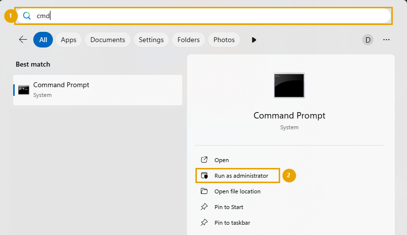
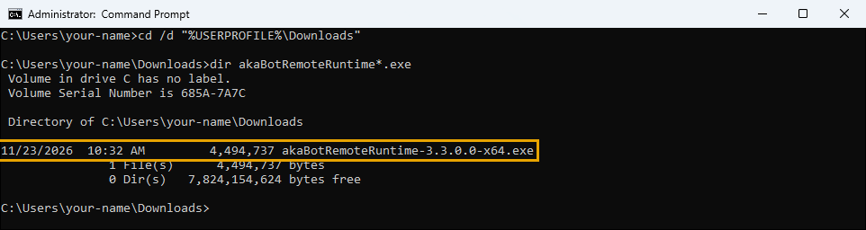
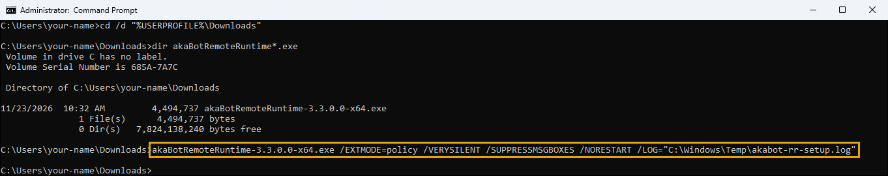
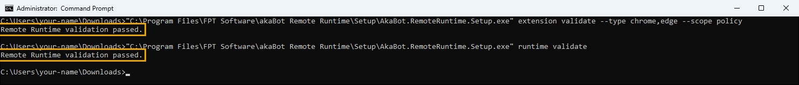
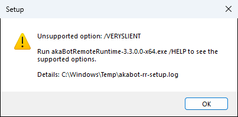

# Install akaBot Remote Runtime from the Command Line

akaBot needs two parts to automate applications inside a Remote Desktop or Citrix session:

| Part | Where it is installed | Installed by |
|---|---|---|
| **Remote Runtime** (server and browser extensions used inside the session) | The **remote machine**: the Remote Desktop host or the Citrix VDA | `akaBotRemoteRuntime-<version>-x64.exe` (this page) |
| **Remote Desktop / Citrix extension** (client DLL) | The machine that **opens** the session, where Studio or Robot runs | The Studio installer. See [Remote Desktop and Citrix extensions](./install-akabot-platform-from-command-line.md#remote-desktop-and-citrix-extensions-remoteext) and [akaBot Commander](./akabot-commander.md#74-remote-desktop-and-citrix-extensions). |

The Remote Runtime installer does **not** install the Remote Desktop or Citrix client DLL.

Follow the 4 steps below on the **remote machine** (the Remote Desktop host or the Citrix VDA). The sections after them describe every option for administrators.

## Before you start

- **Sign in to the remote machine** (the Remote Desktop host or the Citrix VDA) with an account that has **administrator rights**. If you do not have them, ask your IT team.
- **Copy the installer to the remote machine.** It is usually in your **Downloads** folder. The file name looks like `akaBotRemoteRuntime-3.3.0.0-x64.exe` (the numbers can be different).

## Step 1. Open the Command Prompt as administrator

1. Click the **Start** button (Windows logo) and type `cmd` (box **1** in the picture).
2. On the right, click **Run as administrator** (box **2**).
3. If Windows asks *"Do you want to allow this app to make changes to your device?"*, click **Yes**.

A black window opens. Its title starts with **Administrator:**



## Step 2. Go to the Downloads folder

Copy the line below, paste it into the black window (right-click pastes), and press **Enter**:

```bat
cd /d "%USERPROFILE%\Downloads"
```

Then check that the installer is there. Copy, paste, and press **Enter**:

```bat
dir akaBotRemoteRuntime*.exe
```

You should see the installer file name in the list (orange box). Remember this exact name for Step 3.

In the picture, `your-name` is where your own Windows user name appears.



> **Tip:** If you saved the installer somewhere else, change the folder in the first line. For example, for `D:\Setup`:
> `cd /d "D:\Setup"`

## Step 3. Copy and run the install command

Copy the command below, paste it into the black window, and press **Enter**.

**This is the recommended command:**

```bat
akaBotRemoteRuntime-3.3.0.0-x64.exe /EXTMODE=policy /VERYSILENT /SUPPRESSMSGBOXES /NORESTART /LOG="C:\Windows\Temp\akabot-rr-setup.log"
```

> **Important:** If your file has a different name (for example `akaBotRemoteRuntime-3.4.0.0-x64.exe`), change the file name in the command to match the name you saw in Step 2.

What this command does:

- Installs Remote Runtime **without showing any window** (`/VERYSILENT`).
- Adds the akaBot extension to **Chrome and Edge for every user** of this machine (`/EXTMODE=policy`). The extension is **always on**, and users cannot turn it off or remove it. The browser downloads it from the Chrome/Edge store, so the machine needs internet access.
- Shows **no message boxes** (`/SUPPRESSMSGBOXES`). If something goes wrong, the error is written to the log file.
- Does **not restart** the machine (`/NORESTART`).
- Writes the installation log to `C:\Windows\Temp\akabot-rr-setup.log` (`/LOG`). If the installation fails, this file shows why.
- On a Citrix VDA, also adds the akaBot entry to the Citrix **Virtual channel allow list** on this machine. In a company that manages Citrix policies centrally, ask your Citrix administrator to add it to the Citrix policy too: see [Citrix: allow the akaBot virtual channel](#14-citrix-allow-the-akabot-virtual-channel).



Unlike the akaBot Platform installer, the Remote Runtime installer does **not** close Edge and Chrome.

After you press **Enter**, nothing appears on the screen. This is normal. **Wait about 1 minute**: the black window is ready again at once, but the installation keeps running in the background. It is finished when **akaBot Remote Runtime** appears in **Settings > Apps > Installed apps**.

> **If an option name is misspelled** (for example `/VERYSLIENT`), the installer stops before it installs anything and writes `Unsupported option: /VERYSLIENT` to the log. Correct the command and run it again. See [Wrong commands](#15-wrong-commands).

> **For scripts:** to wait for the installer and get its exit code, use `start /wait` and read `%ERRORLEVEL%` on the **next** line:
>
> ```bat
> start "" /wait akaBotRemoteRuntime-3.3.0.0-x64.exe /EXTMODE=policy /VERYSILENT /SUPPRESSMSGBOXES /NORESTART /LOG="C:\Windows\Temp\akabot-rr-setup.log"
> echo %ERRORLEVEL%
> ```
>
> `0` = installed, `1` = unsupported option (nothing was installed) or setup could not start, `10` = installed, but a browser extension or the sign-in task could not be registered (see the log).

## Step 4. Check the installation

1. Check that the extension is registered. Copy, paste, and press **Enter**:

   ```bat
   "C:\Program Files\FPT Software\akaBot Remote Runtime\Setup\AkaBot.RemoteRuntime.Setup.exe" extension validate --type chrome,edge --scope policy
   ```

   It prints `Remote Runtime validation passed.` when the Chrome and Edge extensions are registered in policy mode. Otherwise it prints the reason.

2. Check the sign-in task (and, on a Citrix VDA, the allow-list entry):

   ```bat
   "C:\Program Files\FPT Software\akaBot Remote Runtime\Setup\AkaBot.RemoteRuntime.Setup.exe" runtime validate
   ```

   It also prints `Remote Runtime validation passed.` when everything is in place.

   

3. In a Remote Desktop or Citrix session on this machine, open **Edge** or **Chrome**, go to `edge://extensions` or `chrome://extensions`, and check that **akaBot** is in the list with a small **briefcase icon** next to its switch. The first time, the extension can take **a minute** to appear. If you do not see it, close the browser completely and open it again.

## 1. Installer options

### 1.1 `/EXTMODE`: browser extensions

`/EXTMODE=<list>` chooses which browser extensions are registered on the remote machine, and how.

| Value | Chrome | Edge |
|---|---|---|
| `user` | User mode | User mode |
| `policy` | Policy mode | Policy mode |
| `policyoffline` | Policy offline | Policy offline |
| `none` | No extension | No extension |
| `chrome-user` / `chrome-policy` / `chrome-policyoffline` | The chosen mode | — |
| `edge-user` / `edge-policy` / `edge-policyoffline` | — | The chosen mode |

- Separate values with a comma, without spaces. For example: `/EXTMODE=chrome-policy,edge-user`.
- If a browser is given several modes, `policyoffline` wins over `policy`, and `policy` wins over `user`.
- Without `/EXTMODE`, the **Chrome** and **Edge** components selected in the wizard (or with `/COMPONENTS`) are registered in **user** mode.
- Write `policyoffline` **without a hyphen**. The Studio installer accepts `policy-offline`, but the Remote Runtime installer does not. A value it does not recognize registers **no** extension for that browser.

| Mode | Meaning |
|---|---|
| `user` | Registered for every Windows user at their first sign-in (Active Setup), and for the user running setup now. |
| `policy` | A browser policy that installs the extension from the store, once, for the whole machine. |
| `policyoffline` | A browser policy that installs the package staged in `C:\ProgramData`, with no store. Only for a machine that is domain-joined or enrolled in MDM. On any other machine the registration fails and Setup shows an error. |
| `none` | No browser extension. |

For what each mode writes, see [Browser Group Policies](./browser-group-policies.md).

### 1.2 Standard Inno Setup options

| Option | Effect |
|---|---|
| `/COMPONENTS="server,chrome,edge"` | Chooses the components. `server` is always included. `/EXTMODE` overrides it for the extensions. |
| `/SILENT`, `/VERYSILENT` | No wizard. The runtime still starts in the session of the user who installs it, unless Setup runs as **SYSTEM**. The "Citrix VDA detected" allow-list message is not shown. |
| `/SUPPRESSMSGBOXES` | Hides every message box, also with `/SILENT` or `/VERYSILENT`: the "unsupported option" error and the "could not be registered" errors. The errors are still written to the log. |
| `/LOG="<file>"` | Writes the setup log to this file. Logging is already on by default. |
| `/DIR="<path>"` | Install folder. Default: `C:\Program Files\FPT Software\akaBot Remote Runtime`. |
| `/NOCLOSEAPPLICATIONS` | Does not close applications that hold files being replaced. By default, Setup closes them. |

### 1.3 Example

In an elevated PowerShell window:

```powershell
.\akaBotRemoteRuntime-3.3.0.0-x64.exe /EXTMODE=policy /VERYSILENT /SUPPRESSMSGBOXES /NORESTART /LOG="C:\Windows\Temp\akabot-rr-setup.log"
```

This installs Remote Runtime without a wizard, registers the Chrome and Edge extensions in policy mode for every user, does not restart the computer, and writes the log to `C:\Windows\Temp\akabot-rr-setup.log`. It is the same command as in [Step 3](#step-3-copy-and-run-the-install-command).

### 1.4 Citrix: allow the akaBot virtual channel

Since Citrix Virtual Apps and Desktops 7 2109, all custom virtual channels are blocked by default. For Remote Runtime to work in a Citrix session, the **[Virtual channel allow list](https://docs.citrix.com/us/en/citrix-virtual-apps-desktops/current-release/policies/reference/ica-policy-settings/virtual-channel-allow-list-policy-settings.html)** must contain this entry:

```text
AKABOT,C:\Program Files\FPT Software\akaBot Remote Runtime\AkaBot.RemoteRuntime.Server.exe
```

- The entry has the form `<channel name>,<path of the process that uses the channel>`. The channel name is `AKABOT`.
- If you installed Remote Runtime in another folder (with `/DIR`), use the path of `AkaBot.RemoteRuntime.Server.exe` in that folder.
- Restart the Citrix VDA after the allow list changes.

**What the installer does.** On a Citrix VDA, the installer adds this entry to the allow list stored on the VDA itself (registry `HKLM\SOFTWARE\WOW6432Node\Policies\Citrix\VCPolicies`, value `VirtualChannelWhiteList`). It does this in both wizard and silent installs. If the allow list is turned off, or already contains the entry, nothing is changed. Uninstalling Remote Runtime leaves the allow list as it is.

**In an enterprise environment, also ask your Citrix administrator.** When your company manages the allow list with a Citrix policy (from Citrix Studio or Group Policy), the next policy refresh replaces the list on the VDA with the list from the policy. The akaBot entry is then removed, for example after a restart or on the next day, and Remote Runtime stops working in Citrix sessions. To keep it, ask your Citrix administrator to add the entry above to the Citrix policy **Virtual channel allow list**.

On a Citrix VDA, the setup wizard shows a reminder about this entry. A silent install (`/SILENT`, `/VERYSILENT`) does not show the reminder: the entry is still added on the VDA, but you still need to send it to your Citrix administrator.

To check the entry later, run `runtime validate` of the [setup tool](#2-setup-tool-after-installation).

### 1.5 Wrong commands

Typing rules:

- Start every option with `/`.
- Put **one space** before each `/`.
- Do **not** put spaces around `=` or `,`.
- Put a path with spaces in quotes: `/LOG="C:\My Logs\akabot-rr-setup.log"`.

What the installer does with a mistake:

| Mistake | Example | What happens |
|---|---|---|
| Misspelled or unknown option name | `/VERYSLIENT`, `/EXTMOD=policy` | Setup **stops before it installs anything** with exit code `1`. The message `Unsupported option: ...` is written to the log and shown in a message box (not with `/SUPPRESSMSGBOXES`). Run the installer with `/HELP` to see the supported options. |
| Wrong value after `/EXTMODE=` | `/EXTMODE=polcy`, `/EXTMODE=policy-offline` | Setup installs Remote Runtime but registers **no** extension for that browser, without a message. Check the spelling. Write `policyoffline` without a hyphen. |
| A browser extension or the sign-in task cannot be registered | `/EXTMODE=policyoffline` on a machine that is not domain-joined | Setup finishes, but ends with exit code `10`. The reason is written to the log and shown in a message box (not with `/SUPPRESSMSGBOXES`). |

For example, `akaBotRemoteRuntime-3.3.0.0-x64.exe /VERYSLIENT /EXTMODE=policy /LOG="C:\Windows\Temp\akabot-rr-setup.log"` (without `/SUPPRESSMSGBOXES`) shows this message and installs nothing. With `/SUPPRESSMSGBOXES`, the same text is only in the log file.



| | Example |
|---|---|
| ✅ Correct | `akaBotRemoteRuntime-3.3.0.0-x64.exe /EXTMODE=policy /VERYSILENT /SUPPRESSMSGBOXES /NORESTART /LOG="C:\Windows\Temp\akabot-rr-setup.log"` |
| ❌ Wrong | `akaBotRemoteRuntime-3.3.0.0-x64.exe /EXTMODE=polcy` (no extension is registered) |
| ❌ Wrong | `akaBotRemoteRuntime-3.3.0.0-x64.exe /VERYSLIENT` (setup stops: unsupported option) |
| ❌ Wrong | `akaBotRemoteRuntime-3.3.0.0-x64.exe /EXTMODE = policy` (setup stops: `=` and `policy` are unsupported options) |

## 2. Setup tool (after installation)

The setup tool is `{app}\Setup\AkaBot.RemoteRuntime.Setup.exe`, where `{app}` is the install folder. The installer runs it for you. You can also run it by hand, for example to repair or check a registration.

| Command | Purpose |
|---|---|
| `runtime install\|validate [--exe <AkaBot.RemoteRuntime.Server.exe>]` | Creates or checks the sign-in task and the Citrix VDA allow-list entry. Needs administrator rights. |
| `runtime uninstall [--exe <AkaBot.RemoteRuntime.Server.exe>]` | Removes the sign-in task. |
| `extension install\|uninstall --type <chrome\|edge\|java\|all>[,...] --scope <user\|machine\|policy\|policyoffline> [--app <dir>]` | Registers or removes extensions. `java` needs no `--scope`. |
| `extension uninstall --type recorded` | Removes what the installer registered with `/EXTMODE`. The uninstaller runs this command. |
| `extension validate [--type <chrome\|edge>[,...]] [--scope <...>]` | Checks the registration and prints the reason for any failure. Without `--scope`, it checks the scope it finds. |

| `--scope` | Meaning |
|---|---|
| `user` | This Windows user (HKCU). No administrator rights. |
| `machine` | All users (HKLM external extension). Administrator. |
| `policy` | Browser policy, extension from the store. Administrator. |
| `policyoffline` | Browser policy, package staged in `C:\ProgramData`. Domain-joined or MDM-enrolled machines only. Administrator. |

Without `--exe` or `--app`, the tool uses the Remote Runtime installed in the folder above it.

Example: check the Chrome extension registered in policy mode.

```bat
"C:\Program Files\FPT Software\akaBot Remote Runtime\Setup\AkaBot.RemoteRuntime.Setup.exe" extension validate --type chrome --scope policy
```

### 2.1 Exit codes

| Code | Meaning |
|---|---|
| `0` | Success. |
| `1` | Failure. The reason is written to standard error. |
| `2` | Invalid command line. |
| `3` | `policyoffline` on a machine that is not domain-joined or enrolled in MDM. Use `policy` or `user` instead. |

## 3. Troubleshooting

| Problem | What to do |
|---|---|
| *"... is not recognized as an internal or external command"* | You are not in the right folder, or the file name is different. Do [Step 2](#step-2-go-to-the-downloads-folder) again and use the exact file name you see. |
| *"Access is denied"* | Open the Command Prompt with **Run as administrator** ([Step 1](#step-1-open-the-command-prompt-as-administrator)). |
| The installation fails, and no message is shown | `/SUPPRESSMSGBOXES` hides error messages. Open the log file you set with `/LOG` (for example `C:\Windows\Temp\akabot-rr-setup.log`) and look for the error. |
| *"Unsupported option: ..."* in the log or in a message box, or exit code `1` | An option name is misspelled. Nothing was installed. Correct the command and run it again. See [Wrong commands](#15-wrong-commands). |
| Exit code `10` | Remote Runtime is installed, but a browser extension or the sign-in task could not be registered. The log shows which one and why. |
| No extension is registered for a browser | Check the spelling after `/EXTMODE=`. Write `policyoffline` without a hyphen. A value that is not recognized registers no extension for that browser. |
| *"The browser extensions (...) could not be registered in policyoffline mode"* (setup exit code `10`, setup tool exit code `3`) | You used `policyoffline` on a machine that is not domain-joined or enrolled in MDM. Use `policy` or `user` instead. |
| You want to check what is registered | Run `extension validate` of the [setup tool](#2-setup-tool-after-installation). It prints the reason for any failure. |
| Remote Runtime does not work in a Citrix session | Run `runtime validate` to check the allow-list entry, and check that the VDA was restarted after the change. See [Citrix: allow the akaBot virtual channel](#14-citrix-allow-the-akabot-virtual-channel). |
| Remote Runtime worked in Citrix after installation, but stopped working later (for example the next day) | Your company's Citrix policy replaced the allow list on the VDA and removed the akaBot entry. Ask your Citrix administrator to add the entry to the Citrix policy **Virtual channel allow list**, then restart the VDA. See [Citrix: allow the akaBot virtual channel](#14-citrix-allow-the-akabot-virtual-channel). |
| A setup tool command fails because of missing rights | `runtime install`, `runtime validate`, and the `machine`, `policy` and `policyoffline` scopes need administrator rights. Run the command in an elevated window. |
