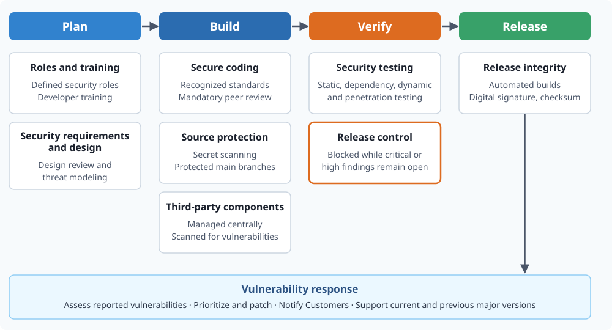
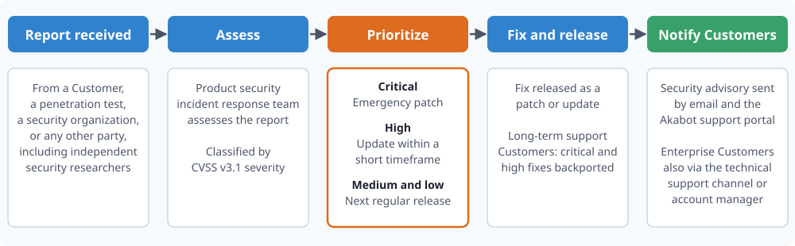

# セキュアな製品開発プロセス

## 1. はじめに

### 1.1 目的

Akabotは、設計やコーディングから各バージョンのリリースおよびサポートに至るまで、製品のライフサイクルのあらゆる段階でセキュリティを考慮しています。本書はそのプロセスを説明し、顧客がAkabot製品にセキュリティがどのように組み込まれているかを理解できるようにするものです。

### 1.2 適用範囲

本書はAkabotシステム全体に適用されます。本書では、Akabotが製品をどのように開発およびサポートしているかを説明します。インフラストラクチャ、ネットワーク、アクセス管理を含む、顧客自身の導入環境のセキュリティについては[技術セキュリティおよびデータフローの説明](../../../legal/latest/technical-security-and-data-flow-description.md)で扱っており、同書にはAkabotと顧客との間でセキュリティ上の責任がどのように分担されるかも記載されています。

### 1.. 対象読者

本書は、Akabotが製品をどのように開発、テスト、リリース、サポートしているかを理解したい顧客のセキュリティ部門、リスク管理部門、IT部門を対象としています。

### 1.4 用語

Akabot製品は、FPT IS Company Limited（以下「FPT IS」）により提供されています。「顧客」および「製品」の用語は、[利用規約](../../../legal/latest/term-of-use.md)に定める意味を有します。「AIプロバイダー」の用語は「技術セキュリティおよびデータフローの説明」と同じ意味で使用しており、Akabotが連携するAIプロバイダーは同書の[外部AIプロバイダーマトリクス](../../../legal/latest/technical-security-and-data-flow-description.md#14-外部aiプロバイダーマトリクス)に一覧があります。

### 1.5 関連ドキュメント

- [技術セキュリティおよびデータフローの説明](../../../legal/latest/technical-security-and-data-flow-description.md)
- [利用規約](../../../legal/latest/term-of-use.md)
- [Akabot Center](../release-notes.md)および[Akabot Studio](../../../studio/latest/release-notes.md)のリリースノート
- Akabot Centerの[ロール管理](../user-guide/how-to-use-by-function/operation-functions/administration/role-management.md)および[パスワード ポリシー](../user-guide/how-to-use-by-function/operation-functions/administration/password-policy.md)

## 2. プロセスの概要

| ステージ | Akabotの取り組み | 詳細 |
|---|---|---|
| 役割とトレーニング | セキュリティ上の責任を明確に割り当て、開発者にセキュアな開発のトレーニングを実施します。 | ..1項および..2項 |
| セキュリティ要件と設計 | コードを書く前にセキュリティ要件を特定し、リスクをレビューします。 | ...項 |
| セキュアコーディング | 広く認知されたセキュアコーディング標準に従い、すべての変更にピアレビューを必須としています。 | 4.1項 |
| ソースコードの保護 | ソースコード内に露出したシークレットがないかをスキャンし、保護ブランチを変更できる人を制限します。 | 4.2項 |
| サードパーティコンポーネント | ライブラリを一元的に管理し、既知の脆弱性およびライセンス上のリスクをスキャンします。 | 4..項 |
| セキュリティテスト | 静的解析、依存関係のスキャン、動的テスト、ペネトレーションテストを実施します。 | 5.1項 |
| リリース管理 | 重大なセキュリティ上の指摘事項が未解決の間は、リリースを停止します。 | 5.2項 |
| リリースの完全性 | 管理されたサーバー上でビルドし、パッケージにデジタル署名を付与し、チェックサムを公開します。 | 6項 |
| 脆弱性対応 | 報告された脆弱性を評価し、修正の優先順位を決定し、顧客に通知します。 | 7.1項および7.2項 |

## .. 計画

### ..1 役割と責任

セキュリティは、Akabot製品の開発およびリリースを担う各チームが共同で責任を負います。本書で説明するプロセスには、次の役割が関与します。

| 役割 | セキュリティ上の責任 |
|---|---|
| 開発チーム | セキュアコーディング標準に従ってコードを記述し、すべての変更をピアレビューに提出し、セキュリティ上の指摘事項を修正します。 |
| シニアレビュアー | 変更が保護ブランチに反映される前に、マージリクエストをレビューし承認します。 |
| セキュリティリード | セキュリティテストとセキュリティ品質ゲートを統括し、プロダクトオーナーとともに補完的管理策を承認します。 |
| プロダクトオーナー | リリースを進めてよいかを判断し、セキュリティリードとともに補完的管理策を承認します。 |
| リリースマネージャーまたはDevOpsリード | ビルドパイプラインを管理し、各リリースの実行とタグ付けを行います。 |
| 製品セキュリティインシデント対応チーム | 報告された脆弱性を評価し、対応を調整します。 |

### ..2 セキュリティトレーニング

開発者は、セキュアな開発に関するトレーニングを受講します。トレーニングでは、セキュアコーディングの実践方法と、OWASP Top 10に挙げられているような一般的なソフトウェアの脆弱性を扱い、定期的に更新されます。

### ... セキュリティ要件と設計

セキュリティは、コードを書く前に考慮されます。

- **セキュリティ要件。** 新機能を定義する際に、認証、アクセス制御、データの保護に関する要件など、セキュリティ要件を特定します。
- **セキュアな設計レビュー。** 機密データ、認証、外部サービスへの接続を扱う機能については、設計段階でセキュリティ上のリスクをレビューします。
- **脅威モデリング。** こうした機能については、開発を開始する前に、想定される脅威を特定し、それを低減するための対策を計画します。

## 4. 構築

### 4.1 セキュアコーディングとコードレビュー

- **標準。** 開発は、Microsoft .NETのセキュアコーディングガイドライン、OWASPのセキュアコーディングガイダンス、およびFPT ISのクリーンかつセキュアなコード標準に従います。
- **必須のピアレビュー。** すべての変更は、自社運用のGitLabシステム上でマージリクエストを経由します。変更は、1名以上のシニアレビュアーが承認し、かつすべての自動パイプラインチェックに合格した場合にのみ、保護ブランチにマージできます。

### 4.2 ソースコードの保護

- **シークレットスキャン。** CI/CDパイプラインで自動的にシークレット検出を実行し、APIキー、トークン、パスワード、秘密鍵がソースコードにコミットされることを防ぎます。
- **シークレットの取り扱い。** パスワード、データベースの認証情報、APIキー、アクセストークン、秘密鍵、クライアントシークレットはシークレットとして扱い、アクセスを制限します。
- **リポジトリへのアクセス。** アクセスは最小権限の原則と役割の分離に従います。開発者がプッシュできるのは、自分のフィーチャーブランチおよび修正ブランチのみです。メイン、リリース、開発の各ブランチは保護されており、直接のプッシュは許可されず、すべての変更に承認済みのマージリクエストが必要です。

### 4.. サードパーティおよびオープンソースコンポーネント

パッケージはパッケージマネージャーで一元的に管理し、取得元とチェックサムを管理します。

Black Duckによるソフトウェア構成分析を、定期的に、また各リリースの前に実行します。推移的依存関係を含む依存関係ツリー全体を確認し、次の事項を検出します。

- 既知の脆弱性
- オープンソースライセンス上のリスク
- 古い、または非推奨のコンポーネント

検出された事項は、5.2項に記載するセキュリティ品質ゲートに従って対応します。

## 5. 検証

### 5.1 セキュリティテスト

- **静的解析。** ソースコードを、定期的に、また開発パイプライン内で、CoverityおよびSonarQubeによりスキャンします。
- **依存関係のスキャン。** 4..項に記載のとおり、サードパーティライブラリを既知の脆弱性についてスキャンします。
- **動的テスト。** Webサービスコンポーネント（Akabot Center）に対して、動的アプリケーションセキュリティテストを実施します。
- **ペネトレーションテスト。** ペネトレーションテストは、毎年、およびメジャーリリースの前に実施します。専任の社内情報セキュリティチーム（FPT CSIRTおよびサイバーセキュリティ部門）が、独立した外部のセキュリティ専門家とともに実施します。

### 5.2 セキュリティ品質ゲート（リリース管理）

重大度が「クリティカル」および「高」の指摘事項がすべて修正されるまで、リリースは停止されます。重大度が「中」または「低」の指摘事項を期限内に修正できない場合は、補完的管理策を講じる必要があります。これらの管理策は、リスク評価を行ったうえで、リリースを進める前にセキュリティリードとプロダクトオーナーが書面で承認する必要があります。

## 6. リリースの完全性

### 6.1 管理されたビルドと職務の分離

- **管理されたビルド。** リリースビルドは専用のビルドサーバー上で自動化されています。開発者のマシンからの手動ビルドは許可されていません。
- **職務の分離。** リリースの実行とバージョンのタグ付けができるのは、リリースマネージャーまたはDevOpsリードのみです。この役割は、機能を開発する開発チームとは分離されています。

### 6.2 コード署名、コード保護、チェックサム

- **コード署名。** 実行ファイル、ライブラリ、インストーラーには、GlobalSignが発行するEVコード署名証明書により、信頼できるタイムスタンプとともにデジタル署名を付与します。
- **コード保護。** コンパイル済みコードを難読化し、リバースエンジニアリングを困難にします。
- **チェックサム。** 各インストーラーにはSHA-256ハッシュが付属しており、顧客はインストール前に完全性を確認できます。

## 7. サポートと対応

### 7.1 リリースノートとセキュリティアドバイザリ

各製品のリリースノートはそのドキュメントで公開されており、顧客は各バージョンでの変更内容を確認できます。たとえば、[Akabot Center](../release-notes.md)および[Akabot Studio](../../../studio/latest/release-notes.md)のリリースノートをご覧ください。

- **リリースノート**には、安定性とセキュリティの改善（たとえばセキュリティの強化や依存関係の更新）の概要を記載します。まだアップグレードしていない顧客を保護するため、脆弱性がどのように悪用され得るかは記載しません。
- **セキュリティアドバイザリ**は、重大な脆弱性の修正に対して発行します。アドバイザリには、CVE識別子、影響範囲、CVSSの重大度、対処のガイダンスが含まれます。アドバイザリは、メールおよびAkabotサポートポータルを通じて送付します。エンタープライズ顧客には、テクニカルサポート窓口または担当アカウントマネージャーを通じても送付します。

### 7.2 脆弱性への対応と修正の対象バージョン

- **評価。** 顧客、ペネトレーションテスト、セキュリティ組織、独立したセキュリティ研究者を含むその他の関係者から脆弱性が報告された場合、Akabotの製品セキュリティインシデント対応チームがこれを評価し、CVSS v..1の重大度で分類します。
- **優先順位付け。** クリティカルな脆弱性には、緊急パッチで対応します。重大度が高い脆弱性には、短期間のうちにリリースするアップデートで対応します。重大度が中および低の脆弱性は、次回の定期リリースまたはメンテナンスリリースに含めます。
- **顧客への通知。** Akabotは、7.1項に記載のとおり、重大なセキュリティ修正をセキュリティアドバイザリで顧客に通知します。その他のセキュリティ修正は、リリースノートに概要を記載します。
- **サポート対象バージョン。** Akabotは、現行バージョンおよび少なくとも1つ前のメジャーバージョンをサポートします。長期サポート契約を締結しているエンタープライズ顧客には、クリティカルおよび重大度が高いセキュリティ修正を、顧客が使用しているバージョンにバックポートします。

### 7.. インシデント対応とリモートサポートアクセス

Akabot製品に関わるインシデントは、Akabotのインシデント対応プロセスに従って対応します。

- 顧客のインフラストラクチャに関わるインシデントは、顧客が対応します。
- AIプロバイダーまたはその他の外部サービスに関わるインシデントは、当該プロバイダーのポリシーに従って対応します。
- インシデントが複数の責任範囲に影響する場合は、関係者間で連携します。

既定では、Akabotは顧客の環境に対する恒常的な管理者アクセスを持ちません。リモートサポートが依頼された場合は、次のとおりです。

1. 顧客がアクセスを承認します。
2. アクセスは必要な範囲に限定されます。
.. アクセス中の操作には、顧客自身の手順が適用されます。
4. サポートの完了後、アクセスは取り消されます。

## 8. セキュリティ上の問題の報告

セキュリティ上の問題を報告する場合は、**support@akabot.com** までご連絡ください。
