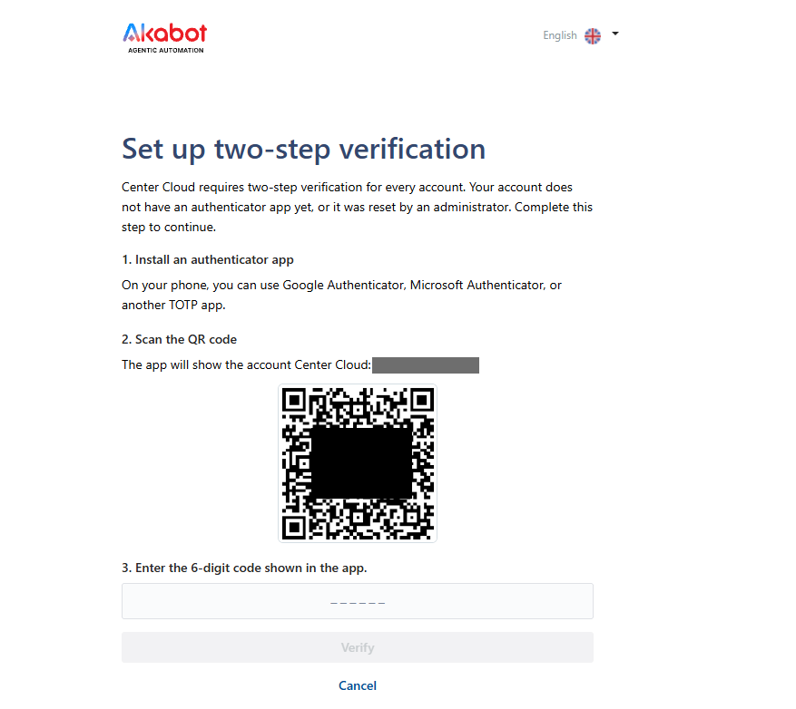
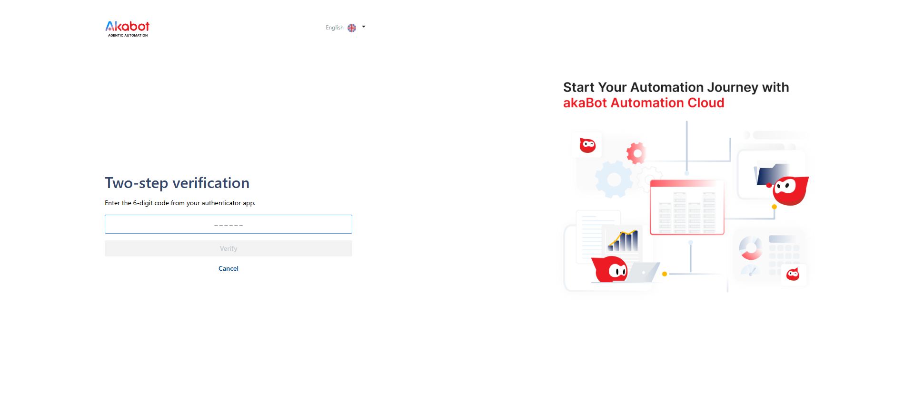

# Center Cloud の二段階認証

Center Cloud では、すべてのアカウントに**二段階認証**（多要素認証、MFA とも呼ばれます）が必須です。ログインの本人確認には、スマートフォンの認証アプリが生成する 6 桁のコードを使用します。

このガイドでは、次の 2 つの作業について説明します。

- [二段階認証を設定する](#二段階認証を設定する) — 初めてログインするとき、または管理者がアカウントをリセットした後に、1 回行います。
- [確認コードでログインする](#確認コードでログインする) — 設定後は、ログインのたびに行います。

## 始める前に

次のものを用意してください。

- Center Cloud のアカウント。
- 認証アプリをインストールできるスマートフォン。たとえば **Google Authenticator**、**Microsoft Authenticator**、またはその他の TOTP アプリを使用できます。

## 二段階認証を設定する

**Set up two-step verification（二段階認証の設定）** ページは、次のいずれかの場合に表示されます。

- アカウントに認証アプリがまだ登録されていない場合（たとえば、初めてログインする場合）。
- 管理者が二段階認証をリセットした場合。

続行するには、この手順を完了する必要があります。

### ステップ 1. 認証アプリをインストールする

スマートフォンに認証アプリをインストールします。Google Authenticator、Microsoft Authenticator、またはその他の TOTP アプリを使用できます。

### ステップ 2. QR コードをスキャンする

1. 認証アプリを開き、QR コードをスキャンして新しいアカウントを追加するオプションを選択します。
2. ページに表示されている QR コードにスマートフォンのカメラを向けます。
3. ページの説明のとおり、アプリには **Center Cloud** に続けてアカウント名がアカウントとして表示されます。

### ステップ 3. 6 桁のコードを入力する

1. 認証アプリで、**Center Cloud** に表示されている 6 桁のコードを確認します。
2. **Enter the 6-digit code shown in the app（アプリに表示されている 6 桁のコードを入力してください）** の下の入力欄にコードを入力します。
3. **Verify（検証）** をクリックします。

このページには **Cancel（キャンセル）** も表示されます。

## 確認コードでログインする

二段階認証の設定が完了すると、**Two-step verification（二段階認証）** ページで、認証アプリの 6 桁のコードの入力を求められます。

1. スマートフォンで認証アプリを開きます。
2. **Center Cloud** のエントリを探し、6 桁のコードを確認します。
3. ページの入力欄にコードを入力します。
4. **Verify（検証）** をクリックします。

このページには **Cancel（キャンセル）** も表示されます。

## ページの言語を変更する

どちらのページも、ページ上部に言語セレクターがあります。

## トラブルシューティング

| 問題 | 確認事項 |
|---|---|
| コードが拒否される | アプリ内の別のアカウントではなく、**Center Cloud** のエントリのコードを使用していることを確認してください。認証アプリのコードは時刻に依存するため、スマートフォンの日付と時刻が自動的に更新される設定になっていることを確認してください。 |
| QR コードをスキャンできない | カメラから QR コード全体がはっきり見えることを確認して、もう一度お試しください。 |
| スマートフォンを紛失した、またはアプリを削除した | 管理者に連絡して、二段階認証をリセットしてもらってください。リセット後は、**Set up two-step verification（二段階認証の設定）** ページが再び表示されます。 |
