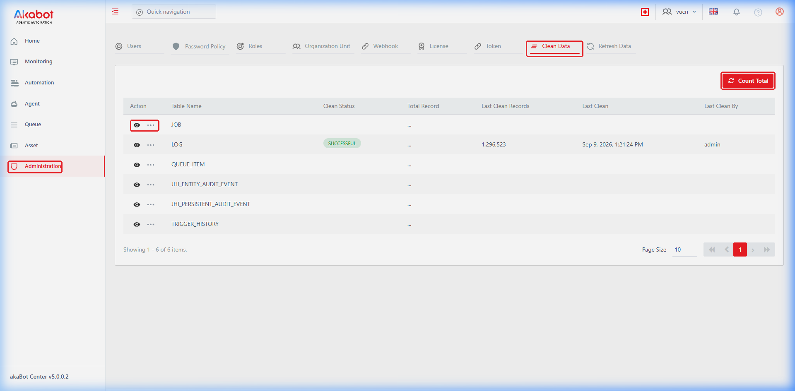
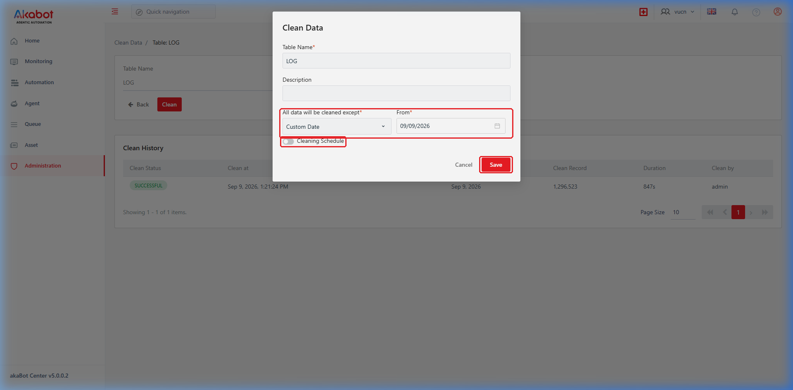
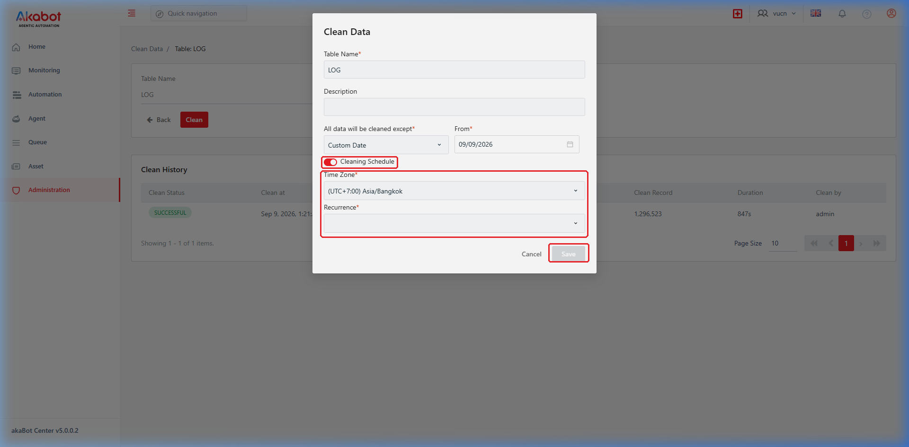
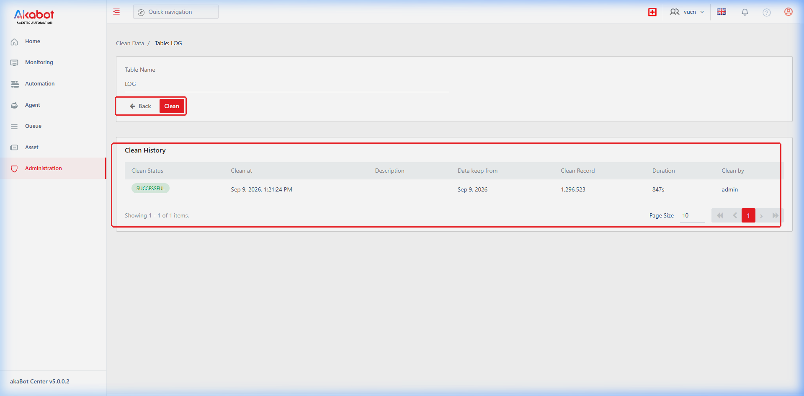

# データクリーン

**Clean Data（データクリーン）** 画面では、管理者がデータ保持ポリシーを管理し、過去の運用データ（完了したタスク、実行ログ、処理済みのキューアイテム、監査証跡など）を削除できます。ロボットによる自動実行を続けると、大量のトランザクション記録が蓄積されます。データのクリーンアップを定期的に設定することで、データベース ストレージの枯渇を防ぎ、クエリの応答性を最適化し、組織のデータ保持規定に準拠できます。

Clean Data 画面を開くには、左側のナビゲーション サイドバーで **Administration（管理）** に移動し、上部のナビゲーション バーから **Clean Data（データクリーン）** タブを選択します。

---

## **データクリーンのダッシュボードの概要**

メインの一覧画面では、クリーンアップの対象となるすべてのデータベース テーブルについて、現在のステータス、総レコード数、過去のクリーンアップの実績を確認できます。

| No | 列 | 説明 |
| :---: | :--- | :--- |
| 1 | **Action（操作）** | 各テーブルで使用できる操作です。 • **View（表示）（目のアイコン）：** テーブルの Clean Data Detail ページに移動し、過去の実行履歴とパフォーマンス ログを表示します。 • **More Options（その他のオプション）（`...`）：** ドロップダウン メニューを開き、手動またはスケジュールによるクリーンアップを実行する **Clean（クリーン）** 操作を選択できます。 |
| 2 | **Table Name（テーブル名）** | データクリーンの対象となるシステム データベース テーブルの技術名です。 |
| 3 | **Clean Status（クリーン ステータス）** | クリーン ジョブの現在の実行ステータスです。 • **SUCCESSFUL：** 直近のクリーンアップがエラーなく完了しました。 • **SCHEDULED：** このテーブルに対して、自動の定期スケジュールが有効です。 • **CLEANING...（RUNNING）：** クリーンアップがバックグラウンドで実行中です。 • **PENDING：** クリーン ジョブが送信され、実行待ちの状態です。 • **FAULTED：** クリーン ジョブの実行中にエラーが発生しました。 |
| 4 | **Total Record（総レコード数）** | テーブルに現在存在するレコードの総数です。**Count Total（総数を集計）** をクリックすると、この数値が更新されます。 |
| 5 | **Last Clean Records（前回のクリーン件数）** | 直近のクリーンアップで削除された行数です。 |
| 6 | **Last Clean（前回のクリーン日時）** | 直近のクリーンアップが実行された日付とタイムスタンプです。 |
| 7 | **Last Clean By（前回のクリーン実行者）** | クリーンアップを実行した管理者のユーザー名です（スケジュール実行の場合は `system`）。 |

> **Count Total（総数を集計）ボタン：**  
> 数百万行規模のテーブルで行数を集計すると、データベース エンジンに大きな負荷がかかることがあります。そのため、既定では **Total Record（総レコード数）** の列にはプレースホルダーのドット（`...`）が表示されます。右上の **Count Total（総数を集計）** ボタンをクリックすると、対象となるすべてのテーブルで、非同期のレコード数の集計が開始されます。

---

## **a. クリーンアップに対応するデータ テーブル**

akaBot Center は、データ量の多い次の 6 つのシステム テーブルについて、選択的なデータ削除に対応しています。

| テーブル識別子 | データの内容 | クリーンアップによる運用への影響 |
| :--- | :--- | :--- |
| **`JOB`** | 過去のタスク実行インスタンス、ワークフローのパラメーター、プロセスの状態遷移です。 | 完了、停止、またはエラーとなったタスクの記録を削除します。実行中および保留中のタスクが削除されることはありません。 |
| **`LOG`** | ワークフローの実行中に akaBot Agent がストリーミングで送信する詳細な実行ログ（Debug、Info、Warn、Error）です。 | 過去のロボットのログ メッセージを削除し、データベース ストレージの空き容量を大きく確保します。 |
| **`QUEUE_ITEM`** | akaBot Queue で処理されたトランザクション（アイテムの内容、固有のデータ、処理のタイムスタンプを含む）です。 | 完了、失敗、または期限切れとなった過去のキュー トランザクションを削除します。 |
| **`JHI_ENTITY_AUDIT_EVENT`** | Center のエンティティ（ユーザー、タスクなど）に対する作成、更新、削除の操作を追跡するシステム監査証跡です。 | コンプライアンス上の保持要件より古いエンティティ監査ログを削除します。 |
| **`JHI_PERSISTENT_AUDIT_EVENT`** | セキュリティおよび認証の監査ログ（ユーザーのログインの成功と失敗、セッション イベント）です。 | 指定した保持期限までの認証監査履歴を保持します。 |
| **`TRIGGER_HISTORY`** | スケジュール型および条件型のトリガーによって生成された、過去の発火イベントと実行タイムスタンプです。 | 有効なトリガー定義を保持したまま、不要になったトリガーのディスパッチ履歴を削除します。 |

---

## **b. 手動でデータをクリーンアップする**

管理者は、指定した保持期限までの不要なデータを削除するクリーンアップを、いつでも必要なときに実行できます。

### **手順：**

1. **Clean Data（データクリーン）** 画面で、対象のテーブル（例：`LOG` または `JOB`）を探します。
2. **Action（操作）** 列の **More Options（その他のオプション）（`...`）** ボタンをクリックし、**Clean（クリーン）** を選択します（または、テーブルの詳細ビューを開いて **Clean（クリーン）** ボタンをクリックします）。

   

3. **Clean Data（データクリーン）** モーダル ダイアログで、次の項目を設定します。

| 項目 / ラベル | 説明 | 種類 | 必須 | オプション / 既定値 |
| :--- | :--- | :--- | :---: | :--- |
| **Table Name（テーブル名）** | 選択したデータベース テーブルの名前を表示します。 | 読み取り専用テキスト | はい | 自動入力されます（例：`LOG`）。 |
| **Description（説明）** | このクリーンアップを実行する理由を記載する任意のメモです。 | テキスト入力 | いいえ | 最大 512 文字。 |
| **All data will be cleaned except（次の期間を除くすべてのデータをクリーンアップ）** | 保持するレコードを決定するデータ保持ルールです。この基準より古いレコードはすべて削除されます。 | ドロップダウン選択 | はい | • **Last 3 days（過去 3 日間）** • **Last 7 days（過去 7 日間）** • **Last 30 days（過去 30 日間）** • **Last 90 days（過去 90 日間）** • **Last 6 months（過去 6 か月）**（180 日） • **Last 12 months（過去 12 か月）**（360 日） • **Custom Date（日付を指定）** |
| **From Date（開始日）** | **Custom Date（日付を指定）** を選択した場合に、基準となる日付を指定します。この日付より前に作成されたレコードが削除されます。 | 日付ピッカー | 条件付き（Custom Date の場合は必須） | カレンダーの日付ピッカー（未来の日付は選択できません）。 |
| **Cleaning Schedule（クリーン スケジュール）** | 自動の定期実行を有効にするトグル スイッチです。 | トグル スイッチ | いいえ | 既定：**Off（オフ）**（オンデマンドで 1 回のみ実行）。 |

4. **Save（保存）** ボタンをクリックして、処理を確定し開始します。
5. クリーンアップのタスクは、バックグラウンドで非同期に実行されます。テーブルのステータス バッジは、**PENDING** ➔ **CLEANING...** ➔ **SUCCESSFUL** の順に遷移します。

> [!TIP]
> **バッチ削除の仕組み：**  
> akaBot Center は、1 回の一括削除クエリを実行するのではなく、制御されたバッチ単位でレコードを削除します。これにより、データベース テーブルのロックやトランザクションのタイムアウト エラーを防ぎ、実行中のロボットのタスクが中断されることなく継続されます。

---

## **c. 自動クリーン スケジュールを設定する**

手動の操作なしでデータベース ストレージを適正な範囲に保つために、管理者は定期的なクリーンアップのスケジュールを設定できます。

### **手順：**

1. 対象のテーブルについて、**More Options（その他のオプション）（`...`）** ➔ **Clean（クリーン）** をクリックして、**Clean Data（データクリーン）** モーダルを開きます。
2. **All data will be cleaned except（次の期間を除くすべてのデータをクリーンアップ）** で、使用する保持ポリシーを選択します（例：*Last 30 days（過去 30 日間）*）。
3. **Cleaning Schedule（クリーン スケジュール）** のスイッチを **On（オン）** にします。モーダルが展開され、繰り返しのスケジューラー項目が表示されます。

   

4. スケジュールのプロパティを設定します。

| 項目 / ラベル | 説明 | 種類 | 必須 | オプション / 詳細 |
| :--- | :--- | :--- | :---: | :--- |
| **Time Zone（タイムゾーン）** | スケジュールの実行に適用されるタイムゾーンです。 | ドロップダウン選択 | はい | 適切なサーバーまたはローカルのタイムゾーンを選択します（例：`Asia/Bangkok (UTC+07:00)`）。 |
| **Recurrence（繰り返し）** | 実行頻度のパターンです。 | ドロップダウン選択 | はい | 利用できるトリガーの種類： • **Once（1 回）：** 将来の 1 回のみ実行します。 • **Minutes（分）：** N 分ごとに実行します。 • **Hourly（時間）：** N 時間ごとに実行します。 • **Daily（毎日）：** 指定した時刻に毎日実行します。 • **Weekly（毎週）：** 選択した曜日に実行します。 • **Monthly（毎月）：** 選択した日に毎月実行します。 • **Advanced（詳細）：** Quartz Cron 式を指定します。 |
| **Timing Parameters（タイミングのパラメーター）** | 選択した繰り返しの種類に応じた、時刻と間隔の設定です。 | フォーム コントロール | はい | 繰り返しの種類によって異なります（例：開始時刻、時、分）。 |

5. **Save（保存）** ボタンをクリックして、スケジュールを確定し保存します。
6. テーブルのステータス バッジに **SCHEDULED** と表示されます。内蔵の Quartz スケジューラーが、指定した間隔でクリーン ジョブを自動的に実行します。

---

## **d. データクリーンの履歴と実行ログを確認する**

手動またはスケジュールによる自動実行を問わず、すべてのクリーン操作は監査証跡に記録されます。

### **手順：**

1. **Clean Data（データクリーン）** の一覧画面で、対象のテーブルの横にある **Action（操作）** 列の **View（表示）（目のアイコン）** ボタンをクリックします。
2. **Clean Data Detail** ページが開き、テーブル情報と **Clean History（クリーン履歴）** ログ テーブルが表示されます。

### **クリーン履歴の列：**

| No | 列 | 説明 |
| :---: | :--- | :--- |
| 1 | **Status（ステータス）** | クリーン タスクの実行結果です：**SUCCESSFUL**、**FAULTED**、**CLEANING...**、または **PENDING**。 |
| 2 | **Clean at（クリーン日時）** | クリーンアップが実行された日時のタイムスタンプです。 |
| 3 | **Description（説明）** | クリーン タスクまたはスケジュールの作成時に入力したメモです。 |
| 4 | **Data keep from（データの保持開始日）** | その実行で適用された保持の境界です（例：*Last 30 days（過去 30 日間）* または指定した日付）。 |
| 5 | **Clean Record（クリーン件数）** | その実行で削除された行の総数です。 |
| 6 | **Duration（所要時間）** | クリーンアップの完了にかかった合計時間です（例：`12s`）。 |
| 7 | **Clean by（クリーン実行者）** | クリーンアップを実行したユーザー名、またはスケジュールの所有者です。 |

3. 詳細画面から別のクリーンアップを実行するには、**Back（戻る）** ボタンの横にある赤い **Clean（クリーン）** ボタンをクリックします。
4. メインの一覧に戻るには、**Back（戻る）** ボタンをクリックします。
