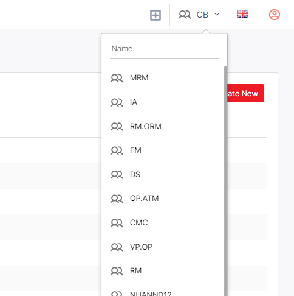
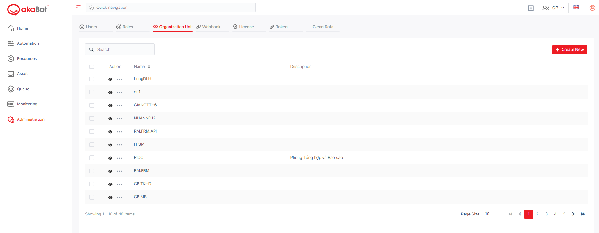
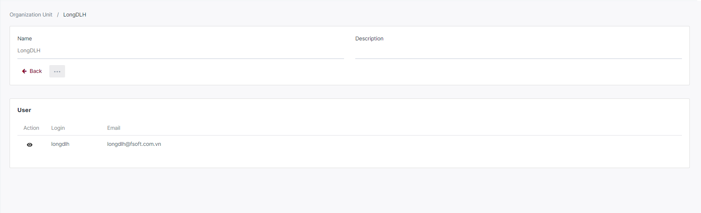
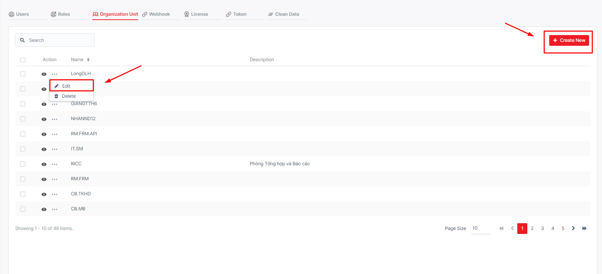
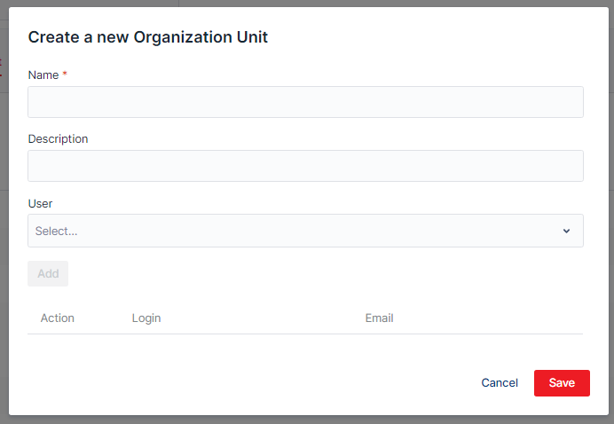
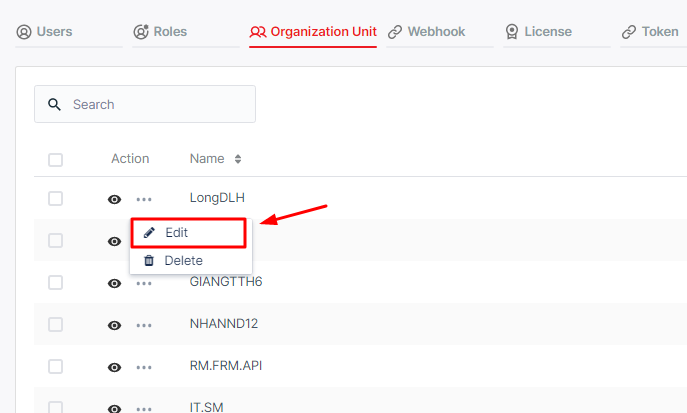

# 組織単位

**Organization Units（OU）（組織単位）** は、Orchestrator のコンポーネントを、指定されたユーザー向けのテナントに分離します。ユーザーから見た akaBot Center の表示は、ユーザーが所属する組織単位と、ユーザーに割り当てられたロールによって決まります。組織単位は、次のカテゴリのエンティティで構成されます。

* エージェント グループ
* エージェント
* ワークフロー
* タスク
* スケジュール
* パッケージ リポジトリ
* 資産
* キュー
* ログ
* レポート  
  統計は組織単位ごとに生成され、ダッシュボードに表示されます。

**注：**  
組織単位が割り当てられていないユーザーは、どの種類のリソースにもアクセスできません。  
同じエージェントを 2 つの異なる組織単位にプロビジョニングすることはできません。また、リソースをある組織単位から別の組織単位へ移動することもできません。  
ページ ヘッダーのドロップダウン リストには、ユーザーに割り当てられているすべての組織単位が常に表示されます。ユーザーはこのリストを使用して、組織単位を切り替えることもできます。

OU ページにアクセスするには、左側のメニューで **Administration（管理）** タブをクリックし、次に **Organization Unit（組織単位）** タブをクリックします。これまでに作成されたすべての OU が、次のように表示されます。

管理者は、特定の OU の詳細の表示、OU の作成、更新、削除、フィルタリング、および OU に割り当てられたユーザーの管理を行えます。

## **a. OU の表示**

OU の詳細をすべて表示するには、目のアイコンのボタンをクリックします。

クリックすると、詳細ページに移動します。

| No | 列/ラベル | 説明 |
| --- | --- | --- |
|  | **Name（名前）** | OU の名前です。 |
|  | **Description（説明）** | OU の説明です。 |
|  | **User（ユーザー）** | この OU に割り当てられているすべてのユーザーの一覧です。一覧には、ユーザー名、メール、割り当てられたロールが含まれます。 |

## **b. OU の作成/編集**

新しい組織単位を作成するには、**Create New（新規作成）** ボタンをクリックします。OU を編集する場合は、対象の OU 名の横にある **Action（アクション）** から編集オプションを選択します。

クリックすると、情報を入力するためのポップアップ フォームが表示されます。

| No | 列/ラベル | 説明 | 種類 | 最大値 | 必須 | 入力条件 |
| --- | --- | --- | --- | --- | --- | --- |
| 1 | **Name（名前）** | 作成または編集する OU の任意の名前を入力します。 | 文字列 | 255 文字 | はい |  |
| 2 | **Description（説明）** | 作成または編集する OU の説明を入力します。 | 文字列 | 1000 文字 | いいえ |  |
| 3 | **User（ユーザー）** | 作成または編集する OU に追加するユーザーを選択します。 | 検索入力 | 制限なし | はい | 複数のユーザーを追加できますが、追加は 1 人ずつ行う必要があります。 |

組織単位からユーザーの割り当てを解除するには、編集ウィンドウを開き、操作欄のごみ箱アイコンをクリックします。すべての情報を入力または編集したら、**Save（保存）** をクリックします。これで OU が作成されます。

## **c. OU の削除**

**重要：** 組織単位を削除すると、その組織単位内のすべてのリソースが削除されます。OU を削除するには、**Organization Unit（組織単位）** ページで、組織単位名の横にある **Delete（削除）** ボタンをクリックします。

確認のポップアップが表示されます。**Delete（削除）** を選択して操作を完了します。
