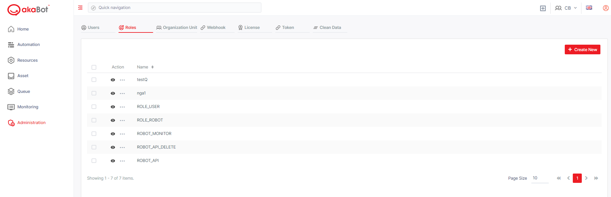
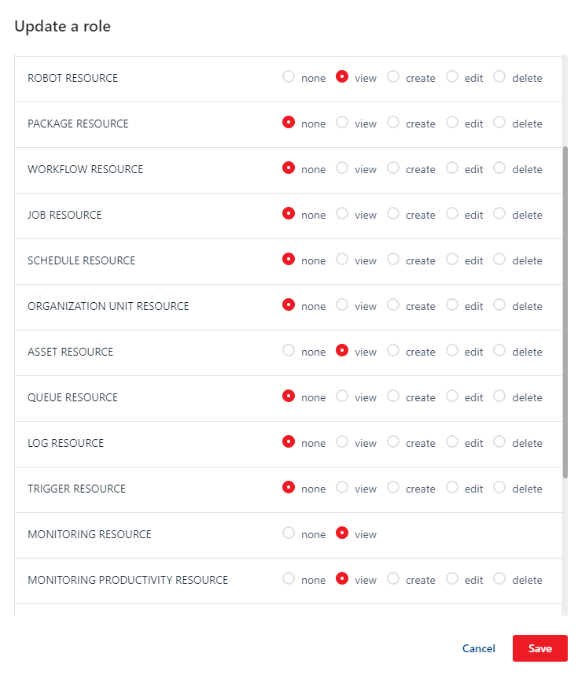
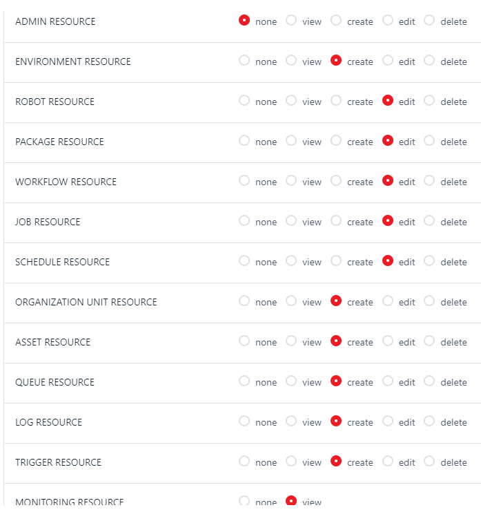
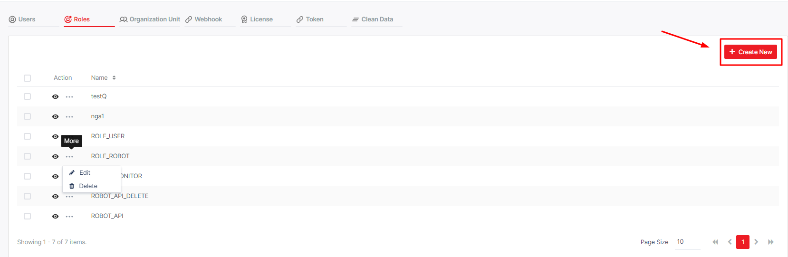
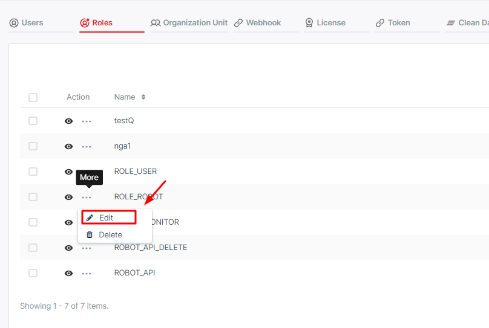
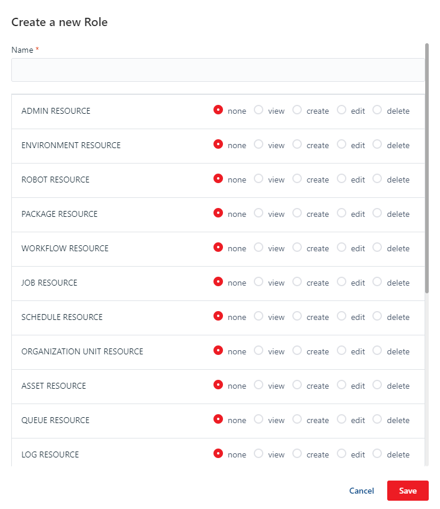
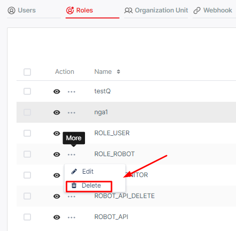

# ロール管理

akaBot には、ロールと権限に基づくアクセス制御の仕組みが組み込まれています。ロールとは権限のセットであり、Center のリソースにアクセスして操作するために必要な権限は、ロールに割り当てられます。つまり、ユーザーに特定のリソースへの権限を直接付与するのではなく、ロールを通じて権限が付与されます。ユーザーは、割り当てられたロールに応じて、次のリソースにアクセスできます。

| No | リソース |
| --- | --- |
| 1 | ADMIN RESOURCE（管理リソース） |
| 2 | ENVIRONMENT RESOURCE（環境リソース） |
| 3 | ROBOT RESOURCE（ロボットリソース） |
| 4 | PACKAGE RESOURCE（パッケージリソース） |
| 5 | WORKFLOW RESOURCE（ワークフローリソース） |
| 6 | JOB RESOURCE（ジョブリソース） |
| 7 | SCHEDULE RESOURCE（スケジュールリソース） |
| 8 | ORGANIZATION UNIT RESOURCE（組織単位リソース） |
| 9 | ASSET RESOURCE（資産リソース） |
| 10 | QUEUE RESOURCE（キューリソース） |
| 11 | LOG RESOURCE（ログリソース） |

| 権限 | 説明 |
| --- | --- |
| None（なし） | Center のインターフェースにリソースが表示されません。 |
| View（表示） | リソースを表示できますが、操作はできません。 |
| Edit（編集） | リソースを表示および編集できます。 |
| Create（作成） | リソースを表示し、新しいリソースを作成できます。 |
| Delete（削除） | リソースを削除できます。 |

この **Role Management（ロール管理）** ページには、使用できるすべてのロールが表示され、管理者はロールを追加、削除、更新できます。**Role Management（ロール管理）** タブを選択すると、次のページが表示されます。

| No | 列 | 説明 |
| --- | --- | --- |
| 1 | Action（アクション） | ロールを管理するために使用できるアクションです。内容：**Edit（編集）**：ロールの詳細を表示できます。**Delete（削除）**：選択したロールを削除できます。 |
| 2 | Name（名前） | ロールの名前です。 |

* 既定のロール

akaBot Center には、3 つの既定のロールがあります。

- ROLE\_ADMIN

- ROLE\_USER

- ROLE\_ROBOT

**ROLE\_ADMIN**  
既定では、このロールはすべてのリソースに対するすべての権限を持ち、これは変更できません。

**ROLE\_USER**  
既定では、このロールには次の権限が付与されています。これらの権限は編集できます。

**ROLE\_ROBOT**  
既定では、このロールには次の権限が付与されています。これらの権限は編集できます。

## **a. ロールの作成/編集**

Center に新しいロールを作成するには、ページ上部の **Create New（新規作成）** ボタンをクリックします。

既存のロールを編集するには、**Action（アクション）** 列で対象のロールに対応する **Edit（編集）** ボタンをクリックします。

**Create New（新規作成）** または **Edit（編集）** ボタンをクリックすると、入力用のフォームが表示されます。詳細は次の表のとおりです。

| No | 列/ラベル | 説明 | 種類 | 最大値 | 必須 | 入力条件 |
| --- | --- | --- | --- | --- | --- | --- |
| 1 | Name（名前） | ロール名を入力します。 | 文字列 | 100 文字 | はい |  |
| 2 | Resources（リソース） | 行ごとに選択できるオプションは 1 つのみです。ロールに付与する権限を選択します。 | 単一選択 |  | はい |  |

## **b. ロールの削除**

ロールを削除するには、対象のロールの **Delete（削除）** ボタンをクリックします。

確認のポップアップが表示されます。**Delete（削除）** をクリックして操作を完了します。
