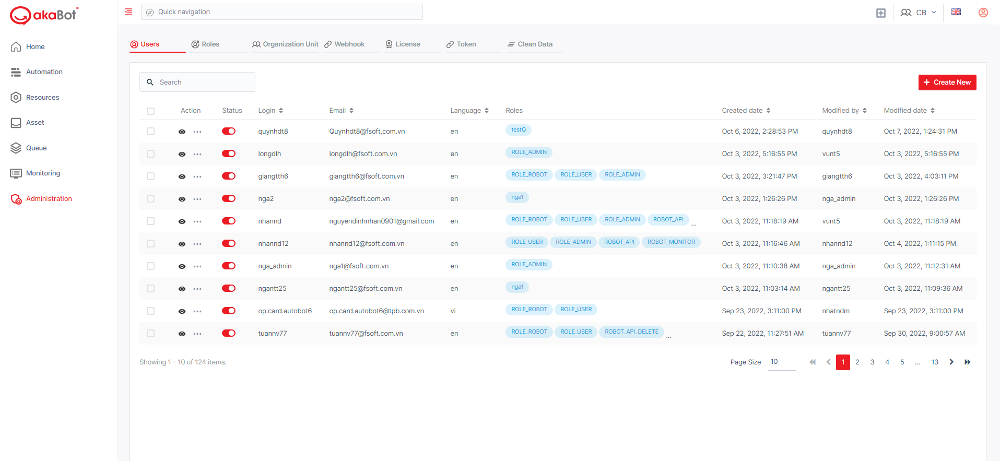
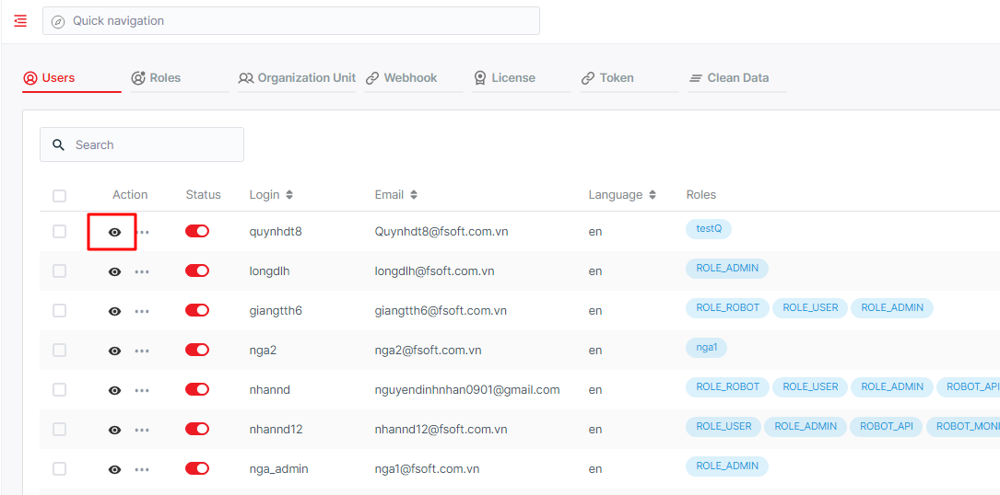
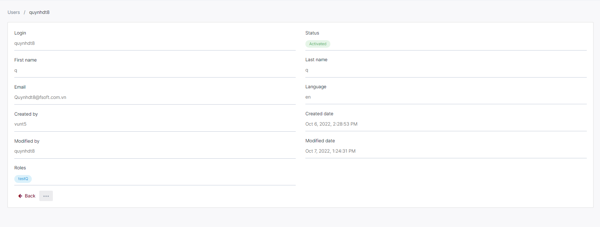
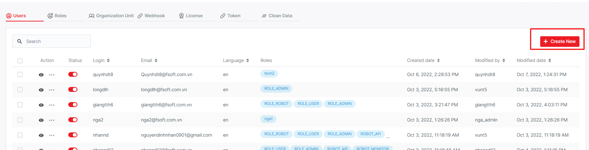
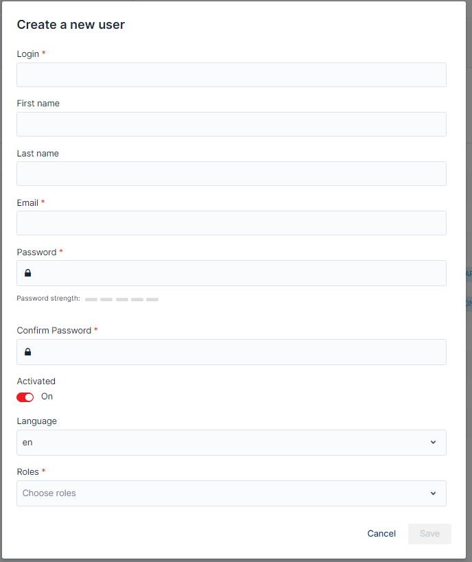
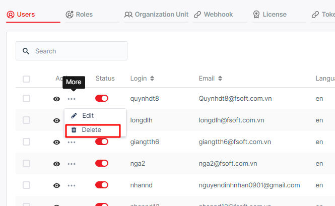

#  ユーザー管理

ユーザーとは、アクセス権に応じた機能を持つエンティティです。akaBot Center での表示範囲と操作権限は、ユーザーに割り当てられたロールによって決まります。ユーザーは Center で作成できます。

このページには、使用できるすべてのユーザーが表示され、管理者はユーザーを追加、削除したり、ユーザー情報を更新したりできます。

**User Management（ユーザー管理）** タブを選択すると、次のページが表示されます。

| No | 列 | 説明 |
| --- | --- | --- |
| 1 | Action（アクション） | ユーザーを管理するために使用できるアクションです。内容：**Edit（編集）**：ユーザーの詳細を表示できます。**Delete（削除）**：選択したユーザーを削除できます。 |
| 2 | Login（ログイン） | サインインに使用するユーザー名です。 |
| 3 | Email（メール） | ユーザーのメール アドレスです。akaBot Center へのログインにも使用できます。 |
| 4 | Status（ステータス） | ユーザーのステータスです。Activated（有効）または Deactivated（無効）にできます。 |
| 5 | Language（言語） | ユーザーが使用する akaBot Center の表示言語です。 |
| 6 | Profiles（プロフィール） | ユーザーに割り当てられたロールです。既定のロールは次の 3 つです：ROLE\_ADMIN、ROLE\_USER、ROLE\_ROBOT。ユーザーは複数のロールを持つことができます。各ロールの権限の詳細は、[ロール管理](./role-management.md)で説明しています。 |
| 7 | Created date（作成日） | ユーザーが作成された日付です。 |
| 8 | Modified by（変更者） | ユーザー情報を最後に変更した人です。 |
| 9 | Modified date（変更日） | ユーザー情報が最後に変更された日付です。 |

## **a. ユーザーの表示**

ユーザーの詳細を表示するには、目のアイコンのボタンをクリックします。

| No | 列 | 説明 |
| --- | --- | --- |
|  | Login（ログイン） | サインインに使用するユーザー名です。 |
|  | Status（ステータス） | ユーザーのステータスです。Activated（有効）または Deactivated（無効）にできます。 |
|  | First name（名） | ユーザーの名です。 |
|  | Last name（姓） | ユーザーの姓です。 |
|  | Email（メール） | ユーザーのメール アドレスです。akaBot Center へのログインにも使用できます。 |
|  | Language（言語） | ユーザーごとの akaBot Center の表示言語です。 |
|  | Created by（作成者） | このユーザーを作成したユーザーです。 |
|  | Created date（作成日） | ユーザーが作成された日付です。 |
|  | Modified by（変更者） | ユーザー情報を最後に変更した人です。 |
|  | Modified date（変更日） | ユーザー情報が最後に変更された日付です。 |
|  | Profiles（プロフィール） | ユーザーに割り当てられたロールです。既定のロールは次の 3 つです：ROLE\_ADMIN、ROLE\_USER、ROLE\_ROBOT。ユーザーは複数のロールを持つことができます。各ロールの権限の詳細は、[ロール管理](./role-management.md)で説明しています。 |

## **b. ユーザーの作成/編集**

新しいユーザーを作成するには、**User（ユーザー）** ページの上部にある **Create new（新規作成）** をクリックします。

**Create New（新規作成）** または **Edit（編集）** ボタンをクリックすると、入力用のフォームが表示されます。詳細は次の表のとおりです。

| No | 列/ラベル | 説明 | 種類 | 最大値 | 必須 | 入力条件 |
| --- | --- | --- | --- | --- | --- | --- |
| 1 | Login（ログイン） | 作成または編集するユーザーが、システムへのログインに使用するユーザー名を入力します。 | 文字列 | 50 | はい |  |
| 2 | First Name（名） | ユーザーの名を入力します。 | 文字列 | 50 | はい |  |
| 3 | Last Name（姓） | ユーザーの姓を入力します。 | 文字列 | 50 | はい |  |
| 4 | Email（メール） | ユーザーのメール アドレスを入力します。 | 文字列 | 100 | はい |  |
| 5 | Password（パスワード） | 新規作成時のみ使用できます。ユーザーのパスワードを入力します。 | 文字列 | 50 | はい |  |
| 6 | Confirm Password（パスワードの確認） | 新規作成時のみ使用できます。ユーザーのパスワードを再入力します。 | 文字列 | 50 | はい |  |
| 7 | Activated（有効化） | 作成時にこのユーザーを有効にする場合に選択します。 | チェックボックス |  | いいえ |  |
| 8 | Language（言語） | ユーザーの言語を選択します。 | ドロップダウン リスト（単一選択） |  | はい |  |
| 9 | Profiles（プロフィール） | ユーザーに割り当てるロールを選択します。 | 複数選択 |  | はい |  |

フォームに入力したら、**Save（保存）** ボタンをクリックして保存すると、ユーザーが作成されます。**Cancel（キャンセル）** ボタンをクリックして、ユーザーの作成をキャンセルすることもできます。

## **c. ユーザーの削除**

ユーザーを削除するには、対象のユーザーの **Delete（削除）** ボタンをクリックします。

確認のポップアップが表示されます。**Delete（削除）** をクリックして操作を完了します。
