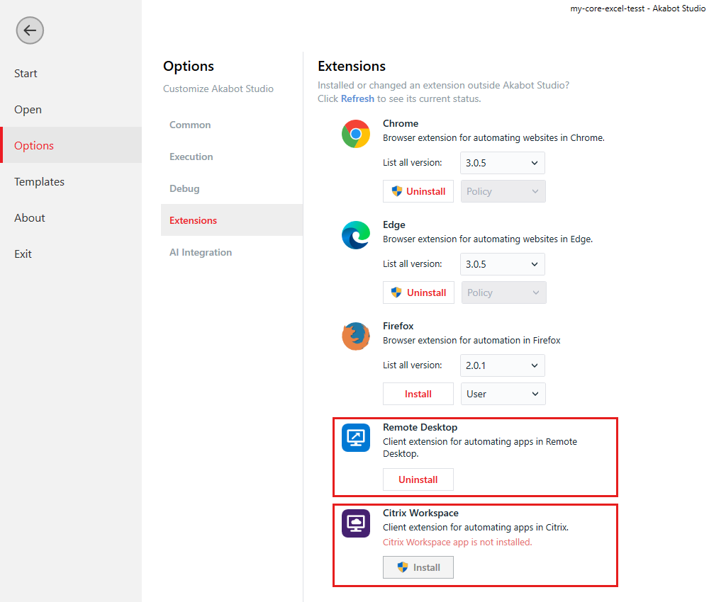
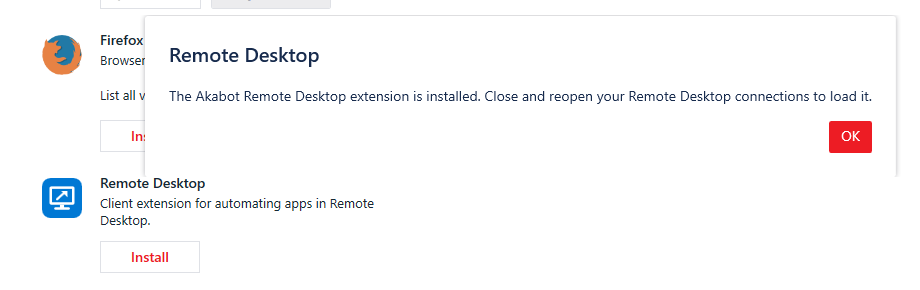
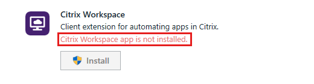
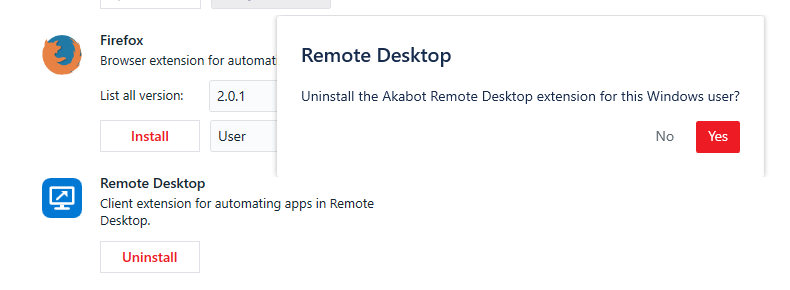

# Akabot リモート デスクトップ拡張機能と Citrix 拡張機能のインストール方法

## 1. はじめに \{#1-introduction}
アプリケーションが **リモート デスクトップ (RDP)** または **Citrix** のセッション内で動作している場合、Akabot Studio と Robot にはセッションの画像しか見えません。そのアプリケーションの要素を検出して操作する (画面上で指定、クリック、文字を入力、テキストを取得など) には、セッションを通じて互いに通信する次の 2 つが必要です。

| 構成要素 | インストール先 | インストール方法 |
|---|---|---|
| **リモート デスクトップ拡張機能** または **Citrix 拡張機能** (クライアント) | **ローカルのコンピューター**: セッションを **開く** 側のコンピューター (Akabot Studio または Robot が動作するコンピューター) | Akabot Studio の **オプション / 拡張機能** ([セクション 3](#3-install-the-remote-desktop-extension) と [セクション 4](#4-install-the-citrix-extension) を参照) |
| **akaBot Remote Runtime** (サーバー) | **リモート側のコンピューター**: リモート デスクトップ ホストまたは Citrix VDA (Virtual Delivery Agent) | インストーラー `AkabotRemoteRuntime-<バージョン>-x64.exe` ([セクション 5](#5-install-akabot-remote-runtime-on-the-remote-machine) を参照) |

両方が必要です。Studio のインストーラーは Remote Runtime をインストールせず、Remote Runtime のインストーラーはリモート デスクトップ拡張機能や Citrix 拡張機能をインストールしません。

## 2. 前提条件 \{#2-prerequisites}

### 2.1 ローカルのコンピューター (Studio または Robot) \{#21-local-machine-studio-or-robot}
- Windows 10/11、Windows Server 2016/2019/2022。
- Akabot Studio がインストールされている (サポートされているバージョン)。
- **リモート デスクトップ:** セッションを開くのにリモート デスクトップ接続 (`mstsc.exe`) を使用します。管理者権限は不要です。拡張機能は現在の Windows ユーザーにだけインストールされます。
- **Citrix:** **Citrix Workspace アプリ** がインストールされている。管理者権限が必要です。拡張機能はコンピューター全体にインストールされます。

### 2.2 リモート側のコンピューター (リモート デスクトップ ホストまたは Citrix VDA) \{#22-remote-machine-remote-desktop-host-or-citrix-vda}
- 64 ビット版 Windows。
- Remote Runtime をインストールするための **管理者権限** のあるアカウント。
- リモート側のコンピューターにコピーした Remote Runtime のインストーラー `AkabotRemoteRuntime-<バージョン>-x64.exe`。お使いの Akabot Studio に対応するバージョンを使用してください。
- **Citrix のみ:** Citrix ポリシー **仮想チャネル許可リスト** (Virtual channel allow list) を変更する権限、またはそれを変更できる Citrix 管理者 ([セクション 6](#6-citrix-allow-the-akabot-virtual-channel) を参照)。

### 2.3 手順の概要 \{#23-overview-of-the-steps}
| 手順 | リモート デスクトップ | Citrix |
|---|---|---|
| 1. ローカルのコンピューターにクライアント拡張機能をインストールする | [セクション 3](#3-install-the-remote-desktop-extension) | [セクション 4](#4-install-the-citrix-extension) |
| 2. リモート側のコンピューターに Remote Runtime をインストールする | [セクション 5](#5-install-akabot-remote-runtime-on-the-remote-machine) | [セクション 5](#5-install-akabot-remote-runtime-on-the-remote-machine) |
| 3. akaBot 仮想チャネルを許可する | — | [セクション 6](#6-citrix-allow-the-akabot-virtual-channel) |
| 4. セッションを開き直して確認する | [セクション 7](#7-check-the-installation) | [セクション 7](#7-check-the-installation) |

## 3. リモート デスクトップ拡張機能をインストールする \{#3-install-the-remote-desktop-extension}
**ローカルのコンピューター** で、リモート デスクトップ接続を開く Windows ユーザーとして行います (無人 Robot の場合は Robot のアカウントでサインインします)。

### 3.1 Akabot Studio からインストールを起動する \{#31-launch-installation-from-akabot-studio}
- Akabot Studio を開きます。
- **オプション / 拡張機能** に移動します。
- **リモート デスクトップ** のカード (*「リモート デスクトップでアプリを自動化するためのクライアント拡張機能。」*) を探します。



- **「インストール」** をクリックします。**ユーザー アカウント制御** は表示されません。

![リモート デスクトップのカードの [インストール] ボタン](/static/img/studio-rdp-extension-install.png)

- *「Akabot リモート デスクトップ拡張機能をインストールしました。読み込むには、リモート デスクトップ接続を閉じてから開き直してください。」* というメッセージが表示されたら、**「OK」** をクリックします。



インストール後、カードのボタンは **アンインストール** に変わります。

### 3.2 拡張機能を読み込む \{#32-load-the-extension}
- 開いているリモート デスクトップ接続をすべて閉じてから、もう一度開きます。リモート デスクトップ接続は、接続の開始時にだけ拡張機能を読み込みます。

> **注:** 拡張機能は **現在の Windows ユーザー** にだけインストールされます (`HKEY_CURRENT_USER\Software\Microsoft\Terminal Server Client\Default\AddIns`)。自動化のためにリモート デスクトップ接続を開く Windows ユーザーは、それぞれ自分のアカウントでインストールする必要があります。

## 4. Citrix 拡張機能をインストールする \{#4-install-the-citrix-extension}
Citrix Workspace アプリがインストールされている **ローカルのコンピューター** で行います。

### 4.1 Akabot Studio からインストールを起動する \{#41-launch-installation-from-akabot-studio}
- Akabot Studio を開きます。
- **オプション / 拡張機能** に移動します。
- **Citrix Workspace** のカード (*「Citrix でアプリを自動化するためのクライアント拡張機能。」*) を探します。
- **「インストール」** をクリックし、Windows の **ユーザー アカウント制御** で **[はい]** をクリックします。
- *「Akabot Citrix 拡張機能をインストールしました。読み込むには、Citrix セッションを閉じてから開き直してください。」* というメッセージが表示されたら、**「OK」** をクリックします。

インストール後、カードのボタンは **アンインストール** に変わります。

> **注:** Citrix Workspace アプリがインストールされていない場合、カードに *「Citrix Workspace アプリがインストールされていません。」* と表示され、**[インストール]** ボタンは無効になります。先に Citrix Workspace アプリをインストールしてから、**拡張機能** ページの **[更新]** をクリックしてください。



### 4.2 拡張機能を読み込む \{#42-load-the-extension}
- 開いている Citrix セッションをすべて閉じてから、もう一度開きます。Citrix Workspace アプリは、セッションの開始時にだけ拡張機能を読み込みます。

> **注:** 拡張機能は **コンピューター全体** に、Citrix Workspace アプリの構成としてインストールされます。コンピューターのすべての Windows ユーザーが使用できます。

## 5. リモート側のコンピューターに akaBot Remote Runtime をインストールする \{#5-install-akabot-remote-runtime-on-the-remote-machine}
**リモート デスクトップ ホスト** または **Citrix VDA** で行います。複数の VDA がある Citrix 環境 (またはマスター イメージから作成したマシン カタログ) では、すべての VDA、またはマスター イメージに Remote Runtime をインストールしてください。

### 5.1 セットアップ ウィザードでインストールする \{#51-install-with-the-setup-wizard}
1. 管理者権限のあるアカウントでリモート側のコンピューターにサインインします。
2. `AkabotRemoteRuntime-<バージョン>-x64.exe` をダブルクリックします。*「このアプリがデバイスに変更を加えることを許可しますか?」* と表示されたら、**[はい]** をクリックします。
3. インストール先フォルダーを選択するか、既定の `C:\Program Files\FPT Software\akaBot Remote Runtime` のままにして、**Next** をクリックします。
4. コンポーネントを選択します。

   | コンポーネント | 意味 |
   |---|---|
   | **akaBot Remote Runtime Core Server** | 常にインストールされます。 |
   | **Chrome extension** | セッション **内** の Chrome 用の akaBot 拡張機能。リモート側のコンピューターの Chrome で Web ページを自動化するのに必要です。 |
   | **Edge extension** | Microsoft Edge 用の同じ拡張機能。 |

   **Full installation** はすべてのコンポーネントを選択します。**Compact installation** はサーバーだけをインストールします。ここで選択したブラウザー拡張機能は **User** モードで、各 Windows ユーザーの初回サインイン時にインストールされます。
5. **Next** をクリックし、**Install** をクリックします。
6. **Citrix VDA のみ:** ウィザードに *"Citrix VDA detected. Add this entry to the Citrix policy "Virtual channel allow list", then restart this machine:"* と、追加するエントリが表示されます。エントリをコピーし、[セクション 6](#6-citrix-allow-the-akabot-virtual-channel) を参照してください。
7. **Finish** をクリックします。Remote Runtime が現在のセッションで起動し、以降はユーザーがリモート側のコンピューターにサインインすると自動的に起動します。

### 5.2 コマンド ラインからインストールする \{#52-install-from-the-command-line}
ウィザードを使わずにインストールする場合、多数のコンピューターにインストールする場合、またはブラウザー拡張機能を **Policy** や **ポリシー (オフライン)** モードでインストールする場合は、コマンド ラインを使用します。たとえば、**管理者として実行** で開いたコマンド プロンプトで次のように実行します。

```bat
AkabotRemoteRuntime-3.3.0.0-x64.exe /EXTMODE=policy /VERYSILENT /SUPPRESSMSGBOXES /NORESTART /LOG="C:\Windows\Temp\akabot-rr-setup.log"
```

すべてのオプションについては、[コマンド ラインから akaBot Remote Runtime をインストールする](./install-remote-runtime-from-command-line.md) を参照してください。

## 6. Citrix: akaBot 仮想チャネルを許可する \{#6-citrix-allow-the-akabot-virtual-channel}
リモート デスクトップの場合、このセクションは省略してください。

Citrix Virtual Apps and Desktops 7 2109 以降、カスタム仮想チャネルは既定ですべてブロックされます。Remote Runtime が Citrix セッションで動作するのは、Citrix ポリシー **[仮想チャネル許可リスト](https://docs.citrix.com/ja-jp/citrix-virtual-apps-desktops/current-release/policies/reference/ica-policy-settings/virtual-channel-allow-list-policy-settings.html)** に次のエントリが含まれている場合だけです。

```text
AKABOT,C:\Program Files\FPT Software\akaBot Remote Runtime\AkaBot.RemoteRuntime.Server.exe
```

- Remote Runtime を別のフォルダーにインストールした場合は、そのフォルダーの `AkaBot.RemoteRuntime.Server.exe` のパスを使用してください。
- インストーラーは、VDA 自体に保存されている許可リストにこのエントリを追加します。会社が Citrix ポリシー (Citrix Studio またはグループ ポリシー) で許可リストを管理している場合、次回のポリシー更新でそのリストが置き換えられ、エントリが削除されます。エントリを維持するには、**Citrix 管理者に依頼して Citrix ポリシーにエントリを追加してください**。
- 許可リストを変更したら、Citrix VDA を再起動してください。

詳しくは、[Citrix: akaBot 仮想チャネルを許可する](./install-remote-runtime-from-command-line.md#14-citrix-allow-the-akabot-virtual-channel) を参照してください。

## 7. インストールを確認する \{#7-check-the-installation}

### 7.1 ローカルのコンピューター \{#71-on-the-local-machine}
- Akabot Studio で **オプション / 拡張機能** に移動し、**[更新]** をクリックします。
- **リモート デスクトップ** または **Citrix Workspace** のカードに **アンインストール** ボタンが表示され、カードの下にメッセージがないことを確認します。

### 7.2 リモート側のコンピューター \{#72-on-the-remote-machine}
**管理者として実行** で開いたコマンド プロンプトで、次を実行します。

```bat
"C:\Program Files\FPT Software\akaBot Remote Runtime\Setup\AkaBot.RemoteRuntime.Setup.exe" runtime validate
```

サインイン タスク (Citrix VDA の場合は許可リストのエントリも) が設定されていれば、`Remote Runtime validation passed.` と表示されます。

### 7.3 画面上で指定を試す \{#73-try-indicate}
1. ローカルのコンピューターで、リモート側のコンピューターへの新しいリモート デスクトップ接続または Citrix セッションを開きます。
2. Akabot Studio で **クリック** などのアクティビティを追加し、**画面上で指定** をクリックします。
3. セッション内のアプリケーションの要素をポイントします。セッションのウィンドウ全体ではなく要素が強調表示され、セレクターにリモート側のコンピューターのアプリケーションが記述されます。

## 8. アンインストール \{#8-uninstall}
- **リモート デスクトップ拡張機能:** **オプション / 拡張機能** で、**リモート デスクトップ** のカードの **[アンインストール]** をクリックし、**[はい]** をクリックします。開いている接続からは、接続を閉じたときに削除されます。

  

- **Citrix 拡張機能:** **オプション / 拡張機能** で、**Citrix Workspace** のカードの **[アンインストール]** をクリックし、**[はい]** をクリックしてから、**ユーザー アカウント制御** で **[はい]** をクリックします。開いているセッションからは、セッションを閉じたときに削除されます。
- **Remote Runtime:** リモート側のコンピューターで **設定 > アプリ > インストールされているアプリ** を開き、**akaBot Remote Runtime** を探して **[アンインストール]** をクリックします。登録されたブラウザー拡張機能も削除されます。Citrix の許可リストはそのまま残ります。

Akabot Studio を開かずにクライアント拡張機能をインストールまたは削除するには、コマンド ラインを使用します。[akaBot Commander: リモート デスクトップと Citrix の拡張機能](../user-guide/akabot-commander.md#74-remote-desktop-and-citrix-extensions) を参照してください。Studio のインストーラーで `/REMOTEEXT=rdp,citrix` を指定してインストールすることもできます ([コマンド ラインから akaBot Platform をインストールする](./install-akabot-platform-from-command-line.md#remote-desktop-and-citrix-extensions-remoteext) を参照)。

## 9. トラブルシューティング \{#9-troubleshooting}
| 問題 | 原因 | 解決方法 |
|---|---|---|
| カードに *「Commander.exe が見つかりません。Studio を修復または再インストールしてください。」* と表示される | Studio のインストールが不完全です。 | Akabot Studio を修復または再インストールしてください。 |
| **リモート デスクトップ** のカードに *「拡張機能のファイルが見つかりません。Studio を修復または再インストールしてください。」* と表示される | Studio のインストール フォルダー (`RemoteRuntime\Client`) に拡張機能のファイルがありません。 | Akabot Studio を修復または再インストールしてください。 |
| **Citrix Workspace** のカードに *「Citrix Workspace アプリがインストールされていません。」* と表示され、**[インストール]** が無効になっている | ローカルのコンピューターに Citrix Workspace アプリがインストールされていません。 | Citrix Workspace アプリをインストールしてから、**[更新]** をクリックしてください。 |
| **Citrix Workspace** のカードに *「古いバージョンです。アンインストールしてから、もう一度インストールしてください。」* と表示される | インストールされている拡張機能が、この Studio に同梱されているものより古いバージョンです (Studio のアップグレード後など)。 | **[アンインストール]** をクリックしてから **[インストール]** をクリックし、Citrix セッションを開き直してください。 |
| カードに *「確認に失敗しました: ... [更新] をクリックして再試行してください。」* と表示される | Akabot Studio が拡張機能の状態を読み取れませんでした。 | **[更新]** をクリックしてください。メッセージが消えない場合は、*「確認に失敗しました:」* の後のテキストを確認してください。 |
| **[インストール]** または **[アンインストール]** のクリック後に *「操作に失敗しました: ...」* と表示される | 拡張機能を登録または削除できませんでした。*「操作に失敗しました:」* の後のテキストに理由が表示されます。 | Citrix の場合は、**ユーザー アカウント制御** で **[はい]** をクリックしてください (管理者権限が必要です)。Citrix Workspace アプリを終了してから、もう一度試してください。 |
| 画面上で指定すると、要素ではなくセッションのウィンドウ全体が強調表示される | クライアント拡張機能が読み込まれていないか、セッション内で Remote Runtime が動作していません。 | セッションを閉じてから開き直してください。リモート側のコンピューターに Remote Runtime がインストールされていること、セッション内で **AkaBot.RemoteRuntime.Server.exe** が動作していること (リモート側のコンピューターのタスク マネージャー) を確認してください。 |
| *"Make sure Akabot Remote Runtime is installed and running"* と表示される | Remote Runtime がインストールされていないか、セッション内で起動していません。 | Remote Runtime をインストールしてください ([セクション 5](#5-install-akabot-remote-runtime-on-the-remote-machine))。インストール済みの場合は、リモート セッションからサインアウトして、もう一度サインインしてください。 |
| リモート デスクトップでは動作するが、Citrix では動作しない | akaBot 仮想チャネルが Citrix ポリシーでブロックされています。 | **仮想チャネル許可リスト** にエントリを追加し、VDA を再起動してください ([セクション 6](#6-citrix-allow-the-akabot-virtual-channel))。 |
| インストール直後は Citrix で動作したが、後で (翌日など) 動作しなくなった | 会社の Citrix ポリシーが VDA の許可リストを置き換え、akaBot のエントリが削除されました。 | Citrix 管理者に依頼して Citrix ポリシー **仮想チャネル許可リスト** にエントリを追加してもらい、VDA を再起動してください。 |
| 同じローカルのコンピューターの別の Windows ユーザーがリモート デスクトップを自動化できない | リモート デスクトップ拡張機能はユーザーごとにインストールされます。 | そのユーザーでサインインし、拡張機能をもう一度インストールしてください ([セクション 3](#3-install-the-remote-desktop-extension))。 |
| セッション内の Web ページを自動化できない | リモート側のコンピューターのブラウザーにブラウザー拡張機能がインストールされていません。 | **Chrome extension** / **Edge extension** コンポーネントを選択して、または `/EXTMODE` を指定して Remote Runtime をインストールしてください ([セクション 5.2](#52-install-from-the-command-line))。その後、セッション内でブラウザーを開き直してください。 |
