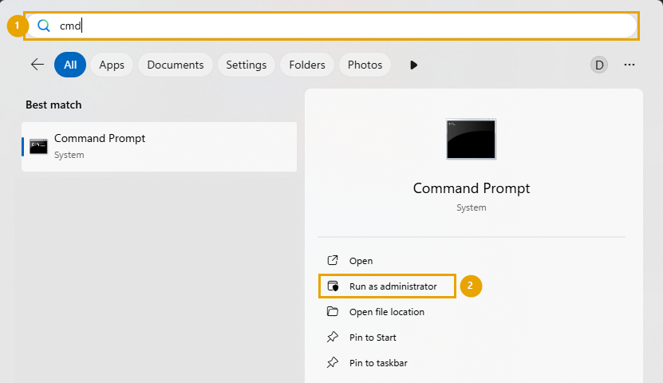
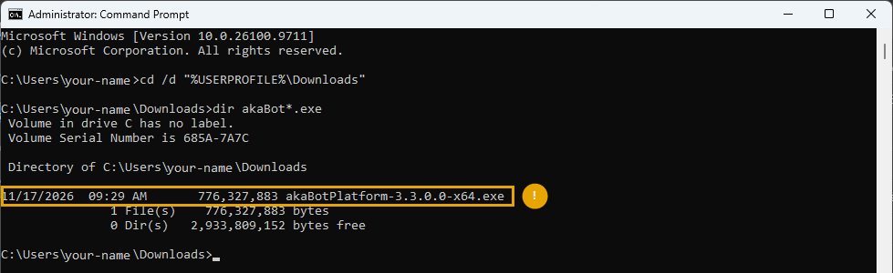
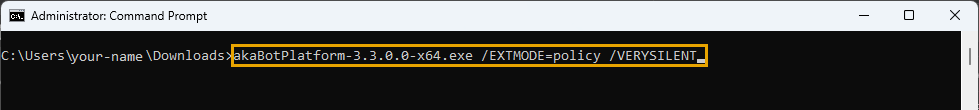
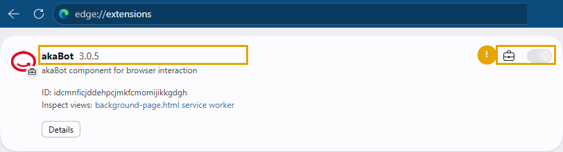
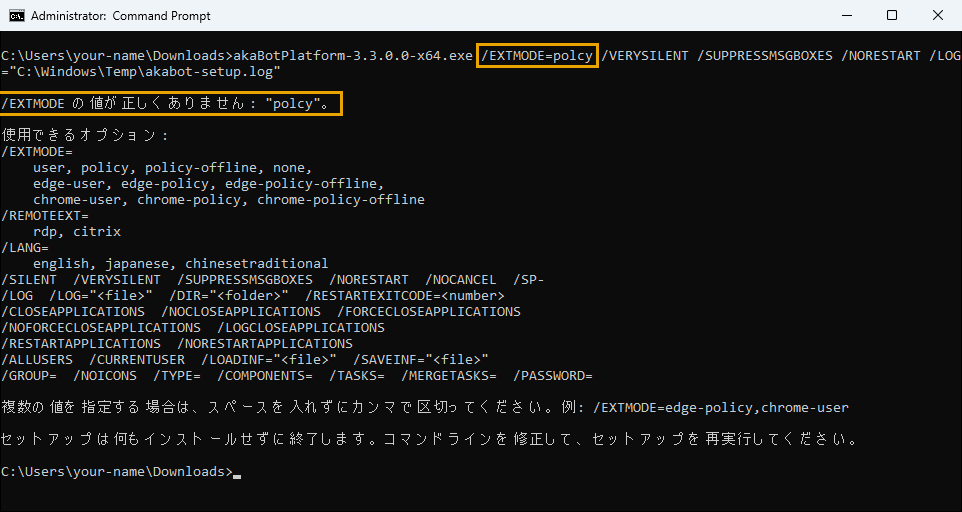
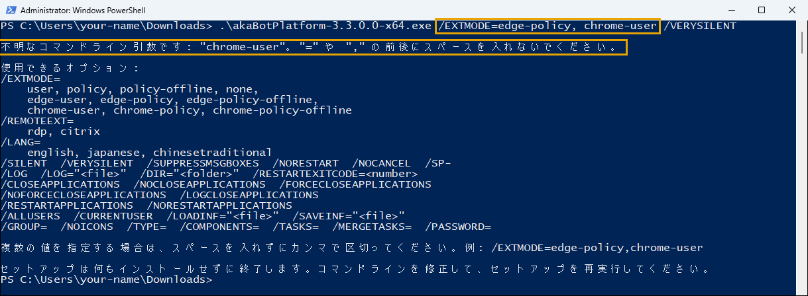

# コマンド ラインから akaBot Platform をインストールする

このガイドでは、**コマンドを 1 つ入力するだけ**で **akaBot Platform** をインストールする方法を説明します。同じコマンドで、akaBot ブラウザー拡張機能も **Microsoft Edge** と **Google Chrome** に、選んだモードで追加されます。

専門知識は必要ありません。次の 4 つの手順を 1 つずつ進めてください。

## 始める前に \{#before-you-start}

- **Edge と Chrome の作業を保存してください。** インストーラーはこれらを自動的に閉じます。
- **インストーラーをダウンロードしてください。** 通常は **ダウンロード** フォルダーにあります。ファイル名は `akaBotPlatform-3.3.0.0-x64.exe` のような形です (数字は異なる場合があります)。
- コンピューターの **管理者権限** が必要です。権限がない場合は、IT 部門に依頼してください。

## 手順 1. コマンド プロンプトを管理者として開く \{#step-1-open-the-command-prompt-as-administrator}

1. **スタート** ボタン (Windows ロゴ) をクリックし、`cmd` と入力します (図の枠 **1**)。
2. 右側の **管理者として実行** をクリックします (枠 **2**)。
3. *「このアプリがデバイスに変更を加えることを許可しますか?」* と表示されたら、**はい** をクリックします。

黒いウィンドウが開きます。タイトルは **管理者:** (英語版 Windows では **Administrator:**) で始まります。



## 手順 2. ダウンロード フォルダーに移動する \{#step-2-go-to-the-downloads-folder}

次の行をコピーして黒いウィンドウに貼り付け (右クリックで貼り付けられます)、**Enter** キーを押します。

```bat
cd /d "%USERPROFILE%\Downloads"
```

次に、インストーラーがあることを確認します。コピーして貼り付け、**Enter** キーを押します。

```bat
dir akaBot*.exe
```

一覧にインストーラーのファイル名が表示されます (オレンジ色の枠)。手順 3 で使うので、正確な名前を覚えておいてください。

図の `your-name` の部分には、お使いの Windows のユーザー名が表示されます。



> **ヒント:** インストーラーを別の場所に保存した場合は、1 行目のフォルダーを変更してください。たとえば `D:\Setup` の場合:
> `cd /d "D:\Setup"`

## 手順 3. インストール コマンドをコピーして実行する \{#step-3-copy-and-run-the-install-command}

次のコマンドをコピーして黒いウィンドウに貼り付け、**Enter** キーを押します。

**推奨コマンド:**

```bat
akaBotPlatform-3.3.0.0-x64.exe /EXTMODE=policy /VERYSILENT /SUPPRESSMSGBOXES /NORESTART /LOG="C:\Windows\Temp\akabot-setup.log"
```

> **重要:** ファイル名が異なる場合 (たとえば `akaBotPlatform-3.4.0.0-x64.exe`) は、コマンド内のファイル名を手順 2 で確認した名前に合わせて変更してください。

このコマンドで行われること:

- **ウィンドウを表示せずに** akaBot をインストールします (`/VERYSILENT`)。
- このコンピューターの **すべてのユーザーの Edge と Chrome** に akaBot 拡張機能を追加します (`/EXTMODE=policy`)。拡張機能は **常に有効** で、ユーザーは無効にしたり削除したりできません。
- **Edge と Chrome を自動的に閉じます。**
- **メッセージ ボックスを表示しません** (`/SUPPRESSMSGBOXES`)。問題が発生した場合、エラーはログ ファイルに書き込まれます (次の項目を参照)。
- コンピューターを **再起動しません** (`/NORESTART`)。
- インストール ログを `C:\Windows\Temp\akabot-setup.log` に書き込みます (`/LOG`)。インストーラーは、akaBot サービスとブラウザー拡張機能に関する 2 つ目のログも `C:\ProgramData\akaBot\Logs\<日付>_Aka.RPA.InstallerV2.log` (たとえば `2026-11-22_Aka.RPA.InstallerV2.log`) に書き込みます。インストールに失敗した場合は、この **2 つのログ ファイル** で原因を確認できます。



**Enter** キーを押しても、画面には何も表示されません。これは正常です。**5 分ほど待ってください**。黒いウィンドウはすぐに入力できる状態に戻りますが、インストールはバックグラウンドで続いています。スタート メニューに **akaBot** が表示されたら完了です。

> **黒いウィンドウにメッセージが表示された場合** (たとえば `不明なオプションです: /VERYSLIENT` や `/EXTMODE の値が正しくありません: "polcy"`)、コマンドに入力ミスがあります。インストーラーは何かをインストールする **前に** コマンドを確認するため、何もインストールされておらず、何も変更されていません。コマンドを修正して、もう一度実行してください。[入力のルール](#typing-rules) を参照してください。

## 手順 4. 拡張機能がインストールされたことを確認する \{#step-4-check-that-the-extension-is-installed}

1. **Edge** または **Chrome** を開きます。
2. アドレス バーに `edge://extensions` (Edge) または `chrome://extensions` (Chrome) と入力し、**Enter** キーを押します。
3. 次の点を確認します。
   - 一覧に **akaBot** がある。
   - スイッチの横に小さな **ブリーフケースのアイコン** があり、スイッチが **灰色** になっている。これは会社が拡張機能を管理していることを示し、拡張機能は常に有効で無効にできません。これが正しい状態です。



> **注:** 初回は、拡張機能が表示されるまで **1 分ほど** かかることがあります。表示されない場合は、ブラウザーを完全に閉じてから、もう一度開いてください。

## すべてのコマンド \{#all-commands}

推奨コマンドは **D** です。他のコマンドは必要な場合にだけ使用してください。

**用語の意味:**

- **User モード**: 通常の拡張機能と同じように追加されます。各ユーザーが無効にしたり削除したりできます。
- **Policy モード**: 会社がすべてのユーザーに追加します。常に有効で、ユーザーは削除できません。ブラウザーは Edge/Chrome のストアから拡張機能をダウンロードするため、コンピューターがインターネットに接続できる必要があります。
- **ポリシー (オフライン)**: Policy モードと同じですが、拡張機能はストアではなくインストーラー自体から追加されます。コンピューターがインターネットに接続できない場合に使用します。**会社が管理するコンピューター** (会社のドメインに参加しているか、Intune/MDM で管理されているコンピューター) でのみ動作します。
- **サイレント** (`/VERYSILENT`): ウィンドウも質問も表示しません。Edge と Chrome は自動的に閉じられます。

| | コマンド | 拡張機能のモード | 表示される質問 |
|---|---|---|---|
| **A** | `akaBotPlatform-3.3.0.0-x64.exe` | User モード | 「拡張機能をインストールしますか?」と「ブラウザーを閉じますか?」 |
| **B** | `akaBotPlatform-3.3.0.0-x64.exe /VERYSILENT` | User モード | なし。ブラウザーは自動的に閉じられます。 |
| **C** | `akaBotPlatform-3.3.0.0-x64.exe /EXTMODE=policy` | Policy モード | 「ブラウザーを閉じますか?」のみ |
| **D** ⭐ | `akaBotPlatform-3.3.0.0-x64.exe /EXTMODE=policy /VERYSILENT /SUPPRESSMSGBOXES /NORESTART /LOG="C:\Windows\Temp\akabot-setup.log"` | Policy モード | なし。ブラウザーは自動的に閉じられます。再起動しません。ログは `C:\Windows\Temp\akabot-setup.log` に書き込まれます。**(推奨)** |
| **E** | `akaBotPlatform-3.3.0.0-x64.exe /EXTMODE=user` | User モード | 「ブラウザーを閉じますか?」のみ |
| **F** | `akaBotPlatform-3.3.0.0-x64.exe /EXTMODE=edge-policy,chrome-user` | Edge: Policy モード<br/>Chrome: User モード | 「ブラウザーを閉じますか?」のみ |
| **G** | `akaBotPlatform-3.3.0.0-x64.exe /EXTMODE=none` | 拡張機能なし | 拡張機能に関する質問なし |
| **H** | `akaBotPlatform-3.3.0.0-x64.exe /EXTMODE=policy-offline` | ポリシー (オフライン) (ストアからダウンロードしない) | 「ブラウザーを閉じますか?」のみ |
| **I** | `akaBotPlatform-3.3.0.0-x64.exe /EXTMODE=policy-offline /VERYSILENT` | ポリシー (オフライン) (ストアからダウンロードしない) | なし。ブラウザーは自動的に閉じられます。 |
| **J** | `akaBotPlatform-3.3.0.0-x64.exe /EXTMODE=chrome-policy-offline,edge-user` | Chrome: ポリシー (オフライン)<br/>Edge: User モード | 「ブラウザーを閉じますか?」のみ |

> **注:** **G** (拡張機能なし) では、ロボットは Edge や Chrome の Web サイトを自動化できません。ブラウザーを自動化しない場合にだけ使用してください。

> **ヒント:** 他のサイレント コマンド (**B** と **I**) にも、**D** と同じ追加オプション `/SUPPRESSMSGBOXES /NORESTART /LOG="C:\Windows\Temp\akabot-setup.log"` を付けられます。エラー メッセージを表示せずにログ ファイルを残せるため、多数のコンピューターにインストールする場合に便利です。

### `/EXTMODE=` の後に指定できる値 \{#values-you-can-use-after-extmode}

| 値 | Edge | Chrome |
|---|---|---|
| `user` | User モード | User モード |
| `policy` | Policy モード | Policy モード |
| `policy-offline` | ポリシー (オフライン) | ポリシー (オフライン) |
| `none` | 拡張機能なし | 拡張機能なし |
| `edge-user` / `edge-policy` / `edge-policy-offline` | 選んだモード | — |
| `chrome-user` / `chrome-policy` / `chrome-policy-offline` | — | 選んだモード |

ブラウザーごとに異なるモードを使う場合は、Edge の値と Chrome の値を 1 つずつ、**スペースを入れずに** カンマで区切って指定します。例: `/EXTMODE=edge-policy,chrome-user`

> **注:** このインストーラーでは `policy-offline` を **ハイフン付き** で指定します。Remote Runtime のインストーラーでは綴りが異なります (`policyoffline`、ハイフンなし)。[コマンド ラインから akaBot Remote Runtime をインストールする](./install-remote-runtime-from-command-line.md#11-extmode-browser-extensions) を参照してください。

### 入力のルール \{#typing-rules}

- すべてのオプションは `-` ではなく `/` で始めます (`-VERYSILENT` ではなく `/VERYSILENT`)。
- 各 `/` の前には **スペースを 1 つ** 入れます。
- `=` や `,` の前後にスペースを **入れません**。
- スペースを含むパスは引用符で囲みます: `/LOG="C:\My Logs\akabot-setup.log"`
- 複数の値は **カンマ** だけで区切ります (`;` は使えません): `/EXTMODE=edge-policy,chrome-user`、`/REMOTEEXT=rdp,citrix`

> **ヒント:** インストーラーで使用できるすべてのオプションを確認するには、`/HELP` を付けて実行します。
> `akaBotPlatform-3.3.0.0-x64.exe /HELP`
> ウィンドウに標準のオプションが表示され、最後に akaBot のオプション (`/EXTMODE`、`/REMOTEEXT`) とその値が表示されます。何もインストールされません。

インストーラーは、何かをインストールする **前に** コマンド全体を確認します。オプション名のスペルが間違っている (たとえば `/VERYSLIENT`)、値が一覧にない (たとえば `/EXTMODE=polcy`)、値がない (`/EXTMODE` だけ)、または入れてはいけない場所にスペースがある場合、インストーラーは **停止します**:

- 問題の内容と使用できるオプションの一覧を **黒いウィンドウ** と `/LOG` で指定したログ ファイルに表示します。
- **メッセージ ボックスは、閉じる人がいる場合にだけ表示します**。つまり、コマンド ウィンドウを使わずに (たとえばショートカットから) 起動され、サイレントで実行されていない場合です。サイレント (`/SILENT`、`/VERYSILENT`) で実行された場合、SYSTEM アカウントで実行された場合、展開ツール (SCCM、Intune、Citrix や RDS のイメージ作成) から実行された場合は表示しないため、無人インストールがクリック待ちで止まることはありません。
- 何も **インストールせず**、何も変更しません。以前の akaBot がインストールされている場合は、そのまま残ります。
- **終了コード 1** で終了します。

メッセージは Windows の表示言語で表示されます (日本語の Windows では日本語、英語の Windows では英語)。

**コマンド プロンプトでの例。** `polcy` は `policy` の入力ミスです。メッセージの 1 行目が問題の内容 (オレンジ色の枠) で、その下の一覧が使用できるオプションと値です。



**Windows PowerShell での例。** カンマの後にスペースがあります。PowerShell はスペースの位置で値を分割するため、インストーラーは `chrome-user` を別の語として受け取り、それを報告します。



> **注:** コマンド プロンプトと PowerShell はインストーラーの終了を待たないため、メッセージが次のプロンプト行 (`C:\Users\your-name\Downloads>`) の直後に表示されることがあります。これは正常です。

> **スクリプトの場合:** インストーラーの終了を待って終了コード (`0` = インストール完了、`1` = コマンドの誤り、またはセットアップを開始できなかった) を取得するには、`start /wait` を使用します。
>
> ```bat
> start "" /wait akaBotPlatform-3.3.0.0-x64.exe /EXTMODE=policy /VERYSILENT /SUPPRESSMSGBOXES /NORESTART /LOG="C:\Windows\Temp\akabot-setup.log"
> echo %ERRORLEVEL%
> ```

| | 例 | インストーラーのメッセージ (日本語の Windows) |
|---|---|---|
| ✅ 正しい | `akaBotPlatform-3.3.0.0-x64.exe /EXTMODE=policy /VERYSILENT /SUPPRESSMSGBOXES /NORESTART /LOG="C:\Windows\Temp\akabot-setup.log"` | インストールされます |
| ❌ 誤り | `akaBotPlatform-3.3.0.0-x64.exe /EXTMODE=polcy` | `/EXTMODE の値が正しくありません: "polcy"。` |
| ❌ 誤り | `akaBotPlatform-3.3.0.0-x64.exe /VERYSLIENT` | `不明なオプションです: /VERYSLIENT。スペルを確認してください。` |
| ❌ 誤り | `akaBotPlatform-3.3.0.0-x64.exe -VERYSILENT` | `オプションは "-" ではなく "/" で始めます。-VERYSILENT ではなく /VERYSILENT と指定してください。` |
| ❌ 誤り | `akaBotPlatform-3.3.0.0-x64.exe /EXTMODE = policy` | `/EXTMODE に値がありません。/EXTMODE=<値> の形式で、"=" の前後にスペースを入れずに指定してください。` |
| ❌ 誤り | `akaBotPlatform-3.3.0.0-x64.exe /EXTMODE=edge-policy, chrome-user` | コマンド プロンプト: `/EXTMODE の値が正しくありません: "edge-policy,"。`<br/>PowerShell: `不明なコマンドライン引数です: "chrome-user"。` |
| ❌ 誤り | `akaBotPlatform-3.3.0.0-x64.exe /VERYSILENT=yes` | `/VERYSILENT には値を指定できません。"=" を付けずに指定してください。` |

## リモート デスクトップと Citrix の拡張機能 (/REMOTEEXT) \{#remote-desktop-and-citrix-extensions-remoteext}

リモート デスクトップまたは Citrix のセッション内のアプリケーションを自動化するには、セッションを **開く** コンピューター (Studio または Robot が動作するコンピューター) に、akaBot のリモート デスクトップ拡張機能または Citrix 拡張機能が必要です。Studio のインストーラーは、これらの拡張機能を常にコピーします。`/REMOTEEXT` を指定すると、登録も行います。

リモート側のコンピューター (リモート デスクトップ ホストまたは Citrix VDA) には **akaBot Remote Runtime** が必要です。これには専用のインストーラーがあります。[コマンド ラインから akaBot Remote Runtime をインストールする](./install-remote-runtime-from-command-line.md) を参照してください。

> **Citrix:** Citrix VDA では、**仮想チャネル許可リスト (Virtual channel allow list)** にエントリも必要です。Remote Runtime のインストーラーは VDA にこのエントリを追加しますが、Citrix ポリシーを一元管理している会社では、後でポリシーによって削除されることがあります。Citrix 管理者に依頼して、Citrix ポリシーにも追加してもらってください。[Citrix: akaBot 仮想チャネルを許可する](./install-remote-runtime-from-command-line.md#14-citrix-allow-the-akabot-virtual-channel) を参照してください。

| オプション | 動作 |
|---|---|
| *(`/REMOTEEXT` なし)* | 拡張機能をコピーするだけです (インストール フォルダーの `RemoteRuntime\Client\x86`、`\x64`、`RemoteRuntime\Client\Citrix\x86`、`\x64`)。何も登録されません。 |
| `/REMOTEEXT=rdp` | セットアップを実行したユーザーにリモート デスクトップ拡張機能を登録し、他の Windows ユーザーには次回サインイン時に登録します (Active Setup)。 |
| `/REMOTEEXT=citrix` | コンピューター全体に Citrix 拡張機能を登録します。Citrix Workspace アプリがインストールされていない場合はスキップされます。 |
| `/REMOTEEXT=rdp,citrix` | 両方を登録します。 |

例:

```bat
akaBotPlatform-3.3.0.0-x64.exe /VERYSILENT /SUPPRESSMSGBOXES /NORESTART /REMOTEEXT=rdp,citrix /LOG="C:\Windows\Temp\akabot-setup.log"
```

これらの拡張機能は、後から **Studio > オプション > 拡張機能** または [akaBot Commander](../user-guide/akabot-commander.md) (`install-rdp`、`install-citrix`) で登録・削除することもできます。

## 知っておくと便利なこと \{#good-to-know}

- **akaBot の更新:** `/EXTMODE` を **指定せずに** 新しいバージョンをインストールすると、拡張機能は以前と同じモードのままになります。モードを変更する場合にだけ `/EXTMODE=...` を指定してください。
- **akaBot のアンインストール** では、インストーラーが追加した拡張機能が同じモードで削除されます。別の方法で (たとえば Studio > オプション > 拡張機能 から別のモードで) 自分で追加した拡張機能は、同じ方法で削除する必要があります。
- Policy モードの詳細は、[Akabot Web 拡張機能をインストールする方法](./how-to-install-akabot-web-extension.md) と [ブラウザーのグループ ポリシー](../user-guide/browser-group-policies.md) を参照してください。

## トラブルシューティング \{#troubleshooting}

| 問題 | 対処方法 |
|---|---|
| *「'...' は、内部コマンドまたは外部コマンド、操作可能なプログラムまたはバッチ ファイルとして認識されていません。」* | フォルダーが正しくないか、ファイル名が異なります。手順 2 をやり直し、表示された正確なファイル名を使用してください。 |
| *「アクセスが拒否されました。」* | **管理者として実行** でコマンド プロンプトを開いてください (手順 1)。 |
| 拡張機能が表示されない (Policy モード) | ブラウザーを完全に閉じてから、もう一度開いてください。コンピューターがインターネット上の Edge/Chrome のストアに接続できる必要があります。接続できない場合は、コマンド **I** (ポリシー (オフライン)) を使用してください。 |
| 黒いウィンドウに `不明なオプションです`、`... の値が正しくありません`、`... に値がありません` などのメッセージが表示される、またはインストーラーが終了コード `1` で終了する | コマンドに入力ミスがあります。何もインストールされていません。メッセージに表示された使用できるオプションとコマンドを見比べて修正し、もう一度実行してください。[入力のルール](#typing-rules) を参照してください。 |
| 拡張機能が表示されない (ポリシー (オフライン)) | ポリシー (オフライン) は、会社が管理するコンピューターでのみ動作します。IT 部門に確認するか、代わりにコマンド **D** を使用してください。 |
| インストールに失敗する、または拡張機能が表示されず、メッセージも表示されない | 推奨コマンドはすべてのメッセージ ボックスを非表示にするため (`/SUPPRESSMSGBOXES`)、エラーはログ ファイルにのみ記録されます。`C:\Windows\Temp\akabot-setup.log` と `C:\ProgramData\akaBot\Logs\<日付>_Aka.RPA.InstallerV2.log` の両方を開いてエラーを確認してください。サポートが必要な場合は、両方のファイルを akaBot サポートに送ってください。 |
| ブラウザーの未保存の作業が失われた | サイレント コマンド (`/VERYSILENT`) は、確認せずに Edge と Chrome を閉じます。実行する前に作業を保存してください。 |

それでも解決しない場合は、IT 部門または akaBot サポートに連絡し、**使用したコマンド** を伝えてください。
