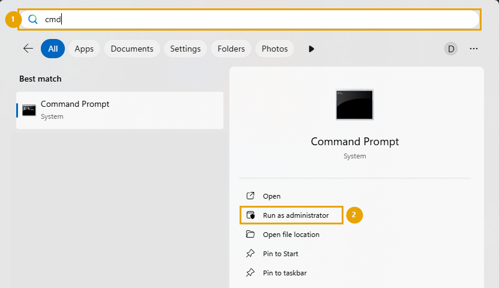
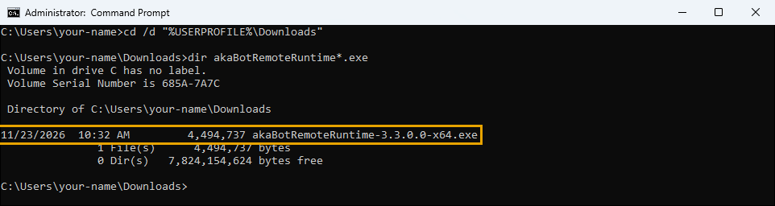
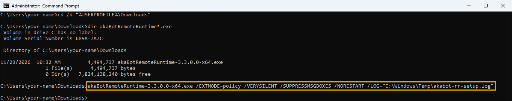
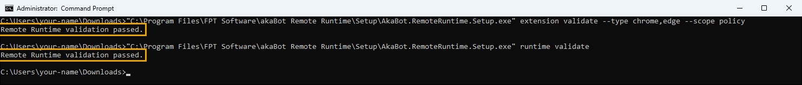
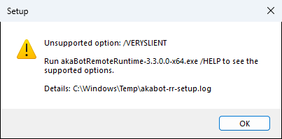

# コマンド ラインから akaBot Remote Runtime をインストールする

リモート デスクトップまたは Citrix のセッション内のアプリケーションを akaBot で自動化するには、次の 2 つが必要です。

| 構成要素 | インストール先 | インストール方法 |
|---|---|---|
| **Remote Runtime** (セッション内で使用するサーバーとブラウザー拡張機能) | **リモート側のコンピューター**: リモート デスクトップ ホストまたは Citrix VDA | `akaBotRemoteRuntime-<バージョン>-x64.exe` (このページ) |
| **リモート デスクトップ / Citrix 拡張機能** (クライアント DLL) | セッションを **開く** 側のコンピューター (Studio または Robot が動作するコンピューター) | Studio のインストーラー。[リモート デスクトップと Citrix の拡張機能](./install-akabot-platform-from-command-line.md#remote-desktop-and-citrix-extensions-remoteext) と [akaBot Commander](../user-guide/akabot-commander.md#74-remote-desktop-and-citrix-extensions) を参照してください。 |

Remote Runtime のインストーラーは、リモート デスクトップや Citrix のクライアント DLL を **インストールしません**。

**リモート側のコンピューター** (リモート デスクトップ ホストまたは Citrix VDA) で、次の 4 つの手順を行ってください。その後の各セクションでは、管理者向けにすべてのオプションを説明します。

## 始める前に \{#before-you-start}

- **管理者権限** のあるアカウントで **リモート側のコンピューター** (リモート デスクトップ ホストまたは Citrix VDA) にサインインしてください。権限がない場合は、IT 部門に依頼してください。
- **インストーラーをリモート側のコンピューターにコピーしてください。** 通常は **ダウンロード** フォルダーにあります。ファイル名は `akaBotRemoteRuntime-3.3.0.0-x64.exe` のような形です (数字は異なる場合があります)。

## 手順 1. コマンド プロンプトを管理者として開く \{#step-1-open-the-command-prompt-as-administrator}

1. **スタート** ボタン (Windows ロゴ) をクリックし、`cmd` と入力します (図の枠 **1**)。
2. 右側の **管理者として実行** をクリックします (枠 **2**)。
3. *「このアプリがデバイスに変更を加えることを許可しますか?」* と表示されたら、**はい** をクリックします。

黒いウィンドウが開きます。タイトルは **管理者:** (英語版 Windows では **Administrator:**) で始まります。



## 手順 2. ダウンロード フォルダーに移動する \{#step-2-go-to-the-downloads-folder}

次の行をコピーして黒いウィンドウに貼り付け (右クリックで貼り付けられます)、**Enter** キーを押します。

```bat
cd /d "%USERPROFILE%\Downloads"
```

次に、インストーラーがあることを確認します。コピーして貼り付け、**Enter** キーを押します。

```bat
dir akaBotRemoteRuntime*.exe
```

一覧にインストーラーのファイル名が表示されます (オレンジ色の枠)。手順 3 で使うので、正確な名前を覚えておいてください。

図の `your-name` の部分には、お使いの Windows のユーザー名が表示されます。



> **ヒント:** インストーラーを別の場所に保存した場合は、1 行目のフォルダーを変更してください。たとえば `D:\Setup` の場合:
> `cd /d "D:\Setup"`

## 手順 3. インストール コマンドをコピーして実行する \{#step-3-copy-and-run-the-install-command}

次のコマンドをコピーして黒いウィンドウに貼り付け、**Enter** キーを押します。

**推奨コマンド:**

```bat
akaBotRemoteRuntime-3.3.0.0-x64.exe /EXTMODE=policy /VERYSILENT /SUPPRESSMSGBOXES /NORESTART /LOG="C:\Windows\Temp\akabot-rr-setup.log"
```

> **重要:** ファイル名が異なる場合 (たとえば `akaBotRemoteRuntime-3.4.0.0-x64.exe`) は、コマンド内のファイル名を手順 2 で確認した名前に合わせて変更してください。

このコマンドで行われること:

- **ウィンドウを表示せずに** Remote Runtime をインストールします (`/VERYSILENT`)。
- このコンピューターの **すべてのユーザーの Chrome と Edge** に akaBot 拡張機能を追加します (`/EXTMODE=policy`)。拡張機能は **常に有効** で、ユーザーは無効にしたり削除したりできません。ブラウザーは Chrome / Edge のストアから拡張機能をダウンロードするため、コンピューターはインターネットに接続できる必要があります。
- **メッセージ ボックスを表示しません** (`/SUPPRESSMSGBOXES`)。問題が発生した場合、エラーはログ ファイルに書き込まれます。
- コンピューターを **再起動しません** (`/NORESTART`)。
- インストール ログを `C:\Windows\Temp\akabot-rr-setup.log` に書き込みます (`/LOG`)。インストールに失敗した場合は、このファイルで原因を確認できます。
- Citrix VDA では、このコンピューターの Citrix **仮想チャネル許可リスト (Virtual channel allow list)** にも akaBot のエントリを追加します。Citrix ポリシーを一元管理している企業では、Citrix 管理者にも Citrix ポリシーへの追加を依頼してください。[Citrix: akaBot 仮想チャネルを許可する](#14-citrix-allow-the-akabot-virtual-channel) を参照してください。



akaBot Platform のインストーラーとは異なり、Remote Runtime のインストーラーは Edge と Chrome を **閉じません**。

**Enter** キーを押しても、画面には何も表示されません。これは正常です。**1 分ほど待ってください**。黒いウィンドウはすぐに入力できる状態に戻りますが、インストールはバックグラウンドで続いています。**設定 > アプリ > インストールされているアプリ** に **akaBot Remote Runtime** が表示されたら完了です。

> **オプション名に入力ミスがある場合** (たとえば `/VERYSLIENT`)、インストーラーは何もインストールせずに停止し、ログに `Unsupported option: /VERYSLIENT` と書き込みます。コマンドを修正して、もう一度実行してください。[誤ったコマンド](#15-wrong-commands) を参照してください。

> **スクリプトの場合:** インストーラーの終了を待って終了コードを取得するには、`start /wait` を使用し、**次の** 行で `%ERRORLEVEL%` を読み取ります。
>
> ```bat
> start "" /wait akaBotRemoteRuntime-3.3.0.0-x64.exe /EXTMODE=policy /VERYSILENT /SUPPRESSMSGBOXES /NORESTART /LOG="C:\Windows\Temp\akabot-rr-setup.log"
> echo %ERRORLEVEL%
> ```
>
> `0` = インストール済み、`1` = サポートされていないオプション (何もインストールされていません) またはセットアップを開始できなかった、`10` = インストール済みだが、ブラウザー拡張機能またはサインイン タスクを登録できなかった (ログを参照)。

## 手順 4. インストールを確認する \{#step-4-check-the-installation}

1. 拡張機能が登録されていることを確認します。コピーして貼り付け、**Enter** キーを押します。

   ```bat
   "C:\Program Files\FPT Software\akaBot Remote Runtime\Setup\AkaBot.RemoteRuntime.Setup.exe" extension validate --type chrome,edge --scope policy
   ```

   Chrome と Edge の拡張機能が Policy モードで登録されていれば、`Remote Runtime validation passed.` と表示されます。そうでない場合は、その理由が表示されます。

2. サインイン タスク (Citrix VDA では許可リストのエントリも) を確認します。

   ```bat
   "C:\Program Files\FPT Software\akaBot Remote Runtime\Setup\AkaBot.RemoteRuntime.Setup.exe" runtime validate
   ```

   すべて揃っていれば、こちらも `Remote Runtime validation passed.` と表示されます。

   

3. このコンピューターのリモート デスクトップまたは Citrix セッションで **Edge** または **Chrome** を開き、`edge://extensions` または `chrome://extensions` に移動して、**akaBot** が一覧にあり、スイッチの横に小さな **ブリーフケース アイコン** が表示されていることを確認します。初回は、拡張機能が表示されるまで **1 分ほど** かかることがあります。表示されない場合は、ブラウザーを完全に閉じてから、もう一度開いてください。

## 1. インストーラーのオプション \{#1-installer-options}

### 1.1 `/EXTMODE`: ブラウザー拡張機能 \{#11-extmode-browser-extensions}

`/EXTMODE=<リスト>` は、リモート側のコンピューターに登録するブラウザー拡張機能とその方法を選びます。

| 値 | Chrome | Edge |
|---|---|---|
| `user` | User モード | User モード |
| `policy` | Policy モード | Policy モード |
| `policyoffline` | Policy (オフライン) | Policy (オフライン) |
| `none` | 拡張機能なし | 拡張機能なし |
| `chrome-user` / `chrome-policy` / `chrome-policyoffline` | 選んだモード | — |
| `edge-user` / `edge-policy` / `edge-policyoffline` | — | 選んだモード |

- 値はスペースを入れずにコンマで区切ります。例: `/EXTMODE=chrome-policy,edge-user`。
- 1 つのブラウザーに複数のモードを指定した場合、`policyoffline` が `policy` より優先され、`policy` が `user` より優先されます。
- `/EXTMODE` を指定しない場合、ウィザード (または `/COMPONENTS`) で選んだ **Chrome** と **Edge** のコンポーネントが **user** モードで登録されます。
- `policyoffline` は **ハイフンなし** で入力してください。Studio のインストーラーは `policy-offline` を受け付けますが、Remote Runtime のインストーラーは受け付けません。認識できない値を指定すると、そのブラウザーの拡張機能は **登録されません**。

| モード | 意味 |
|---|---|
| `user` | 各 Windows ユーザーの初回サインイン時 (Active Setup) と、現在セットアップを実行しているユーザーに登録します。 |
| `policy` | ストアから拡張機能をインストールするブラウザー ポリシーを、コンピューター全体に 1 回だけ設定します。 |
| `policyoffline` | `C:\ProgramData` に配置したパッケージを、ストアを使わずにインストールするブラウザー ポリシーです。ドメインに参加しているか MDM に登録されているコンピューター専用です。それ以外のコンピューターでは登録に失敗し、セットアップがエラーを表示します。 |
| `none` | ブラウザー拡張機能なし。 |

各モードで書き込まれる内容については、[ブラウザーのグループ ポリシー](../user-guide/browser-group-policies.md) を参照してください。

### 1.2 Inno Setup の標準オプション \{#12-standard-inno-setup-options}

| オプション | 効果 |
|---|---|
| `/COMPONENTS="server,chrome,edge"` | コンポーネントを選びます。`server` は常に含まれます。拡張機能については `/EXTMODE` が優先されます。 |
| `/SILENT`、`/VERYSILENT` | ウィザードを表示しません。セットアップを **SYSTEM** で実行した場合を除き、ランタイムはインストールしたユーザーのセッションで起動します。「Citrix VDA が検出されました」という許可リストのメッセージは表示されません。 |
| `/SUPPRESSMSGBOXES` | `/SILENT` や `/VERYSILENT` と一緒に使った場合も、すべてのメッセージ ボックス (「サポートされていないオプション」のエラーと「登録できませんでした」のエラー) を非表示にします。エラーはログには書き込まれます。 |
| `/LOG="<ファイル>"` | セットアップのログをこのファイルに書き込みます。ログは既定で有効です。 |
| `/DIR="<パス>"` | インストール先フォルダー。既定値: `C:\Program Files\FPT Software\akaBot Remote Runtime`。 |
| `/NOCLOSEAPPLICATIONS` | 置き換えるファイルを使用しているアプリケーションを閉じません。既定では、セットアップがそれらを閉じます。 |

### 1.3 例 \{#13-example}

管理者として開いた PowerShell ウィンドウで:

```powershell
.\akaBotRemoteRuntime-3.3.0.0-x64.exe /EXTMODE=policy /VERYSILENT /SUPPRESSMSGBOXES /NORESTART /LOG="C:\Windows\Temp\akabot-rr-setup.log"
```

ウィザードを表示せずに Remote Runtime をインストールし、すべてのユーザーの Chrome と Edge の拡張機能を Policy モードで登録し、コンピューターを再起動せず、ログを `C:\Windows\Temp\akabot-rr-setup.log` に書き込みます。[手順 3](#step-3-copy-and-run-the-install-command) と同じコマンドです。

### 1.4 Citrix: akaBot 仮想チャネルを許可する \{#14-citrix-allow-the-akabot-virtual-channel}

Citrix Virtual Apps and Desktops 7 2109 以降、カスタム仮想チャネルはすべて既定でブロックされます。Citrix セッションで Remote Runtime を動作させるには、**[仮想チャネル許可リスト (Virtual channel allow list)](https://docs.citrix.com/us/en/citrix-virtual-apps-desktops/current-release/policies/reference/ica-policy-settings/virtual-channel-allow-list-policy-settings.html)** に次のエントリが必要です。

```text
AKABOT,C:\Program Files\FPT Software\akaBot Remote Runtime\AkaBot.RemoteRuntime.Server.exe
```

- エントリの形式は `<チャネル名>,<チャネルを使用するプロセスのパス>` です。チャネル名は `AKABOT` です。
- Remote Runtime を別のフォルダーにインストールした場合 (`/DIR` を使用)、そのフォルダーにある `AkaBot.RemoteRuntime.Server.exe` のパスを使用してください。
- 許可リストを変更した後は、Citrix VDA を再起動してください。

**インストーラーが行うこと。** Citrix VDA では、インストーラーが VDA 自体に保存されている許可リスト (レジストリ `HKLM\SOFTWARE\WOW6432Node\Policies\Citrix\VCPolicies`、値 `VirtualChannelWhiteList`) にこのエントリを追加します。ウィザードでもサイレント インストールでも行われます。許可リストが無効になっている場合や、すでにエントリが含まれている場合は、何も変更しません。Remote Runtime をアンインストールしても、許可リストはそのまま残ります。

**企業環境では、Citrix 管理者にも依頼してください。** 会社が Citrix ポリシー (Citrix Studio またはグループ ポリシー) で許可リストを管理している場合、次のポリシー更新で VDA 上のリストがポリシーのリストに置き換えられます。その結果、akaBot のエントリが削除され (たとえば再起動後や翌日)、Citrix セッションで Remote Runtime が動作しなくなります。これを防ぐには、Citrix 管理者に依頼して、上記のエントリを Citrix ポリシーの **仮想チャネル許可リスト (Virtual channel allow list)** に追加してもらってください。

Citrix VDA では、セットアップ ウィザードがこのエントリについての注意を表示します。サイレント インストール (`/SILENT`、`/VERYSILENT`) では注意は表示されません。エントリは VDA に追加されますが、Citrix 管理者への連絡は別途必要です。

エントリを後で確認するには、[セットアップ ツール](#2-setup-tool-after-installation) の `runtime validate` を実行します。

### 1.5 誤ったコマンド \{#15-wrong-commands}

入力のルール:

- すべてのオプションは `/` で始めます。
- 各 `/` の前に **スペースを 1 つ** 入れます。
- `=` や `,` の前後にはスペースを **入れません**。
- スペースを含むパスは引用符で囲みます: `/LOG="C:\My Logs\akabot-rr-setup.log"`。

入力ミスがあった場合のインストーラーの動作:

| ミス | 例 | 結果 |
|---|---|---|
| オプション名のスペル ミスまたは不明なオプション | `/VERYSLIENT`、`/EXTMOD=policy` | セットアップは **何もインストールせずに停止** し、終了コード `1` を返します。`Unsupported option: ...` というメッセージがログに書き込まれ、メッセージ ボックスにも表示されます (`/SUPPRESSMSGBOXES` 指定時は表示されません)。サポートされているオプションは、インストーラーを `/HELP` 付きで実行すると確認できます。 |
| `/EXTMODE=` の後の値が誤っている | `/EXTMODE=polcy`、`/EXTMODE=policy-offline` | セットアップは Remote Runtime をインストールしますが、そのブラウザーの拡張機能は **登録されず**、メッセージも表示されません。スペルを確認してください。`policyoffline` はハイフンなしで入力します。 |
| ブラウザー拡張機能またはサインイン タスクを登録できない | ドメインに参加していないコンピューターで `/EXTMODE=policyoffline` | セットアップは完了しますが、終了コード `10` を返します。理由はログに書き込まれ、メッセージ ボックスにも表示されます (`/SUPPRESSMSGBOXES` 指定時は表示されません)。 |

たとえば、`akaBotRemoteRuntime-3.3.0.0-x64.exe /VERYSLIENT /EXTMODE=policy /LOG="C:\Windows\Temp\akabot-rr-setup.log"` (`/SUPPRESSMSGBOXES` なし) を実行すると、次のメッセージが表示され、何もインストールされません。`/SUPPRESSMSGBOXES` を付けた場合、同じ内容はログ ファイルにのみ書き込まれます。



| | 例 |
|---|---|
| ✅ 正しい | `akaBotRemoteRuntime-3.3.0.0-x64.exe /EXTMODE=policy /VERYSILENT /SUPPRESSMSGBOXES /NORESTART /LOG="C:\Windows\Temp\akabot-rr-setup.log"` |
| ❌ 誤り | `akaBotRemoteRuntime-3.3.0.0-x64.exe /EXTMODE=polcy` (拡張機能が登録されない) |
| ❌ 誤り | `akaBotRemoteRuntime-3.3.0.0-x64.exe /VERYSLIENT` (セットアップが停止する: サポートされていないオプション) |
| ❌ 誤り | `akaBotRemoteRuntime-3.3.0.0-x64.exe /EXTMODE = policy` (セットアップが停止する: `=` と `policy` がサポートされていないオプションになる) |

## 2. セットアップ ツール (インストール後) \{#2-setup-tool-after-installation}

セットアップ ツールは `{app}\Setup\AkaBot.RemoteRuntime.Setup.exe` です (`{app}` はインストール先フォルダー)。インストーラーが自動的に実行しますが、登録の修復や確認のために手動で実行することもできます。

| コマンド | 用途 |
|---|---|
| `runtime install\|validate [--exe <AkaBot.RemoteRuntime.Server.exe>]` | サインイン タスクと Citrix VDA の許可リスト エントリを作成または確認します。管理者権限が必要です。 |
| `runtime uninstall [--exe <AkaBot.RemoteRuntime.Server.exe>]` | サインイン タスクを削除します。 |
| `extension install\|uninstall --type <chrome\|edge\|java\|all>[,...] --scope <user\|machine\|policy\|policyoffline> [--app <dir>]` | 拡張機能を登録または削除します。`java` には `--scope` は不要です。 |
| `extension uninstall --type recorded` | インストーラーが `/EXTMODE` で登録したものを削除します。アンインストーラーがこのコマンドを実行します。 |
| `extension validate [--type <chrome\|edge>[,...]] [--scope <...>]` | 登録を確認し、失敗した場合はその理由を表示します。`--scope` を指定しない場合は、見つかったスコープを確認します。 |

| `--scope` | 意味 |
|---|---|
| `user` | 現在の Windows ユーザー (HKCU)。管理者権限は不要です。 |
| `machine` | すべてのユーザー (HKLM の外部拡張機能)。管理者権限が必要です。 |
| `policy` | ブラウザー ポリシー。拡張機能はストアから取得します。管理者権限が必要です。 |
| `policyoffline` | ブラウザー ポリシー。`C:\ProgramData` に配置したパッケージを使用します。ドメインに参加しているか MDM に登録されているコンピューター専用です。管理者権限が必要です。 |

`--exe` または `--app` を指定しない場合、ツールは 1 つ上のフォルダーにインストールされている Remote Runtime を使用します。

例: Policy モードで登録された Chrome 拡張機能を確認する。

```bat
"C:\Program Files\FPT Software\akaBot Remote Runtime\Setup\AkaBot.RemoteRuntime.Setup.exe" extension validate --type chrome --scope policy
```

### 2.1 終了コード \{#21-exit-codes}

| コード | 意味 |
|---|---|
| `0` | 成功。 |
| `1` | 失敗。理由は標準エラーに書き込まれます。 |
| `2` | コマンド ラインが無効です。 |
| `3` | ドメインに参加していない、または MDM に登録されていないコンピューターで `policyoffline` を指定しました。代わりに `policy` または `user` を使用してください。 |

## 3. トラブルシューティング \{#3-troubleshooting}

| 問題 | 対処方法 |
|---|---|
| *「... は、内部コマンドまたは外部コマンド、操作可能なプログラムまたはバッチ ファイルとして認識されていません。」* | フォルダーが正しくないか、ファイル名が異なります。[手順 2](#step-2-go-to-the-downloads-folder) をもう一度行い、表示された正確なファイル名を使用してください。 |
| *「アクセスが拒否されました。」* | **管理者として実行** でコマンド プロンプトを開いてください ([手順 1](#step-1-open-the-command-prompt-as-administrator))。 |
| インストールに失敗し、メッセージが表示されない | `/SUPPRESSMSGBOXES` はエラー メッセージを非表示にします。`/LOG` で指定したログ ファイル (たとえば `C:\Windows\Temp\akabot-rr-setup.log`) を開いて、エラーを確認してください。 |
| ログまたはメッセージ ボックスに *"Unsupported option: ..."* が表示される、または終了コード `1` | オプション名にスペル ミスがあります。何もインストールされていません。コマンドを修正して、もう一度実行してください。[誤ったコマンド](#15-wrong-commands) を参照してください。 |
| 終了コード `10` | Remote Runtime はインストールされましたが、ブラウザー拡張機能またはサインイン タスクを登録できませんでした。どれが失敗したか、その理由はログで確認できます。 |
| ブラウザーの拡張機能が登録されない | `/EXTMODE=` の後のスペルを確認してください。`policyoffline` はハイフンなしで入力します。認識できない値を指定すると、そのブラウザーの拡張機能は登録されません。 |
| *"The browser extensions (...) could not be registered in policyoffline mode"* (セットアップの終了コード `10`、セットアップ ツールの終了コード `3`) | ドメインに参加していない、または MDM に登録されていないコンピューターで `policyoffline` を使用しました。代わりに `policy` または `user` を使用してください。 |
| 登録されている内容を確認したい | [セットアップ ツール](#2-setup-tool-after-installation) の `extension validate` を実行してください。失敗した場合は、その理由が表示されます。 |
| Citrix セッションで Remote Runtime が動作しない | `runtime validate` を実行して許可リストのエントリを確認し、変更後に VDA を再起動したことを確認してください。[Citrix: akaBot 仮想チャネルを許可する](#14-citrix-allow-the-akabot-virtual-channel) を参照してください。 |
| インストール直後は Citrix で動作していたが、後で (たとえば翌日) 動作しなくなった | 会社の Citrix ポリシーによって VDA 上の許可リストが置き換えられ、akaBot のエントリが削除されました。Citrix 管理者に依頼してエントリを Citrix ポリシーの **仮想チャネル許可リスト (Virtual channel allow list)** に追加してもらい、VDA を再起動してください。[Citrix: akaBot 仮想チャネルを許可する](#14-citrix-allow-the-akabot-virtual-channel) を参照してください。 |
| 権限が不足しているためにセットアップ ツールのコマンドが失敗する | `runtime install`、`runtime validate`、およびスコープ `machine`、`policy`、`policyoffline` には管理者権限が必要です。管理者として開いたウィンドウでコマンドを実行してください。 |
