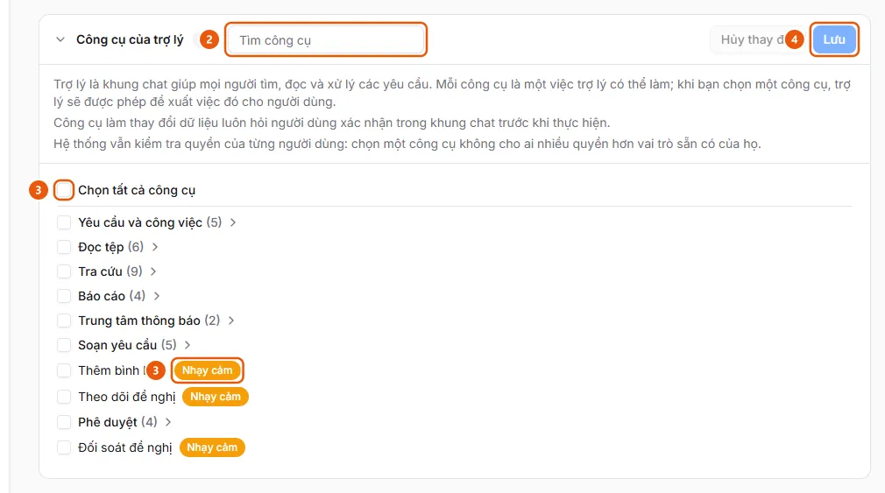

# Bật trợ lý AI và chọn việc trợ lý được làm

Quản trị viên muốn bật trợ lý AI cho người dùng và chọn các công cụ (đọc tệp, tra cứu, tạo nháp, duyệt…) mà trợ lý được phép dùng.

**Khi nào sử dụng:**

- Người dùng không thấy nút Trợ lý AI ở góc trên bên phải.
- Trợ lý báo một kỹ năng cần công cụ chưa được bật.
- Quản trị viên muốn cho phép hoặc chặn trợ lý đọc tệp, tạo bản nháp, nộp hoặc duyệt đề nghị.

Mặc định trợ lý chưa có công cụ nào và ẩn với mọi người; công cụ đã bật vẫn tuân theo quyền của từng vai trò.

## Các cách thực hiện

- [Bật công cụ của trợ lý](how-to/enable-assistant-tools.md) — Ở Cài đặt AI, tab Trợ lý, mục Công cụ của trợ lý, đánh dấu các công cụ trợ lý được dùng (theo nhóm hoặc từng công cụ) rồi bấm Lưu.

## Xem thêm

- [Quản lý kỹ năng của trợ lý AI](manage-assistant-skill.md) — Quản trị viên muốn thêm, sửa, tắt hoặc khôi phục một kỹ năng (lệnh /) để trợ lý làm theo quy trình của công ty.

## Được dùng trong các hướng dẫn

- [Quản lý kỹ năng của trợ lý AI](manage-assistant-skill.md) — Quản trị viên muốn thêm, sửa, tắt hoặc khôi phục một kỹ năng (lệnh /) để trợ lý làm theo quy trình của công ty.

## Các bước

[Bật công cụ của trợ lý](how-to/enable-assistant-tools.md)

1. [Bật công cụ của trợ lý](how-to/enable-assistant-tools.md)
   1. Ở thanh bên, mục **Quản trị**, mở **Cài đặt AI** (chỉ quản trị viên, trên máy tính) và chọn tab **Trợ lý**.
   2. Mở mục **Công cụ của trợ lý** (chia nhóm: Yêu cầu và công việc, Đọc tệp, Tra cứu, Báo cáo, Trung tâm thông báo, Soạn yêu cầu, Phê duyệt). Dùng ô **Tìm công cụ** (2) để lọc; di chuột lên tên công cụ để xem nó làm gì và dành cho vai trò nào.
      
   3. Đánh dấu từng công cụ, ô của một nhóm, hoặc **Chọn tất cả công cụ** (3). Công cụ có nhãn **Nhạy cảm** (3) làm thay đổi dữ liệu và luôn hỏi người dùng xác nhận trong khung chat; **Đối soát đề nghị** chỉ dành cho người vận hành và quản trị viên.
   4. Bấm **Lưu** (4) ("Đã lưu các công cụ của trợ lý."), hoặc **Hủy thay đổi** để bỏ các dấu chưa lưu.

## Nếu có sự cố

### [Bật công cụ của trợ lý](how-to/enable-assistant-tools.md)

- "Không tải được các công cụ của trợ lý": dịch vụ trợ lý không phản hồi hoặc bạn không có quyền quản lý; bấm **Thử lại**.
- Bật một công cụ không mở thêm quyền cho ai: ứng dụng vẫn kiểm tra quyền của từng người ở mọi thao tác.
