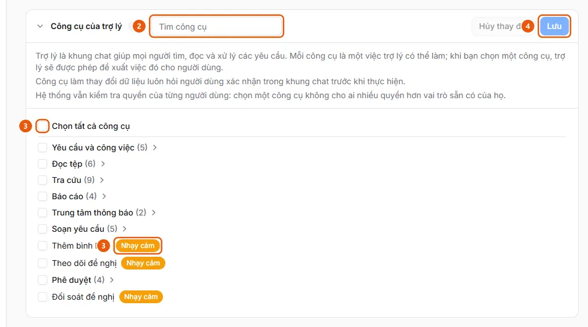

# Bật công cụ của trợ lý

Ở Cài đặt AI, tab Trợ lý, mục Công cụ của trợ lý, đánh dấu các công cụ trợ lý được dùng (theo nhóm hoặc từng công cụ) rồi bấm Lưu.

## Các bước

1. Ở thanh bên, mục **Quản trị**, mở **Cài đặt AI** (chỉ quản trị viên, trên máy tính) và chọn tab **Trợ lý**.
2. Mở mục **Công cụ của trợ lý** (chia nhóm: Yêu cầu và công việc, Đọc tệp, Tra cứu, Báo cáo, Trung tâm thông báo, Soạn yêu cầu, Phê duyệt). Dùng ô **Tìm công cụ** (2) để lọc; di chuột lên tên công cụ để xem nó làm gì và dành cho vai trò nào.

   

3. Đánh dấu từng công cụ, ô của một nhóm, hoặc **Chọn tất cả công cụ** (3). Công cụ có nhãn **Nhạy cảm** (3) làm thay đổi dữ liệu và luôn hỏi người dùng xác nhận trong khung chat; **Đối soát đề nghị** chỉ dành cho người vận hành và quản trị viên.
4. Bấm **Lưu** (4) ("Đã lưu các công cụ của trợ lý."), hoặc **Hủy thay đổi** để bỏ các dấu chưa lưu.

## Xử lý lỗi

- "Không tải được các công cụ của trợ lý": dịch vụ trợ lý không phản hồi hoặc bạn không có quyền quản lý; bấm **Thử lại**.
- Bật một công cụ không mở thêm quyền cho ai: ứng dụng vẫn kiểm tra quyền của từng người ở mọi thao tác.

## Kết quả

- [Trợ lý AI đã được bật cho vai trò của bạn](../../../troubleshooting/assistant/tools-enabled.md) — Quản trị viên đã bật ít nhất một công cụ của trợ lý mà vai trò của bạn được dùng, nên nút Trợ lý AI hiện ra.

## Được dùng trong các hướng dẫn

- [Kỹ năng của trợ lý AI](../../assistant/features/skills.md) — Công thức soạn sẵn gồm các bước viết bằng ngôn ngữ tự nhiên; người dùng gọi bằng lệnh bắt đầu bằng dấu / trong khung chat, quản trị viên quản lý.
- [Bật trợ lý AI và chọn việc trợ lý được làm](../enable-assistant-tools.md) — Quản trị viên muốn bật trợ lý AI cho người dùng và chọn các công cụ (đọc tệp, tra cứu, tạo nháp, duyệt…) mà trợ lý được phép dùng.
- [Thêm hoặc sửa kỹ năng của trợ lý](manage-assistant-skill.md) — Ở Cài đặt AI, tab Trợ lý, mục Kỹ năng, bấm Thêm kỹ năng hoặc biểu tượng bút để sửa; bật/tắt, khôi phục hoặc xóa ở từng dòng.
- [Trợ lý AI đã được bật cho vai trò của bạn](../../../troubleshooting/assistant/tools-enabled.md) — Quản trị viên đã bật ít nhất một công cụ của trợ lý mà vai trò của bạn được dùng, nên nút Trợ lý AI hiện ra.
