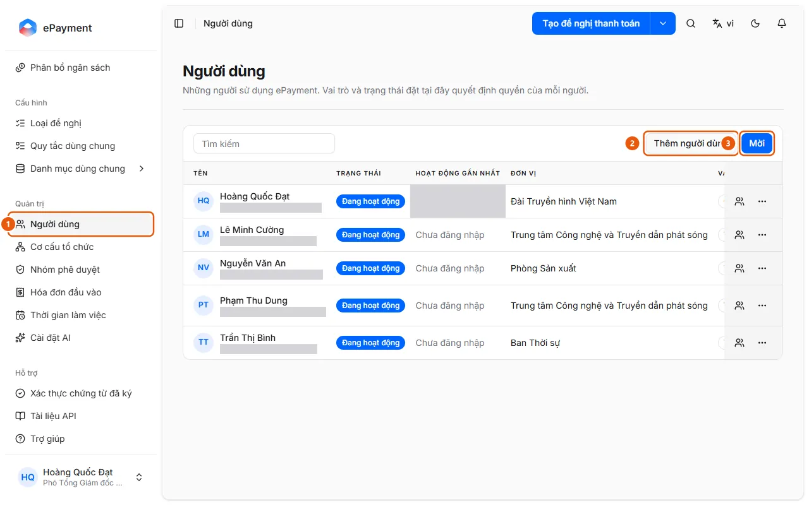
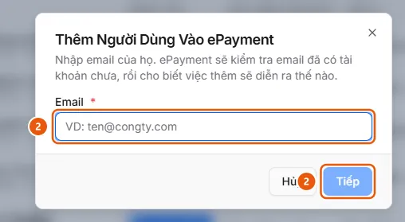

# Thêm hoặc mời người dùng

Ở Người dùng, bấm Thêm người dùng (kiểm tra từng email) hoặc Mời (nhiều email cùng vai trò).

## Trước khi bắt đầu

- **[Không xóa hoặc vô hiệu hóa được khi còn đang được dùng](../../../reference/admin/directory-delete-guards.md)**\
  Đơn vị còn đơn vị con, thành viên, đề nghị hoặc phân bổ thì không xóa được; nhóm còn thành viên hoặc đang được loại đề nghị dùng thì không xóa được.

## Các bước

1. Ở thanh bên, mục **Quản trị**, mở **Người dùng** (1).

   

2. Để thêm một người: bấm **Thêm người dùng** (2), nhập email rồi **Tiếp** (2). Làm theo kết quả kiểm tra:
   - Đã là người dùng AkaPayment: không cần thêm lại.
   - Đã là thành viên công ty: bấm **Thêm**; họ vào AkaPayment ngay, không có email gửi đi.
   - Đã có tài khoản nhưng chưa thuộc công ty: bấm **Gửi lời mời**; họ nhận email và tham gia khi chấp nhận.
   - Chưa có tài khoản: nhập **Tên**, **Họ**, **Mật khẩu tạm** (tối thiểu 6 ký tự; họ đổi mật khẩu khi đăng nhập lần đầu) rồi bấm **Tạo tài khoản**; sao chép mật khẩu ngay vì nó chỉ hiển thị một lần.

   

3. Để mời nhiều người: bấm **Mời** (3), nhập từng email (nhấn Enter để thêm email), chọn **Vai trò** (mặc định Thành viên) rồi **Lưu**; trang báo "Đã mời người dùng", họ tự đặt mật khẩu ở lần đăng nhập đầu tiên. Người được mời nhận email và tham gia theo Tham gia công ty từ lời mời (akabot-identity).
4. Với dòng đang chờ, dùng **Gửi lại lời mời** hoặc **Thu hồi lời mời**.
5. Ở menu **Thao tác** của dòng, đặt **Nhóm phê duyệt**, **Đơn vị**, **Vai trò** (Thành viên, Vận hành, Quản trị), **Đặt lại mật khẩu ký** hoặc **Vô hiệu hóa** (**Kích hoạt lại** để bật lại).

## Xử lý lỗi

- Không kiểm tra được email: "Không kiểm tra được email này. Vui lòng thử lại." Không vô hiệu hóa được chủ tài khoản, trưởng bộ phận hoặc quản trị viên cuối cùng: xem [Không xóa hoặc vô hiệu hóa được khi còn đang được dùng](../../../reference/admin/directory-delete-guards.md).

## Xem thêm

- akabot-identity:goal.members.invite (akabot-identity)
- akabot-identity:goal.members.add-user (akabot-identity)

## Được dùng trong các hướng dẫn

- [Mời người dùng mới vào AkaPayment](../invite-user.md) — Quản trị viên muốn cho một đồng nghiệp truy cập AkaPayment.
