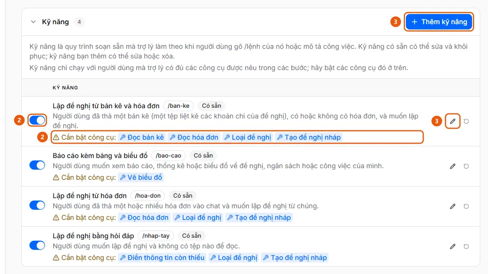

# Thêm hoặc sửa kỹ năng của trợ lý

Ở Cài đặt AI, tab Trợ lý, mục Kỹ năng, bấm Thêm kỹ năng hoặc biểu tượng bút để sửa; bật/tắt, khôi phục hoặc xóa ở từng dòng.

## Các bước

1. Ở thanh bên, mục **Quản trị**, mở **Cài đặt AI** (chỉ quản trị viên, trên máy tính) và chọn tab **Trợ lý**.
2. Mở mục **Kỹ năng** (4 kỹ năng có sẵn có nhãn **Có sẵn**; mỗi dòng có công tắc bật/tắt (2); nếu trợ lý còn thiếu công cụ mà kỹ năng cần, dòng hiện "Cần bật công cụ:" (2) kèm tên công cụ).

   

3. Bấm **Thêm kỹ năng** (3) (tối đa 50 kỹ năng mỗi tổ chức), hoặc biểu tượng bút (3) ở dòng để sửa. Hộp thoại có **Tên**, **Lệnh** (người dùng gõ /lệnh trong khung chat; chữ thường, số và dấu gạch ngang (-), không trùng lệnh khác), **Khi nào dùng**, **Các bước** (gõ @ để chèn một công cụ) và công tắc **Hiện trên màn hình chào**.
4. Bấm **Lưu** ("Đã lưu kỹ năng.").
5. Để bỏ chỉnh sửa của kỹ năng có sẵn (dòng có nhãn **Đã sửa**), bấm biểu tượng mũi tên vòng **Khôi phục mặc định** và xác nhận; kỹ năng do tổ chức tự thêm thì có nút **Xóa** (không thể hoàn tác).
6. Bật các công cụ mà kỹ năng cần ở mục **Công cụ của trợ lý** ([Bật công cụ của trợ lý](enable-assistant-tools.md)); kỹ năng chỉ chạy với người dùng mà trợ lý có đủ các công cụ đó.

## Tính năng sử dụng

- [Kỹ năng của trợ lý AI](../../assistant/features/skills.md) — Công thức soạn sẵn gồm các bước viết bằng ngôn ngữ tự nhiên; người dùng gọi bằng lệnh bắt đầu bằng dấu / trong khung chat, quản trị viên quản lý.

## Được dùng trong các hướng dẫn

- [Quản lý kỹ năng của trợ lý AI](../manage-assistant-skill.md) — Quản trị viên muốn thêm, sửa, tắt hoặc khôi phục một kỹ năng (lệnh /) để trợ lý làm theo quy trình của công ty.
