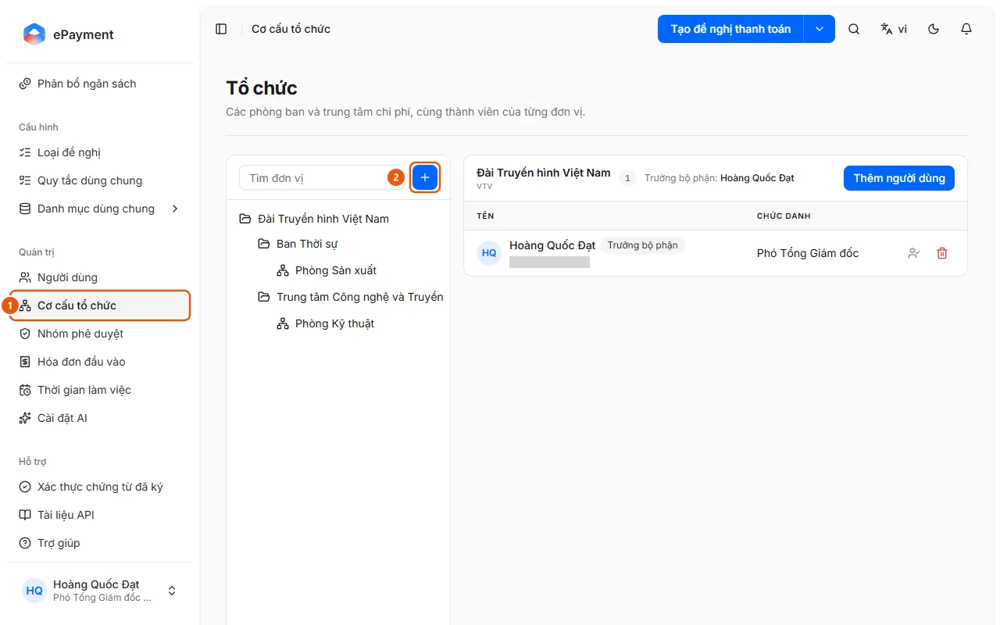

# Thêm hoặc sửa một đơn vị trong cơ cấu tổ chức

Ở Cơ cấu tổ chức, bấm Thêm đơn vị hoặc Thêm đơn vị con, rồi thêm người dùng và đặt trưởng bộ phận.

## Trước khi bắt đầu

- **[Không xóa hoặc vô hiệu hóa được khi còn đang được dùng](../../../reference/admin/directory-delete-guards.md)**\
  Đơn vị còn đơn vị con, thành viên, đề nghị hoặc phân bổ thì không xóa được; nhóm còn thành viên hoặc đang được loại đề nghị dùng thì không xóa được.

## Các bước

1. Ở thanh bên, mục **Quản trị**, mở **Cơ cấu tổ chức** (1) (cây đơn vị bên trái với ô "Tìm đơn vị", thành viên bên phải).

   

2. Bấm **Thêm đơn vị** (nút +, 2), hoặc ở menu **Thao tác** của một đơn vị chọn **Thêm đơn vị con**; **Chỉnh sửa đơn vị** để sửa.
3. Nhập **Tên**, **Mã** (dùng chữ in hoa, số, dấu gạch ngang (-) hoặc gạch dưới) và **Mô tả**, rồi **Lưu**.
4. Chọn đơn vị rồi bấm **Thêm người dùng** để thêm thành viên; ở dòng thành viên dùng **Đặt làm trưởng bộ phận** để các bước duyệt giao cho trưởng bộ phận được chuyển đến người này, hoặc **Xóa khỏi đơn vị**.
5. Dùng **Xóa đơn vị** khi không còn dùng.

## Xử lý lỗi

- Không xóa được đơn vị: xem [Không xóa hoặc vô hiệu hóa được khi còn đang được dùng](../../../reference/admin/directory-delete-guards.md).

## Được dùng trong các hướng dẫn

- [Chỉnh cơ cấu tổ chức](../manage-organization.md) — Quản trị viên muốn thêm phòng ban, chuyển người giữa các đơn vị hoặc đặt trưởng bộ phận.
