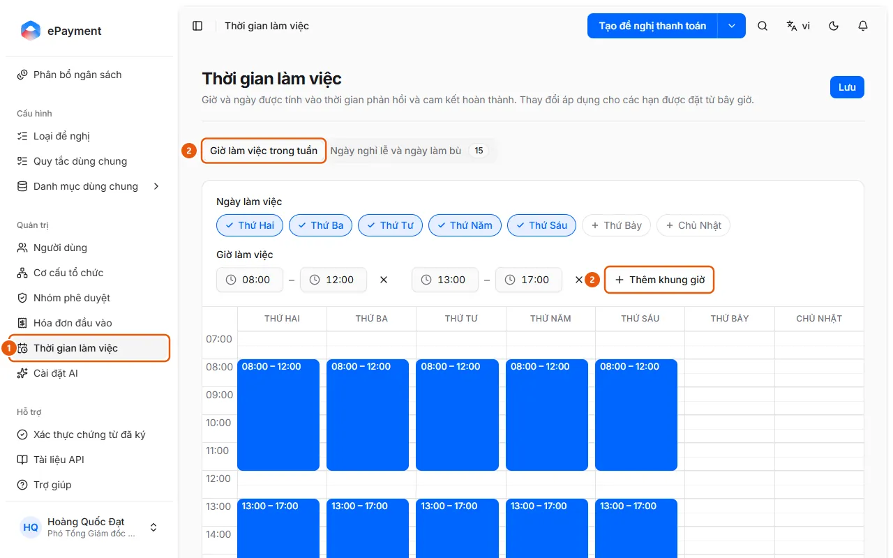

# Đặt giờ làm việc và ngày nghỉ

Ở Thời gian làm việc, chọn ngày và khung giờ làm việc trong tuần, thêm ngày nghỉ lễ hoặc làm bù trên lịch, rồi bấm Lưu.

## Các bước

1. Ở thanh bên, mục **Quản trị**, mở **Thời gian làm việc** (1) (chỉ quản trị viên).

   

2. Tab **Giờ làm việc trong tuần** (2): ở **Ngày làm việc**, bấm chọn các ngày từ Thứ Hai đến Chủ Nhật; ở **Giờ làm việc**, sửa các khung giờ dùng chung (mặc định 08:00–12:00 và 13:00–17:00), **Thêm khung giờ** (2) nếu cần.
3. Để một ngày có giờ riêng, dùng lưới tuần bên dưới: kéo trên vùng trống để thêm giờ, kéo khối để dời, kéo mép khối để đổi độ dài, bấm vào khối để sửa **Từ**/**Đến** hoặc **Xóa khung giờ** rồi **Xong**.
4. Tab **Ngày nghỉ lễ và ngày làm bù**: trên lịch (xem theo **Năm** hoặc **Tháng**), bấm **Thêm ngày** hoặc kéo chọn các ngày; nhập **Tên**, **Ngày** và **Loại** (Nghỉ hoặc Làm bù) rồi **Áp dụng**. Bấm vào một ngày đã có để sửa hoặc xóa.
5. Bấm **Lưu** (góc trên bên phải). Thay đổi chỉ áp dụng cho hạn xử lý tính sau khi lưu; hạn đã tính giữ nguyên.

## Xử lý lỗi

- **Lưu** bị khóa: đọc dòng đỏ trên đầu trang ("Phải có ít nhất một ngày trong tuần có giờ làm việc." hoặc khung giờ kết thúc trước khi bắt đầu, các khung chồng nhau, ngày thiếu tên); tab có lỗi được đánh dấu "Tab này có lỗi".

## Được dùng trong các hướng dẫn

- [Thiết lập lịch làm việc](../set-working-time.md) — Quản trị viên muốn chỉnh giờ làm việc và ngày nghỉ dùng để tính hạn xử lý.
