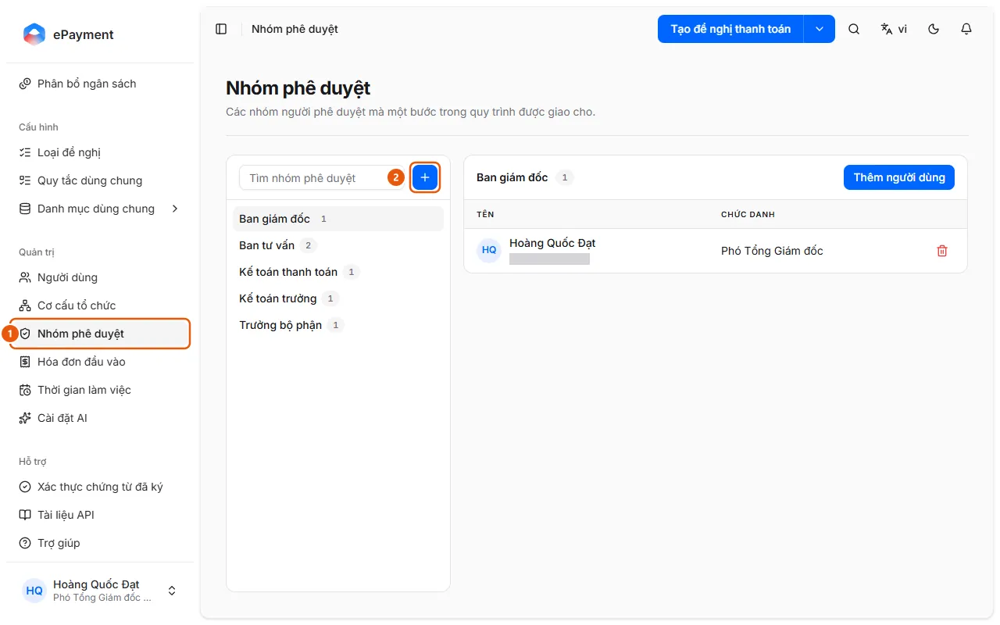

# Quản lý nhóm người phê duyệt

Quản trị viên muốn đổi người duyệt ở một bước của luồng phê duyệt bằng cách sửa thành viên nhóm.

**Khi nào sử dụng:**

- Kế toán trưởng mới cần nhận việc duyệt.
- Quản trị viên muốn đổi thành viên của một nhóm phê duyệt.

Thành viên nhóm phê duyệt nhận việc ở các bước duyệt của loại đề nghị.

## Các cách thực hiện

- [Thêm hoặc sửa nhóm phê duyệt](how-to/manage-approval-group.md) — Ở Nhóm phê duyệt, bấm Thêm nhóm phê duyệt, rồi thêm hoặc bớt thành viên.

## Trước khi bắt đầu

- **[Không xóa hoặc vô hiệu hóa được khi còn đang được dùng](../../reference/admin/directory-delete-guards.md)**\
  Đơn vị còn đơn vị con, thành viên, đề nghị hoặc phân bổ thì không xóa được; nhóm còn thành viên hoặc đang được loại đề nghị dùng thì không xóa được.

## Các bước

[Thêm hoặc sửa nhóm phê duyệt](how-to/manage-approval-group.md)

1. [Thêm hoặc sửa nhóm phê duyệt](how-to/manage-approval-group.md)
   1. Ở thanh bên, mục **Quản trị**, mở **Nhóm phê duyệt** (1).
      
   2. Bấm **Thêm nhóm phê duyệt** (nút +, 2) và nhập **Tên**, **Mô tả**, rồi **Lưu**; hoặc dùng menu **Thao tác** của nhóm: **Thêm người dùng**, **Chỉnh sửa nhóm phê duyệt**, **Xóa nhóm phê duyệt**.
   3. Chọn nhóm và bấm **Thêm người dùng** để thêm thành viên; bấm biểu tượng thùng rác ở dòng thành viên để bỏ họ khỏi nhóm.
   4. Chỉ định nhóm cho một bước ở tab **Luồng phê duyệt** của loại đề nghị ([Thiết lập và phát hành loại đề nghị](../config/how-to/publish-request-type.md)).

## Nếu có sự cố

### [Thêm hoặc sửa nhóm phê duyệt](how-to/manage-approval-group.md)

- Không xóa được nhóm: xem [Không xóa hoặc vô hiệu hóa được khi còn đang được dùng](../../reference/admin/directory-delete-guards.md).
