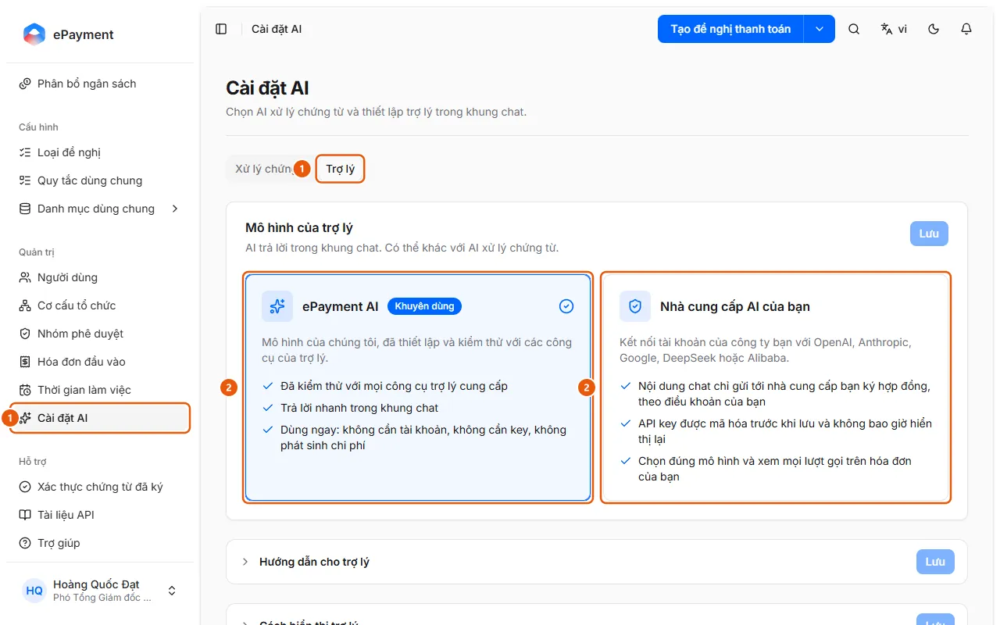

# Chọn mô hình AI cho trợ lý chat

Quản trị viên muốn chọn mô hình AI trả lời trong khung chat của trợ lý và mức độ suy nghĩ của nó.

**Khi nào sử dụng:**

- Công ty muốn nội dung chat chỉ gửi tới nhà cung cấp AI của mình.
- Trợ lý báo mô hình AI không chạy được hoặc chưa cấu hình.
- Quản trị viên muốn trợ lý suy nghĩ kỹ hơn với câu hỏi khó, hoặc trả lời nhanh và rẻ hơn.

Mô hình của trợ lý độc lập với mô hình xử lý chứng từ; mô hình riêng phải hỗ trợ gọi công cụ (tool calling).

## Các cách thực hiện

- [Chọn mô hình AI cho trợ lý](how-to/set-assistant-model.md) — Ở Cài đặt AI, tab Trợ lý, thẻ Mô hình của trợ lý, chọn ePayment AI hoặc nhà cung cấp riêng, đặt Mức độ suy nghĩ nếu có, rồi bấm Lưu.

## Xem thêm

- [Chọn AI đọc hóa đơn và xử lý chứng từ](set-document-model.md) — Quản trị viên muốn chọn mô hình AI đọc hóa đơn, tách bộ chứng từ và kiểm tra quy tắc đối soát: ePayment AI hoặc tài khoản AI của công ty.

## Được dùng trong các hướng dẫn

- [Chọn AI đọc hóa đơn và xử lý chứng từ](set-document-model.md) — Quản trị viên muốn chọn mô hình AI đọc hóa đơn, tách bộ chứng từ và kiểm tra quy tắc đối soát: ePayment AI hoặc tài khoản AI của công ty.

## Các bước

[Chọn mô hình AI cho trợ lý](how-to/set-assistant-model.md)

1. [Chọn mô hình AI cho trợ lý](how-to/set-assistant-model.md)
   1. Ở thanh bên, mục **Quản trị**, mở **Cài đặt AI** (chỉ quản trị viên, trên máy tính) và chọn tab **Trợ lý** (1).
      
   2. Ở thẻ **Mô hình của trợ lý** (có thể khác với AI xử lý chứng từ), chọn **ePayment AI** (khuyên dùng) hoặc **Nhà cung cấp AI của bạn** (2).
   3. Nếu chọn nhà cung cấp riêng: chọn **Nhà cung cấp**, chọn hoặc nhập **Mô hình** (phải gọi được công cụ) và nhập **API key**. Muốn đổi **Mức độ suy nghĩ** (Mặc định (theo nhà cung cấp), Thấp, Trung bình, Cao) thì mở **Nâng cao**; mục này chỉ có với OpenAI không đặt Base URL, Anthropic và Google Gemini.
   4. Bấm **Lưu**. Với nhà cung cấp riêng, nút hiện "Đang kiểm tra mô hình…"; mô hình chỉ được lưu khi qua kiểm tra.

## Lưu ý

- **[Khi tổ chức dùng mô hình AI riêng](../../reference/ai/own-model.md)**\
  Mô hình riêng phải qua kiểm tra mới được áp dụng; key không hiển thị lại; nhà cung cấp lỗi thì tính năng AI dừng, không tự chuyển sang ePayment AI.

## Nếu có sự cố

### [Chọn mô hình AI cho trợ lý](how-to/set-assistant-model.md)

- Khung viền đỏ ở cuối thẻ ghi lý do (ví dụ "Mô hình này không gọi được công cụ…" hoặc "API key bị từ chối…"): sửa rồi bấm **Lưu** lại. Xem [Khi tổ chức dùng mô hình AI riêng](../../reference/ai/own-model.md).
