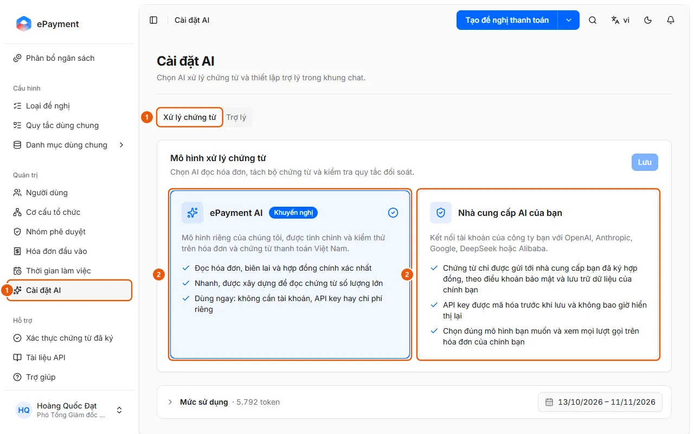

# Chọn AI đọc hóa đơn và xử lý chứng từ

Quản trị viên muốn chọn mô hình AI đọc hóa đơn, tách bộ chứng từ và kiểm tra quy tắc đối soát: AkaPayment AI hoặc tài khoản AI của công ty.

**Khi nào sử dụng:**

- Công ty muốn chứng từ chỉ gửi tới nhà cung cấp AI mà họ đã ký hợp đồng.
- Đọc hóa đơn hoặc đối soát báo lỗi vì key hoặc mô hình AI riêng không còn dùng được.
- Quản trị viên muốn việc đọc hóa đơn và đối soát chạy trên tài khoản OpenAI, Anthropic hoặc Gemini của công ty.

Mô hình này chạy mọi việc AI trên chứng từ (đọc hóa đơn, tách bộ chứng từ, đối soát); mô hình của trợ lý chat đặt riêng.

## Các cách thực hiện

- [Chọn mô hình AI xử lý chứng từ](how-to/set-document-model.md) — Ở Cài đặt AI, tab Xử lý chứng từ, chọn AkaPayment AI hoặc Nhà cung cấp AI của bạn (nhà cung cấp, mô hình, API key) rồi bấm Lưu để kiểm tra và áp dụng.

## Xem thêm

- [Chọn mô hình AI cho trợ lý chat](set-assistant-model.md) — Quản trị viên muốn chọn mô hình AI trả lời trong khung chat của trợ lý và mức độ suy nghĩ của nó.

## Được dùng trong các hướng dẫn

- [Chọn mô hình AI cho trợ lý chat](set-assistant-model.md) — Quản trị viên muốn chọn mô hình AI trả lời trong khung chat của trợ lý và mức độ suy nghĩ của nó.

## Các bước

[Chọn mô hình AI xử lý chứng từ](how-to/set-document-model.md)

1. [Chọn mô hình AI xử lý chứng từ](how-to/set-document-model.md)
   1. Ở thanh bên, mục **Quản trị**, mở **Cài đặt AI** (chỉ quản trị viên, trên máy tính) và chọn tab **Xử lý chứng từ** (1).
      
   2. Ở thẻ **Mô hình xử lý chứng từ**, chọn **AkaPayment AI** (khuyến nghị, không cần key) hoặc **Nhà cung cấp AI của bạn** (2).
   3. Nếu chọn nhà cung cấp riêng: chọn **Nhà cung cấp** (OpenAI, Anthropic, Google Gemini, DeepSeek, Alibaba Qwen), chọn hoặc nhập mã ở ô **Mô hình** (mô hình phải đọc được ảnh) và nhập **API key**; chỉ dùng **Nâng cao** → **Base URL** cho máy chủ tương thích OpenAI hoặc proxy.
   4. Bấm **Lưu**. Với nhà cung cấp riêng, trang hiện "Đang kiểm tra … Có thể mất một, hai phút."; khi qua kiểm tra, mô hình được áp dụng ("Đã áp dụng mô hình.").

## Lưu ý

- **[Khi tổ chức dùng mô hình AI riêng](../../reference/ai/own-model.md)**\
  Mô hình riêng phải qua kiểm tra mới được áp dụng; key không hiển thị lại; nhà cung cấp lỗi thì tính năng AI dừng, không tự chuyển sang AkaPayment AI.

## Nếu có sự cố

### [Chọn mô hình AI xử lý chứng từ](how-to/set-document-model.md)

- "… chưa vượt qua kiểm tra. Mô hình hiện tại vẫn được dùng.": đọc lý do ở từng mục **Kết nối**, **Đọc ảnh**, **Trả lời có cấu trúc** (hoặc **Kiểm tra** khi quá trình kiểm tra không hoàn tất), sửa key, mã mô hình hoặc Base URL rồi **Lưu** lại (không cần nhập lại key). Xem [Khi tổ chức dùng mô hình AI riêng](../../reference/ai/own-model.md).
