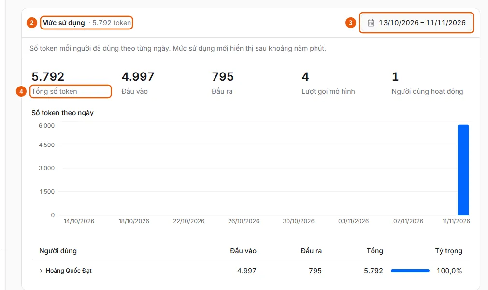

# Xem ai dùng bao nhiêu token AI

Quản trị viên muốn xem số token AI đã dùng theo ngày và theo người, cho xử lý chứng từ và cho trợ lý.

**Khi nào sử dụng:**

- Chi phí AI tăng và quản trị viên muốn biết ai dùng nhiều.
- Quản trị viên muốn xem tổng token mỗi ngày của xử lý chứng từ hoặc trợ lý.

Mỗi tab của Cài đặt AI có mục Mức sử dụng riêng, số liệu cập nhật chậm khoảng 5 phút.

## Các cách thực hiện

- [Xem mức sử dụng token AI](how-to/view-ai-usage.md) — Ở Cài đặt AI, mở mục Mức sử dụng ở cuối tab Xử lý chứng từ hoặc tab Trợ lý, chọn khoảng ngày và xem token theo ngày, theo người.

## Các bước

[Xem mức sử dụng token AI](how-to/view-ai-usage.md)

1. [Xem mức sử dụng token AI](how-to/view-ai-usage.md)
   1. Ở thanh bên, mục **Quản trị**, mở **Cài đặt AI** (chỉ quản trị viên, trên máy tính); chọn tab **Xử lý chứng từ** (đọc hóa đơn, tách chứng từ, đối soát) hoặc **Trợ lý** (khung chat).
   2. Kéo xuống cuối tab và mở mục **Mức sử dụng** (2) (tiêu đề đã hiện tổng token của khoảng ngày).
      
   3. Chọn khoảng ngày ở ô ngày (3) trên đầu mục (mặc định 30 ngày gần nhất; ngày tính theo múi giờ của tổ chức).
   4. Xem **Tổng số token** (4), **Đầu vào**, **Đầu ra**, **Lượt gọi mô hình**, **Người dùng hoạt động**, biểu đồ số token theo ngày và bảng theo **Người dùng** với **Tỷ trọng**; bấm mũi tên ở một dòng để xem theo ngày của người đó.

## Nếu có sự cố

### [Xem mức sử dụng token AI](how-to/view-ai-usage.md)

- Chưa thấy lượt dùng vừa xong: mức sử dụng mới hiển thị sau khoảng năm phút. Dòng **Khác** gom lượt dùng không gắn được với một người dùng ePayment.
- Khoảng ngày dài hơn 366 ngày bị từ chối: chọn khoảng ngắn hơn.
