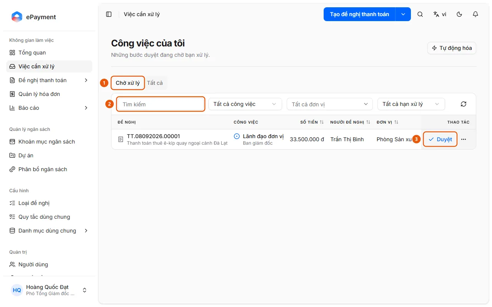

# Duyệt đề nghị được giao cho tôi

Người duyệt xử lý một việc đang chờ mình trong Việc cần xử lý.

**Khi nào sử dụng:**

- Người dùng thấy thông báo "Có đề nghị cần tôi duyệt" và muốn duyệt.
- Người dùng có bước duyệt đang chờ và muốn duyệt.

Bạn có một bước phê duyệt được giao và muốn duyệt đề nghị đó.

## Các cách thực hiện

- [Duyệt một việc được giao](how-to/approve-task.md) — Mở Việc cần xử lý và bấm Duyệt trên dòng, hoặc mở đề nghị và bấm Duyệt ở thẻ Việc của bạn; bước bắt buộc ký thì ký bằng mật khẩu ký.

## Được dùng trong các hướng dẫn

- [AkaPayment](../../overview.md) — Lập, duyệt và theo dõi đề nghị thanh toán; tiếp nhận hóa đơn đầu vào, đối soát chứng từ và quản lý ngân sách, có trợ lý AI.

## Trước khi bắt đầu

- **[Quy tắc khi duyệt, từ chối, trả lại, ủy quyền](../../reference/approvals/action-rules.md)**\
  Trả lại bắt buộc có lý do; Ủy quyền bắt buộc chọn người nhận khác; Từ chối không bắt buộc nhập lý do; Duyệt có thể yêu cầu ký.

## Các bước

[Duyệt một việc được giao](how-to/approve-task.md)

1. [Duyệt một việc được giao](how-to/approve-task.md)
   1. Mở **Việc cần xử lý** ở thanh bên; trang "Công việc của tôi" mở ở tab **Chờ xử lý** (1).
      
   2. Tìm việc bằng ô **Tìm kiếm** (2) hoặc các bộ lọc **Tất cả công việc**, **Tất cả đơn vị**, **Tất cả hạn xử lý** nếu cần.
   3. Bấm **Duyệt** (3) ở cuối dòng, hoặc bấm vào đề nghị để mở trang chi tiết rồi bấm **Duyệt** ở thẻ "Việc của bạn" (ở danh sách có hộp thoại hỏi lại "Duyệt {mã}?").
   4. Nếu bước có trường riêng bắt buộc, điền chúng trước (nút Duyệt bị khóa cho đến khi điền đủ). Nếu bước cho phép điều chỉnh phân bổ ngân sách và cần sửa khoản mục hoặc đơn vị chịu chi phí, làm theo [Điều chỉnh phân bổ ngân sách khi duyệt](how-to/adjust-allocation.md) trước khi duyệt.
   5. Nếu hộp thoại **Ký duyệt** hiện ra, nhập **Mật khẩu ký** (và **Lý do** nếu cần) rồi bấm **Ký và duyệt**. Nếu báo "Hãy hoàn tất hồ sơ ký trước.", bấm **Đi đến hồ sơ** để đặt chữ ký rồi quay lại.
   6. Nếu không có hộp thoại ký, xác nhận hộp thoại duyệt (ô **Lý do** không bắt buộc): bấm **Chấp nhận** (6) ở hộp thoại mở từ danh sách, hoặc **Xác nhận** ở trang chi tiết.
      
   Tùy chọn: [Đã có chữ ký và mật khẩu ký](../../troubleshooting/profile/signing-ready.md) — Hồ sơ cá nhân → tab "Chữ ký" hiện ảnh chữ ký và dòng "Đã đặt mật khẩu ký." Nếu chưa đáp ứng, hãy cân nhắc [Đặt chữ ký và mật khẩu ký trong hồ sơ](../profile/how-to/set-signature.md).

## Nếu có sự cố

### [Duyệt một việc được giao](how-to/approve-task.md)

- Cần lý do, ủy quyền hoặc bị khóa ký: xem [Quy tắc khi duyệt, từ chối, trả lại, ủy quyền](../../reference/approvals/action-rules.md).
- Muốn trả lại, từ chối hoặc giao việc thay vì duyệt: xem [Trả lại đề nghị cho người tạo](how-to/return-request.md), [Từ chối một đề nghị](how-to/reject-request.md), [Ủy quyền một việc cho người khác](how-to/delegate-task.md).
