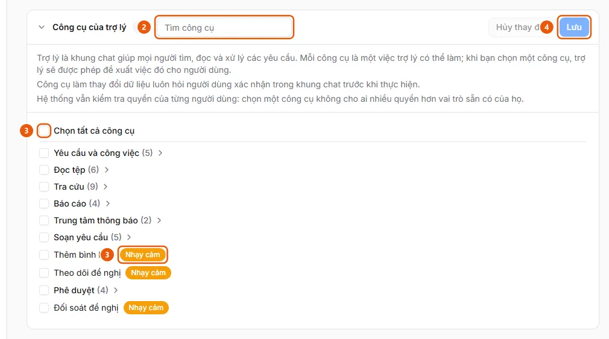

# Nhờ trợ lý AI lập đề nghị

Người dùng muốn trợ lý đọc hóa đơn hoặc bản kê (hoặc hỏi đáp để điền thông tin khi không có tệp) và dựng sẵn đề nghị nháp.

**Khi nào sử dụng:**

- Người dùng có nhiều hóa đơn hoặc một bản kê và muốn AI dựng đề nghị.
- Người dùng muốn trả lời vài câu hỏi trong chat thay vì tự điền biểu mẫu.
- Người dùng muốn trợ lý AI dựng bản nháp đề nghị từ các tệp có sẵn.

Dùng khung chat và các kỹ năng /hoa-don, /ban-ke, /nhap-tay để tạo bản nháp thay vì điền tay.

## Các cách thực hiện

- [Lập đề nghị bằng trợ lý AI](how-to/create-draft.md) — Mở Trợ lý AI, chọn kỹ năng /hoa-don, /ban-ke hoặc /nhap-tay, thả hóa đơn hoặc bản kê, trả lời biểu mẫu và bấm Đồng ý ở thẻ xác nhận.

## Được dùng trong các hướng dẫn

- [Tạo đề nghị thanh toán](../requests/create-draft.md) — Người dùng muốn lập một đề nghị thanh toán mới và lưu thành bản nháp.
- [AkaPayment](../../overview.md) — Lập, duyệt và theo dõi đề nghị thanh toán; tiếp nhận hóa đơn đầu vào, đối soát chứng từ và quản lý ngân sách, có trợ lý AI.

## Trước khi bắt đầu

- **[Giới hạn khi tải chứng từ](../../reference/extraction/file-limits.md)**\
  Thêm từ hóa đơn tối đa 50 hóa đơn mỗi lần; nhập bộ chứng từ tối đa 50 tệp và 100 MB; tệp tải cho trợ lý tối đa 10 MB.

## Các bước

[Lập đề nghị bằng trợ lý AI](how-to/create-draft.md)

1. Kiểm tra [Trợ lý AI đã được bật cho vai trò của bạn](../../troubleshooting/assistant/tools-enabled.md).
   Đầu trang có nút ✨ "Trợ lý AI" (hoặc bong bóng nổi ở góc màn hình); không có thì trợ lý chưa được bật cho bạn.
   Nếu chưa đáp ứng: làm theo [Bật công cụ của trợ lý](../admin/how-to/enable-assistant-tools.md) bên dưới.
2. [Bật công cụ của trợ lý](../admin/how-to/enable-assistant-tools.md) — chỉ khi [Trợ lý AI đã được bật cho vai trò của bạn](../../troubleshooting/assistant/tools-enabled.md) chưa được đáp ứng
   1. Ở thanh bên, mục **Quản trị**, mở **Cài đặt AI** (chỉ quản trị viên, trên máy tính) và chọn tab **Trợ lý**.
   2. Mở mục **Công cụ của trợ lý** (chia nhóm: Yêu cầu và công việc, Đọc tệp, Tra cứu, Báo cáo, Trung tâm thông báo, Soạn yêu cầu, Phê duyệt). Dùng ô **Tìm công cụ** (2) để lọc; di chuột lên tên công cụ để xem nó làm gì và dành cho vai trò nào.
      
   3. Đánh dấu từng công cụ, ô của một nhóm, hoặc **Chọn tất cả công cụ** (3). Công cụ có nhãn **Nhạy cảm** (3) làm thay đổi dữ liệu và luôn hỏi người dùng xác nhận trong khung chat; **Đối soát đề nghị** chỉ dành cho người vận hành và quản trị viên.
   4. Bấm **Lưu** (4) ("Đã lưu các công cụ của trợ lý."), hoặc **Hủy thay đổi** để bỏ các dấu chưa lưu.
3. [Lập đề nghị bằng trợ lý AI](how-to/create-draft.md)
   1. Bấm nút ✨ **Trợ lý AI** ở đầu trang (hoặc bong bóng nổi, tùy cách hiển thị) để mở khung chat "Tôi có thể giúp gì cho bạn?".
   2. Chọn gợi ý **Lập đề nghị từ hóa đơn** (/hoa-don), **Lập đề nghị từ bản kê và hóa đơn** (/ban-ke) hoặc **Lập đề nghị bằng hỏi đáp** (/nhap-tay, khi không có tệp); hoặc bấm **+** → **Kỹ năng**, hoặc gõ / trong ô nhập của khung chat. Lệnh được ghi vào ô nhập; viết thêm yêu cầu nếu cần rồi gửi.
   3. Đính kèm tệp bằng **+** → **Đính kèm tệp** hoặc kéo thả vào khung chat (mỗi tệp tối đa 10 MB, tệp được giữ tạm 24 giờ).
   4. Theo dõi các thẻ trợ lý hiện trong khung chat: phân loại tệp (theo tên tệp, rồi theo nội dung nếu chưa rõ), đọc từng hóa đơn, với /ban-ke thì đọc bản kê và ghép mỗi hóa đơn với một dòng. Trả lời khi trợ lý hỏi loại đề nghị, hóa đơn không khớp dòng nào, hoặc hiện biểu mẫu **Điền thông tin còn thiếu** (bấm **Gửi** hoặc **Bỏ qua**). Người đề nghị, đơn vị, ngày đề nghị, kỳ ngân sách và giá trị mặc định được tự điền như khi lập trên màn hình.
   5. Ở thẻ "Xác nhận: Tạo đề nghị nháp", kiểm tra loại đề nghị, các khoản chi (tối đa 50), phần "Thông tin từ ứng dụng (không phải từ trợ lý)" và các giá trị "Chưa khớp" (sẽ để trống để bạn chọn lại); khi nút còn ghi **Chờ đọc hóa đơn** thì đợi đọc xong. Bấm **Đồng ý** để trợ lý tạo bản nháp, hoặc **Hủy**.
   6. Bấm **Mở đề nghị** để mở bản nháp và kiểm tra trước khi nộp; trợ lý không nộp thay khi bạn chưa đồng ý và không bao giờ ký. Thẻ hóa đơn đơn lẻ cũng có nút **Tạo đề nghị từ hóa đơn này**.

## Nếu có sự cố

### [Bật công cụ của trợ lý](../admin/how-to/enable-assistant-tools.md)

- "Không tải được các công cụ của trợ lý": dịch vụ trợ lý không phản hồi hoặc bạn không có quyền quản lý; bấm **Thử lại**.
- Bật một công cụ không mở thêm quyền cho ai: ứng dụng vẫn kiểm tra quyền của từng người ở mọi thao tác.

### [Lập đề nghị bằng trợ lý AI](how-to/create-draft.md)

- "Không tạo được đề nghị. Tệp có thể đã hết hạn" hoặc tệp không còn sau 24 giờ: thả lại tệp vào khung chat. "Đã tạo đề nghị nhưng chưa gắn được tệp hóa đơn": tải hóa đơn lên trong đề nghị. Quá 50 tệp đang chờ trong một khung chat: gắn bớt vào đề nghị hoặc bắt đầu **Cuộc trò chuyện mới**. Xem [Giới hạn khi tải chứng từ](../../reference/extraction/file-limits.md).
- Bản kê có hơn 50 dòng: trợ lý hỏi để tách thành nhiều đề nghị.
- "Chưa cấu hình mô hình AI" hoặc "Mô hình AI này không chạy được trợ lý": nhờ quản trị viên ([Chọn mô hình AI cho trợ lý](../admin/how-to/set-assistant-model.md)).
