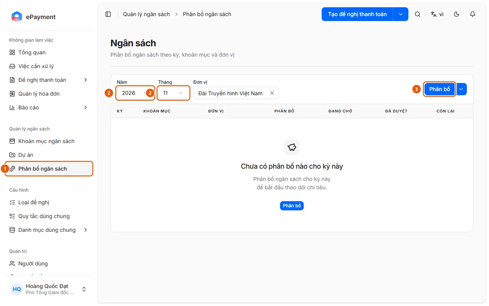
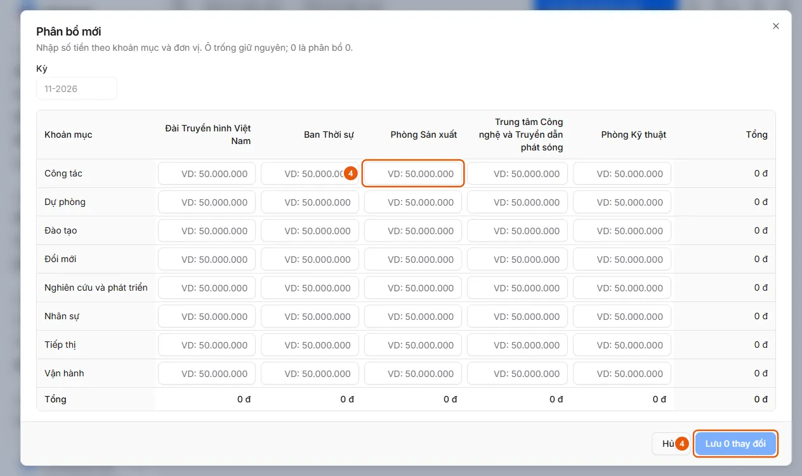

# Phân bổ ngân sách

Người quản lý ngân sách muốn đặt hạn mức theo kỳ, khoản mục và đơn vị (và dự án khi bật phân bổ theo dự án).

**Khi nào sử dụng:**

- Đầu kỳ cần đặt ngân sách cho các khoản mục.
- Người quản lý ngân sách muốn phân bổ số tiền cho một kỳ.

Hạn mức làm cơ sở cho phần Còn lại và Kiểm tra ngân sách của đề nghị.

## Các cách thực hiện

- [Phân bổ ngân sách cho một kỳ](how-to/allocate.md) — Ở Quản lý ngân sách → Phân bổ ngân sách chọn năm, tháng, đơn vị (và dự án), bấm Phân bổ để nhập số tiền theo khoản mục và đơn vị.

## Được dùng trong các hướng dẫn

- [AkaPayment](../../index.md) — Lập, duyệt và theo dõi đề nghị thanh toán; tiếp nhận hóa đơn đầu vào, đối soát chứng từ và quản lý ngân sách, có trợ lý AI.

## Trước khi bắt đầu

- **[Quy tắc nhập phân bổ ngân sách](../../reference/budget/allocation-rules.md)**\
  Số tiền không âm; mỗi tổ hợp chỉ một dòng trong một lô; một lô tối đa 5000 dòng; ghi chú tối đa 1024 ký tự.

## Các bước

[Phân bổ ngân sách cho một kỳ](how-to/allocate.md)

1. [Phân bổ ngân sách cho một kỳ](how-to/allocate.md)
   1. Ở thanh bên, mục **Quản lý ngân sách**, mở **Phân bổ ngân sách** (1) (trang "Ngân sách"; chỉ người vận hành và quản trị viên, chỉ trên máy tính).
      
   2. Chọn **Năm**, **Tháng** (2), **Đơn vị**, và **Dự án** nếu ngân sách được phân bổ theo dự án.
   3. Bấm **Phân bổ** (3) để mở bảng "Phân bổ mới" cho kỳ đã chọn: hàng là khoản mục, cột là đơn vị; ô để trống thì không đổi; nhập 0 nghĩa là phân bổ bằng 0. Khi phân bổ theo dự án, chọn **Dự án** trước ("Chọn dự án để bắt đầu.").
   4. Nhập số tiền (4) rồi bấm **Lưu N thay đổi** (4) (hoặc **Hủy**).
      
   5. Để sửa hoặc xóa một dòng đã có, dùng **Sửa phân bổ** hoặc **Xoá phân bổ** ở dòng (xóa không hoàn tác được).
   6. Để bật hoặc tắt phân bổ theo dự án, bấm mũi tên cạnh **Phân bổ** → **Chiều phân bổ ngân sách** (Khoản mục ngân sách và Đơn vị luôn bật). Nhập nhiều dòng bằng Excel: xem [Nhập phân bổ ngân sách từ Excel](how-to/import-allocations.md).

## Nếu có sự cố

### [Phân bổ ngân sách cho một kỳ](how-to/allocate.md)

- Số âm, trùng tổ hợp hoặc thiếu dự án: xem [Quy tắc nhập phân bổ ngân sách](../../reference/budget/allocation-rules.md). Chưa có khoản mục hay dự án nào ("Chưa có khoản mục ngân sách nào đang hoạt động."): thêm ở [Thêm hoặc sửa một bản ghi danh mục](../master-data/how-to/manage-list.md).
