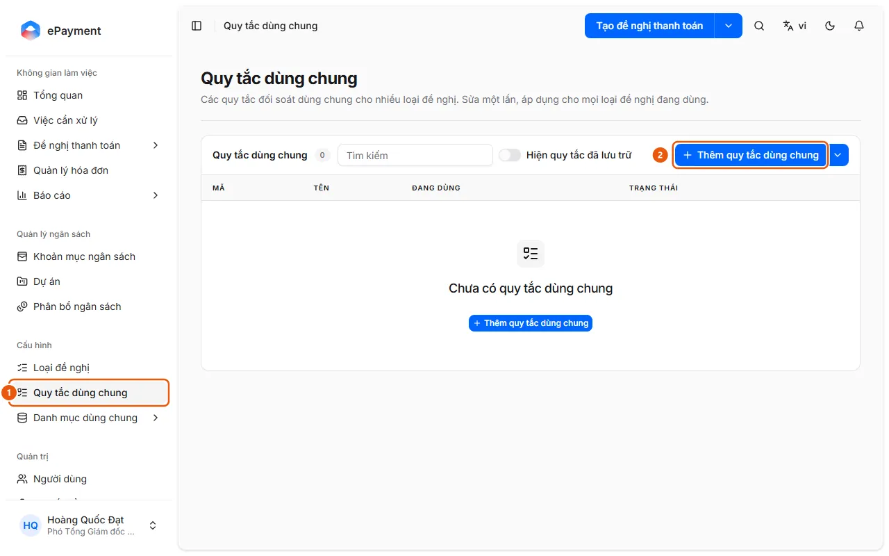
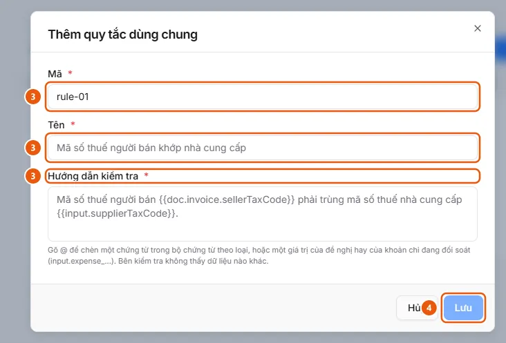

# Quản lý quy tắc đối soát dùng chung

Quản trị viên muốn tạo hoặc sửa một quy tắc đối soát chứng từ một lần và dùng cho nhiều loại đề nghị.

**Khi nào sử dụng:**

- Quản trị viên muốn đổi cách kiểm tra chứng từ cho mọi loại đề nghị cùng lúc.
- Quản trị viên muốn dùng lại một quy tắc đối soát cho nhiều loại đề nghị.

Quy tắc dùng chung nằm trong một thư viện: sửa một lần, áp dụng cho mọi loại đề nghị đang liên kết.

## Các cách thực hiện

- [Tạo và sửa quy tắc đối soát dùng chung](how-to/manage-reconciliation-rule.md) — Cấu hình → Quy tắc dùng chung: Thêm quy tắc dùng chung (Mã, Tên, Hướng dẫn kiểm tra), Sửa, Lưu trữ hoặc Khôi phục; liên kết vào loại đề nghị ở tab Luồng đề nghị.

## Trước khi bắt đầu

- **[Điều kiện lưu quy tắc dùng chung](../../reference/config/global-rule-rules.md)**\
  Mã 1–32 ký tự (chữ, số, _ . -) không đổi sau khi tạo; mã và tên không trùng; hướng dẫn phải dùng biến có thật; sửa áp dụng ngay cho mọi loại đề nghị đang liên kết.

## Các bước

[Tạo và sửa quy tắc đối soát dùng chung](how-to/manage-reconciliation-rule.md)

1. [Tạo và sửa quy tắc đối soát dùng chung](how-to/manage-reconciliation-rule.md)
   1. Ở thanh bên, mục **Cấu hình**, mở **Quy tắc dùng chung** (1) (chỉ người vận hành và quản trị viên, chỉ trên máy tính; bảng Mã, Tên, Đang dùng = số loại đề nghị, Trạng thái; tìm bằng ô **Tìm kiếm**, bật **Hiện quy tắc đã lưu trữ** để xem cả quy tắc đã lưu trữ).
      
   2. Bấm **Thêm quy tắc dùng chung** (2), hoặc **Sửa quy tắc dùng chung** ở dòng một quy tắc.
   3. Nhập **Mã** (chỉ khi tạo mới; có gợi ý sẵn), **Tên** và **Hướng dẫn kiểm tra** (3); gõ `@` trong ô hướng dẫn để chèn biến của chứng từ hoặc của đề nghị (ví dụ "Mã số thuế người bán `{{doc.invoice.sellerTaxCode}} `phải trùng mã số thuế nhà cung cấp `{{input.supplierTaxCode}}`.").\
      
   4. Bấm **Lưu** (4). Nếu quy tắc đang được dùng, hộp thoại liệt kê các loại đề nghị bị ảnh hưởng; bấm **Lưu và áp dụng**.
   5. Để ngừng dùng, bấm **Lưu trữ** ở dòng (quy tắc đang dùng sẽ hỏi lại); **Khôi phục** để dùng lại. Menu cạnh nút **Thêm quy tắc dùng chung** có **Xuất JSON** và **Nhập JSON** để chuyển quy tắc giữa các môi trường.
   6. Để một loại đề nghị dùng quy tắc: mở loại đó ở [Thiết lập và phát hành loại đề nghị](how-to/publish-request-type.md) → tab **Luồng đề nghị** → bước Bảng kê chi phí → mục **Đối soát** (bật **Bật đối soát** nếu chưa bật) → **Thêm quy tắc dùng chung**, chọn quy tắc, bấm **Thêm N quy tắc**, rồi phát hành. Một quy tắc riêng có thể chuyển vào danh sách Quy tắc dùng chung bằng **Chuyển thành dùng chung**.

## Nếu có sự cố

### [Tạo và sửa quy tắc đối soát dùng chung](how-to/manage-reconciliation-rule.md)

- Bị từ chối khi lưu (mã hoặc tên trùng, biến không có thật, người khác vừa sửa): xem [Điều kiện lưu quy tắc dùng chung](../../reference/config/global-rule-rules.md).
