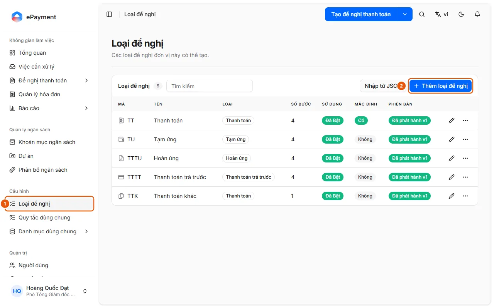
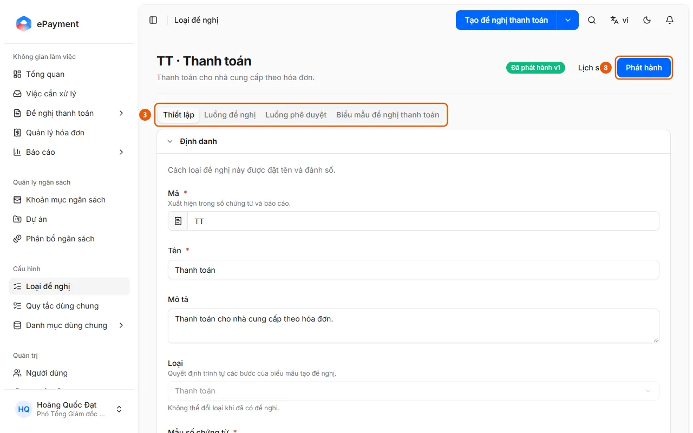

# Cấu hình và phát hành loại đề nghị

Quản trị viên muốn tạo hoặc thay đổi một loại đề nghị và đưa vào sử dụng.

**Khi nào sử dụng:**

- Quản trị viên muốn đổi luồng phê duyệt của một loại đề nghị.
- Quản trị viên muốn tạo mới hoặc cập nhật một loại đề nghị.

Đặt tên, luồng phê duyệt và cách hoạt động của loại đề nghị rồi phát hành phiên bản mới.

## Các cách thực hiện

- [Thiết lập và phát hành loại đề nghị](how-to/publish-request-type.md) — Mở loại đề nghị, chỉnh các tab, bấm Lưu rồi Phát hành; phát hành lỗi thì hiện danh sách vấn đề cần sửa.

## Trước khi bắt đầu

- **[Điều kiện phát hành loại đề nghị](../../reference/config/publish-validation.md)**\
  Phát hành không thành công kèm danh sách vấn đề theo tab (Thiết lập, Luồng đề nghị, Luồng phê duyệt); phát hành khi loại đề nghị không có thay đổi thì không tạo phiên bản mới.

## Các bước

[Thiết lập và phát hành loại đề nghị](how-to/publish-request-type.md)

1. [Thiết lập và phát hành loại đề nghị](how-to/publish-request-type.md)
   1. Ở thanh bên, mục **Cấu hình**, mở **Loại đề nghị** (1).
      
   2. Bấm vào một loại để sửa, hoặc **Thêm loại đề nghị** (2) (hay **Nhập từ JSON**) để tạo mới; **Nhân bản** để sao một loại có sẵn.
   3. Tab **Thiết lập** (dải tab, 3): chỉnh Định danh (Mã và Tên bắt buộc), Phạm vi sử dụng và Cách hoạt động (hình thức thanh toán, đối tượng thụ hưởng, Kiểm tra ngân sách, Yêu cầu chữ ký phê duyệt, Cam kết hoàn thành, mẫu Excel Bảng kê chi phí). Không đổi được ô **Loại** khi loại đề nghị đã có đề nghị ("Không thể đổi loại khi đã có đề nghị.").
      
   4. Tab **Luồng đề nghị** (dải tab, 3): mỗi bước của người đề nghị (Tổng quan, Bảng kê chi phí, Thanh toán, Xem lại) mở ra để chỉnh; bước Bảng kê chi phí có các nhóm trường, "Bộ chứng từ bắt buộc" (mỗi loại chứng từ có ô **Bắt buộc**; chứng từ mà một quy tắc đối soát bắt buộc dùng thì luôn bắt buộc) và mục **Đối soát** với công tắc **Bật đối soát**, nút **Thêm quy tắc**, **Thêm quy tắc dùng chung** và **Sao chép từ loại đề nghị** (quy tắc dùng chung: [Tạo và sửa quy tắc đối soát dùng chung](how-to/manage-reconciliation-rule.md)).
   5. Tab **Luồng phê duyệt** (dải tab, 3): sắp xếp các bước (mỗi bước giao cho một nhóm phê duyệt và phải có tên); có thể **Sao chép từ…** loại khác. Ở **Thiết lập nâng cao** của một bước, bật **Bỏ qua khi người duyệt là người đề nghị** hoặc **Điều chỉnh phân bổ ngân sách** (người duyệt bước đó được sửa phân bổ, xem [Điều chỉnh phân bổ ngân sách khi duyệt](../approvals/how-to/adjust-allocation.md)).
   6. Tab **Biểu mẫu đề nghị thanh toán** (dải tab, 3): thiết kế biểu mẫu in; tab này có nút **Lưu** riêng cho bố cục.
   7. Bấm **Lưu** ở đầu trang để ghi các chỉnh sửa đang giữ tạm (trang báo "Có thay đổi chưa phát hành" khi bản nháp khác bản đã phát hành). **Hủy thay đổi** đưa loại về phiên bản đã phát hành gần nhất và không hoàn tác được.
   8. Bấm **Phát hành** (8) và xác nhận "Phát hành loại đề nghị này?": bản nháp thành phiên bản dùng cho các đề nghị tạo mới, đề nghị đang xử lý giữ phiên bản cũ. Thành công hiện "Đã phát hành vN."; nếu không, hiện "Chưa thể phát hành loại đề nghị này." kèm danh sách vấn đề, mỗi vấn đề chỉ rõ tab cần sửa.

## Nếu có sự cố

### [Thiết lập và phát hành loại đề nghị](how-to/publish-request-type.md)

- Phát hành bị từ chối: xem [Điều kiện phát hành loại đề nghị](../../reference/config/publish-validation.md); không có phiên bản nào được ghi. Muốn quay lại bản cũ: [Khôi phục phiên bản loại đề nghị](how-to/restore-request-type.md).
